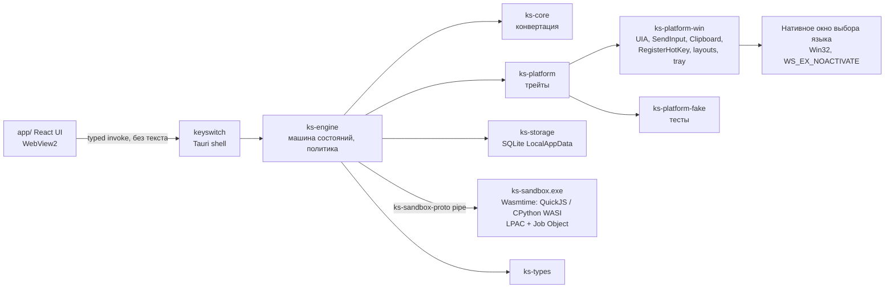

# SYSTEM_ARCHITECTURE — техническая архитектура KeySwitch

Статус: **консолидированная версия v2.1** (2026-11-10). Источник истины по архитектуре. Детали и обоснования — в `docs/research/arch-architecture-v2.md` (AV2), `arch-windows-field-replacement.md` (FR), `arch-dependencies.md` (DEP); здесь — принятые решения с учётом перекрёстных ревью (`review-*.md`). Заменяет `docs/02-architecture.md`.
Проверка: System Architect — автор; CISO — security-часть (`SECURITY_REVIEW.md`); CLO — лицензии (`LICENSE_REGISTER.md`). Ни один модуль кроме `ks-core` ещё не реализован.

## 1. Принципы
1. Ядро без ОС и I/O; системное — за трейтами-«сессиями» с непрозрачными идентификаторами.
2. При сомнении — отказ без изменений. Универсальная поддержка программ не обещается.
3. Пользовательский текст — только `UserText` (без `Debug/Display/Clone`, zeroize), только в памяти, никогда в логах, событиях WebView, дампах.
4. Нет сети в runtime; нет хуков клавиатуры, инъекций, повышения прав.
5. Пользовательский код — только Wasm в отдельном процессе с урезанными правами; действия применяет ядро после политики.

## 2. Компоненты и связи



| Crate | Назначение | Статус |
|-------|-----------|--------|
| `ks-core` | раскладки как данные (скан-коды), языковая модель, `detect` / `convert` / `convert_mixed` | **реализован** (прототип S-1), 30 тестов |
| `ks-types` | общие типы: `UserText`, `FocusFingerprint`, коды причин отказа | план |
| `ks-platform` | трейты: `FocusProvider`, `TextAccess`, `Writer`, `ClipboardTx`, `KeyboardLayout`, `Hotkeys`, `Autostart`, `Tray` (AV2 §3.2) | план |
| `ks-platform-win` | Windows-реализация (единственное место `unsafe`) | план → S-2 |
| `ks-platform-fake` | детерминированная платформа для тестов движка | план |
| `ks-engine` | конвейер операции, политика, шлюз побочных эффектов, профили приложений | план |
| `ks-sandbox-proto` | протокол песочницы с лимитами | план → S-3 |
| `ks-sandbox` (exe) | хост Wasmtime в отдельном процессе | план → S-3 |
| `ks-storage` | настройки, слот макроса, журнал метаданных | план |
| `keyswitch` | Tauri 2 оболочка, IPC, трей | каркас (S-4) |

`ks-layouts` из черновика упразднён (данные — в `ks-core`).

## 3. Потоки (AV2 §4)
- **T0** — UI/Tauri. **T1** — STA-поток окон: message loop `RegisterHotKey`, окно выбора, владелец буфера (`WM_RENDERFORMAT`). **T2** — MTA-поток UIA с таймаутами (500/1000 мс) и сторожем. **T3** — сторож.
- **Поколение операций:** атомарный счётчик; любой побочный эффект (пакет SendInput, `EM_REPLACESEL`, начало вставки, восстановление буфера) проходит через единый шлюз с проверкой поколения. «Отравленный» поток после таймаута не выполняет побочных эффектов (XR-05).
- Фокус в собственном окне KeySwitch — отказ `SelfTarget` до вызовов UIA (XR-06).

## 4. Конвейер операции конвертации

```
Hotkey → Gate (пауза, исключения, SelfTarget, SelfElevated, повышенные окна, secure desktop)
 → Focus (HWND, PID + время старта процесса, RuntimeId, ControlType, признаки пароля)
 → Scope: выделение → (поле, если профиль разрешает и однострочное) → фрагмент строки до каретки → отказ
 → Read (≤ 5 000 символов; встроенные объекты U+FFFC → отказ)
 → Analyze (ks-core) → смешанный? → окно выбора (WS_EX_NOACTIVATE, 1/2/Esc, 10 с) → низкая уверенность? → отказ
 → Select → перечитать выделение → сравнить с ожидаемым
 → Verify (тот же отпечаток фокуса, текст не изменился, модификаторы отпущены)
 → Write: W1 EM_REPLACESEL(fCanUndo) [только класс Edit] | W3 SendInput Unicode [≤ порога профиля, без \n и \t, пакеты ≤ 64, проверка фокуса перед каждым] | W2 вставка через буфер [только по профилю, строгий сигнал] | отказ
 → Post-verify → SwitchLayout (WM_INPUTLANGCHANGEREQUEST) → Log (только метаданные)
```
До шага Write изменений нет. `ValuePattern.SetValue` не используется. Многострочный текст через SendInput запрещён (Enter = отправка сообщения).

### 4.1 Контракт буфера обмена (W2)
1. Snapshot: перечислить форматы без чтения; читать только белый список (текст, Unicode, HTML, RTF, локаль); лимит 16 МБ; чужие OLE/приватные форматы или зависший владелец (`IsHungAppWindow`) → W2 запрещён.
2. Временные данные — с метками `ExcludeClipboardContentFromMonitorProcessing`, `CanIncludeInClipboardHistory=0`, `CanUploadToCloudClipboard=0`; при `SM_REMOTESESSION` W2 запрещён.
3. Отложенная отрисовка: `WM_RENDERFORMAT` **до** Ctrl+V → прервать, восстановить, W3 или отказ `ClipboardListenerInterference`. После Ctrl+V сигнал засчитывается только от процесса цели (или брокера из профиля).
4. Восстановление — только при сигнале от цели **и** совпадении пост-проверки; seq сравнивается под `OpenClipboard`.
5. **Нет сигнала → не восстанавливать** (временный текст остаётся, пользователю — действие «вернуть буфер»). Решение CISO по Q-1.

### 4.2 Поддержка по семействам программ (до тестов S-2)
| Семейство | План v1 | Основание |
|-----------|---------|-----------|
| Win32 Edit/RichEdit (Notepad Win10) | поддержка; RichEdit через W1 — после теста RTF (XR-03) | документировано |
| Chromium `<input>`/`<textarea>` | до S-2 — только выделение/фрагмент; «всё поле» для `<input>` — если S-2 подтвердит различимость | исходники Chromium |
| contenteditable (Discord), WhatsApp (WebView2), новый Notepad Win11, UWP/WinUI | только по профилю после S-2 и ручной приёмки; WhatsApp — по сообщениям, текст через UIA не отдаёт | гипотеза |
| Qt (Telegram), Firefox | экспериментально | гипотеза |
| Word | только выделение или фрагмент | гипотеза |
| Excel вне правки ячейки, консоль/терминалы, окна администратора, secure desktop | отказ | решение |
| Программы без UIA | только выделение через Ctrl+C по профилю (решение Project Director по Q-7) | решение |

## 5. Песочница макросов (AV2 §6 с поправками)
- `ks-sandbox.exe`: Wasmtime LTS 48 (≥ 48.0.8), модули QuickJS-ng и CPython 3.14 WASI собираются в CI из закреплённых commit SHA (WASI SDK по хэшу) и встраиваются `include_bytes!` с проверкой хэша.
- **Stdlib Python — из памяти, ноль preopen** (zip через `include_bytes!` + собственное read-only подмножество WASI; ускорение — Wizer-снимок в CI). Каталог с диска — только запасной вариант с отдельным одобрением CISO (условия XR-07).
- Нет WASI-сокетов и env; лимиты: время (epoch, 2 с) + `TerminateJobObject`, память 64 МБ, вывод 5 000 символов, кадр 64 КиБ гость→хост, ≤ 16 клавиш, глубина ≤ 8, `deny_unknown_fields`, фильтр управляющих/bidi/zero-width символов.
- Процесс: LPAC (или AppContainer), Job Object (UI-ограничения, память, без дочерних процессов, `DIE_ON_UNHANDLED_EXCEPTION`), win32k lockdown; ACG — если S-3 покажет приемлемую скорость Pulley; без `user32`/`gdi32` в импортах; самопроверка токена и Job при старте.
- Новый процесс на каждый запуск, если у слота есть доступ к буферу; иначе «тёплый» до 60 с, перезапуск при изменении скрипта.
- Действия скрипта: `insert` / `replace` / `keys` (белый список; **Enter и Tab — только при отдельном разрешении слота, по умолчанию выключено**, решение владельца в V3) / `none`. Разрешение на чтение буфера привязано к хэшу исходника.

## 6. Tauri и UI
- Capabilities — минимальный явный список вместо `core:default`; без плагинов `fs`/`shell`/`http`; из плагинов — только `single-instance`; трей — встроенная фича `tray-icon`; хоткеи и автозапуск — собственные реализации.
- Строгая CSP (текущая — `tauri.conf.json`), `freezePrototype`, devtools выключены в релизе, автозаполнение WebView2 выключено.
- Пользовательский текст не передаётся в WebView ни командами, ни событиями.

## 7. Хранение, журналы, сбои
- `%LOCALAPPDATA%\KeySwitch\` SQLite (rusqlite bundled), `secure_delete`, журнал `diag_log` — только коды, время, имя exe, способ, длительность; без заголовков окон, URL и длины текста.
- Panic hook без payload; исключение из Windows Error Reporting (выполняет основной процесс/установщик) и `WER_FAULT_REPORTING_FLAG_NOHEAP`; crash-тест в CI.

## 8. macOS (будущее)
`ks-platform-mac` (AXUIElement, TIS, CGEvent, NSPasteboard); песочница — тот же Wasmtime + App Sandbox. Ядро, движок и UI не меняются (AV2 §8.4).

## 9. Что должно быть доказано спайками
- **S-2:** 18 сценариев FR §8 + 9 пунктов review-arch §4 (гонки буфера, сторонний слушатель, зависший владелец, порог и Undo SendInput, окно выбора без активации, пароли, `<input>` vs contenteditable, crash/WER).
- **S-3:** 9 пунктов review-arch §4 (stdlib из памяти и Wizer, матрица Cranelift/Pulley × LPAC × ACG, импорты, H-01…H-40, дедлайн, протокол-fuzz, дампы, воспроизводимая сборка wasm, политика Tier 2).

## 10. Принятые исправления к AV2/FR/DEP
Внести 13 исправлений из `review-arch-on-security.md` §2 (stdlib из памяти, лимиты протокола, `UserText` без `Clone`, «нет сигнала → не восстанавливать», белый список буфера, `allows_paste=false` для неизвестных, окно `WS_EX_NOACTIVATE`, `SelfElevated`, профиль песочницы, `granted_for`, `include_bytes!`, новые риски, гостевые crate вне workspace). Исполнитель — AGENT 03, задача BL-ARCH-01.
