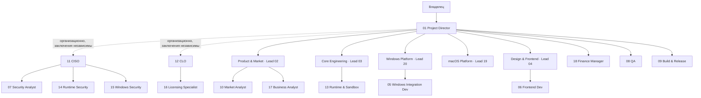

# TEAM_STRUCTURE — организационная структура KeySwitch

Редакция V7 (2026-11-10). ID ролей уникальны и не переиспользуются. Уровни присваиваются по подтверждённым результатам; сертификатов и стажа агентам не приписывается. Агенты — субагенты Claude Code (`.claude/agents/*.md`), запускаемые Project Director в облачной сессии; одновременно активно ≤ 4 рабочих потоков (ограничение бюджета и платформы).

## Иерархия

## Реестр ролей

| ID | Роль | Агент | Уровень | Команда | Основание уровня | Блокировка |
|----|------|-------|---------|---------|------------------|------------|
| 01 | Project Director / CTO | основная сессия | Director | → владелец | директива | приёмка/интеграция |
| 02 | Product Analyst | `product-analyst.md` | **Lead** | Lead, Product & Market | PRD v2, матрица 18 приложений, 119 граничных случаев (проверено PD) | — |
| 03 | System Architect | `system-architect.md` | **Lead** | Lead, Core Engineering | архитектура v2, анализ замены поля, принятые исправления после ревью | архитектурные дефекты |
| 04 | UI/UX Designer | `ui-ux-designer.md` | **Lead** | Lead, Design & Frontend | дизайн-система (контраст 96/96 AA), прототип | — |
| 05 | Windows Integration Developer | `rust-windows-dev.md` | Middle | Windows Platform | S-2a начат, не сдан | — |
| 06 | Frontend Developer | `frontend-dev.md` | Middle | Design & Frontend | задач не было | — |
| 07 | Security Analyst | `security-analyst.md` (чтение) | **Senior** | Security | 53 угрозы, 28+10 находок, подтверждены ревью | через CISO |
| 08 | QA Engineer | `qa-engineer.md` | Middle | → PD | задач не было | GATE 11 |
| 09 | Build & Release Engineer | `release-engineer.md` | Middle | → PD | задач не было | — |
| 10 | Market & Competitive Intelligence Analyst | `market-analyst.md` | **Senior** | Product & Market; постоянный (D-16) | рынок, 22 идеи, B2C-исследование с маркировкой доказательств | — |
| 11 | **CISO** | `ciso.md` | Director | независимый | директива | **да** |
| 12 | **CLO** | `clo.md` | Director | независимый | директива | **да** |
| 13 | Runtime & Sandbox Engineer | `runtime-sandbox-dev.md` | Middle | Core Engineering | S-3a начат, не сдан | — |
| 14 | Runtime & WebAssembly Security | `runtime-security.md` (чтение) | Middle | Security | ревью S-3 (впереди) | через CISO |
| 15 | Windows Platform Security | `windows-security.md` (чтение) | Middle | Security | ревью S-2 (впереди) | через CISO |
| 16 | OSS & Data Licensing Specialist | `licensing-specialist.md` | Middle | Legal | задачи впереди | через CLO |
| 17 | **Business Analyst** (бывш. B2B Researcher) | `b2b-researcher.md` | **Senior** | Product & Market | B2B/Business/Enterprise-исследование с честной маркировкой доказательств, найден риск VDI | — |
| 18 | **Finance Manager** (новый) | `finance-manager.md` | Middle | → PD | V7 §15: финансовая модель отсутствовала | — |
| 19 | **macOS Platform Lead** (новый) | `macos-platform-lead.md` | Lead (назначен; уровень подтверждается по итогам M-1) | Lead, macOS Platform | V7 §9.2: macOS — обязательная платформа, компетенции не было | — |
| 20 | **Windows Platform Lead** (новый) | `windows-platform-lead.md` | Lead (назначен; подтверждается по итогам S-2) | Lead, Windows Platform | V7 §4: отдельное руководство Windows-платформой; AGENT 05 нужен независимый технический ревьюер | — |

## Команды

| Команда | Руководитель | Состав | Зона ответственности | Backlog-префиксы | Независимая проверка |
|---------|--------------|--------|----------------------|------------------|----------------------|
| Product & Market | 02 | 02, 10, 17 | рынок B2C (10), бизнес/B2B (17), требования и критерии (02) | BL-PRD, BL-MKT, BL-COM | PD; CISO/CLO по триггерам |
| Core Engineering | 03 | 03, 13 | архитектура, ядро, песочница, обновления (проект), ADR | BL-ARCH, BL-CORE, BL-SBX, BL-UPD | CISO (14), QA |
| Windows Platform | 20 | 20, 05 | Windows-адаптер, профили приложений, матрица Windows | BL-WIN, S-2 | CISO (15), QA, ручная приёмка |
| macOS Platform | 19 | 19 (+ разработчик macOS — при начале реализации) | macOS-адаптер, разрешения, CI macOS, матрица macOS | BL-MAC | CISO, QA, ручная приёмка на Mac |
| Design & Frontend | 04 | 04, 06 | дизайн-система, UI, i18n, доступность | BL-DES, BL-UI | PD, QA |
| Security | 11 CISO | 07, 14, 15 | безопасность продукта, уязвимости, политика экстренных патчей, ключи подписи | BL-SEC | независима |
| Legal & Compliance | 12 CLO | 16 | право ЕС, лицензии, SBOM-лицензии, проекты EULA/ToS/Privacy | BL-LEG | независима; юрист-человек по необходимости |
| Finance (индивидуально) | 18 → PD | 18 | затраты, сценарии, экономика тарифов | BL-FIN | PD |
| QA / Release (индивидуально) | 08, 09 → PD | 08, 09 | тестирование; CI/CD, сборка, подпись, публикация обновлений | BL-QA, BL-REL | CISO (release security) |

Разделение аналитиков (V7 §4.1): Market Analyst — рынок, конкуренты, отзывы, тренды; Business Analyst — бизнес-процессы, корпоративные клиенты, B2B/Enterprise; Product Analyst — требования, спецификации, критерии приёмки; Finance Manager — затраты, модели, прогнозы, прибыльность.

## Правила
- Разработчик не принимает свою работу: код — ревью Lead команды; функционал — QA; безопасность — CISO/специалист; право — CLO.
- Повышение — после работы, принятой независимой проверкой; запись основания в реестре. Регулярная оценка (V7 §16.4): качество, самостоятельность, точность, надёжность, соблюдение требований, сотрудничество.
- Лиды, назначенные без истории (19, 20), подтверждаются по первому результату; при неудаче — замена.

## Журнал изменений
| Дата | Изменение |
|------|-----------|
| 2026-11-10 | AGENT 10 Market Analyst (D-16). |
| 2026-11-10 | V3: CISO (11), CLO (12), Runtime & Sandbox (13); повышения 02/03/04 → Lead, 07/10 → Senior. |
| 2026-11-10 | По запросам директоров: 14 Runtime Security, 15 Windows Security, 16 Licensing Specialist. |
| 2026-11-10 | V4: 17 B2B Researcher. |
| 2026-11-10 | V7: 17 → Business Analyst (повышен до Senior по качеству исследования); новые 18 Finance Manager, 19 macOS Platform Lead, 20 Windows Platform Lead; команда Engineering разделена на Core Engineering, Windows Platform, macOS Platform. |
