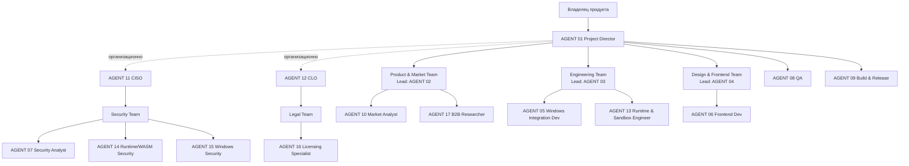

# TEAM_STRUCTURE — организационная структура KeySwitch

Действует с 2026-11-10 (директива V3). Заменяет `docs/team.md` (оставлен как ссылка). ID ролей уникальны и не переиспользуются. Уровни присвоены по фактически выполненной и проверенной работе; сертификатов и «опыта» агентам не приписывается.

## Иерархия

CISO и CLO подчиняются Project Director только организационно: их экспертные заключения независимы, отрицательное заключение не может быть отменено Project Director (эскалация — к владельцу).

## Реестр ролей

| ID | Роль | Агент (`.claude/agents/`) | Уровень | Команда / подчинение | Основание уровня | Право блокировки |
|----|------|---------------------------|---------|----------------------|------------------|------------------|
| AGENT 01 | Project Director / CTO | основная сессия | Director | → владелец | назначен директивой V3 | gate-решения в пределах полномочий |
| AGENT 02 | Product Analyst | `product-analyst.md` | **Lead** (повышен с Senior) | Lead, Product & Market Team | PRD v2 (US/FR/NFR с трассировкой), матрица 18 приложений, 119 граничных случаев; выявил 16 противоречий, часть подтверждена архитектором и Security | — |
| AGENT 03 | System Architect | `system-architect.md` | **Lead** (Engineering Lead) | Lead, Engineering Team | исследование замены поля по исходникам Chromium/Qt и докам MS, архитектура v2, проверенные версии зависимостей; в перекрёстном ревью принял обоснованные исправления | архитектурные дефекты |
| AGENT 04 | UI/UX Designer | `ui-ux-designer.md` | **Lead** (Design & Frontend Lead) | Lead, Design & Frontend Team | концепция, дизайн-система с расчётом контраста (96/96 AA), рабочий прототип, проверенный в headless Chrome | — |
| AGENT 05 | Windows Integration Developer (бывш. Rust/Windows Dev) | `rust-windows-dev.md` | Middle | Engineering Team | ещё не выполнял задач как отдельный агент | — |
| AGENT 06 | Frontend Developer | `frontend-dev.md` | Middle | Design & Frontend Team | ещё не выполнял задач | — |
| AGENT 07 | Security Analyst | `security-analyst.md` (только чтение) | **Senior** | Security Team (→ CISO) | 53 угрозы, 28 находок со ссылками file:line, перекрёстное ревью с 10 новыми находками (подтверждены архитектором) | через CISO |
| AGENT 08 | QA Engineer | `qa-engineer.md` | Middle | → Project Director (индивидуально, независимо от разработки) | ещё не выполнял задач | критические функциональные дефекты (GATE 9) |
| AGENT 09 | Build & Release Engineer | `release-engineer.md` | Middle | → Project Director | ещё не выполнял задач | — |
| AGENT 10 | Market & Competitive Intelligence Analyst | `market-analyst.md` | **Senior** | Product & Market Team; постоянный, на весь срок жизни продукта (D-16) | исследование ~20 конкурентов, 18 болей, 22 идеи; честно отметил непроверенное | — |
| AGENT 11 | **CISO** — Director of Information Security & Product Security | `ciso.md` | Director | независимый директор | назначен директивой V3 | **да**: PR, функции, релиз при открытых Critical/High |
| AGENT 12 | **CLO** — Legal Director & Head of EU Regulatory Compliance | `clo.md` | Director | независимый директор | назначен директивой V3 | **да**: юридически неподготовленный выпуск, несовместимые лицензии |
| AGENT 14 | Runtime & WebAssembly Security Specialist (новый) | `runtime-security.md` (только чтение) | Middle | Security Team (→ CISO) | запрос CISO: независимое ревью S-3 | через CISO |
| AGENT 15 | Windows Platform Security Specialist (новый) | `windows-security.md` (только чтение) | Middle | Security Team (→ CISO) | запрос CISO: независимое ревью S-2 | через CISO |
| AGENT 16 | OSS & Data Licensing Specialist (новый) | `licensing-specialist.md` | Middle | Legal Team (→ CLO) | запрос CLO (LS-1): лицензии зависимостей, данных, notice-файлы | через CLO |
| AGENT 17 | B2B & Enterprise Market Researcher (новый) | `b2b-researcher.md` | Middle | Product & Market Team | V4 ч. 8: исследование B2B/Enterprise — отдельная компетенция (развёртывание, лицензирование, IT-политики), Market Analyst ведёт B2C | — |
| AGENT 13 | Runtime & Sandbox Engineer (новый) | `runtime-sandbox-dev.md` | Middle | Engineering Team; security-ревью — CISO | закрывает пробел компетенций WebAssembly/WASI/CPython/QuickJS/AppContainer для S-3 | — |

Приостановленных ролей нет. Слияний ролей нет: Product Analyst и Market Analyst разделены (решение владельца).

## Команды и зоны ответственности

| Команда | Руководитель | Состав | Зона ответственности | Передаёт результат |
|---------|--------------|--------|----------------------|--------------------|
| Product & Market | AGENT 02 (Lead) | 02, 10, 17 | рынок, идеи, требования, MVP, критерии приёмки, матрица приложений | Project Director → GATE 3 |
| Engineering | AGENT 03 (Lead) | 03, 05, 13 | архитектура, ядро, Windows-интеграция, песочница, качество кода | Project Director → GATE 4, 6, 7, 8 |
| Design & Frontend | AGENT 04 (Lead) | 04, 06 | дизайн-система, прототипы, UI, i18n, доступность | Project Director → GATE 5 |
| Security | AGENT 11 CISO | 07, 14, 15 (+ специалисты по запросу CISO) | безопасность всего продукта | GATE 10, security review задач |
| Legal & Compliance | AGENT 12 CLO | 16 (+ LS-2 CRA/PLD до GATE 4, LS-3 Privacy/Consumer позже; внешние юристы — по решению владельца) | право ЕС и национальное, лицензии, IP, распространение | GATE 11, legal review задач |
| QA (индивидуально) | AGENT 08 → Project Director | 08 | независимое функциональное тестирование | GATE 9 |
| Build & Release (индивидуально) | AGENT 09 → Project Director | 09 | CI/CD, сборка, установщик | GATE 12 |

QA и Release пока не образуют отдельных команд (по одному участнику). Команда создаётся, когда в направлении появляется второй участник; тогда назначается Senior/Lead руководитель.

## Правила повышения и замены
- Повышение — после минимум одной задачи, принятой независимой проверкой (QA, CISO или перекрёстное ревью), с записью основания в этой таблице.
- Понижение/замена — при повторных дефектах, обнаруженных проверяющими, или недостоверных отчётах.
- Каждое изменение структуры — запись в журнале ниже; владелец не утверждает обычные кадровые изменения (V3, ч. 8).

## Журнал изменений
| Дата | Изменение |
|------|-----------|
| 2026-11-10 | AGENT 10 Market Analyst добавлен (решение владельца, D-16). |
| 2026-11-10 | Директива V3: назначены AGENT 11 CISO и AGENT 12 CLO; AGENT 07 переподчинён CISO; созданы команды Product & Market, Engineering, Design & Frontend, Security, Legal; повышены 02, 03, 04 до Lead, 07 и 10 — Senior; добавлен AGENT 13 Runtime & Sandbox Engineer; AGENT 05 сфокусирован на Windows-интеграции. |
| 2026-11-10 | По запросу CISO добавлены AGENT 14 Runtime & WebAssembly Security и AGENT 15 Windows Platform Security (ревьюеры S-3 и S-2, только чтение). |
| 2026-11-10 | По запросу CLO добавлен AGENT 16 OSS & Data Licensing Specialist. |
| 2026-11-10 | Директива V4: добавлен AGENT 17 B2B & Enterprise Market Researcher; Market Analyst отвечает за B2C, конкурентов и монетизацию. |
