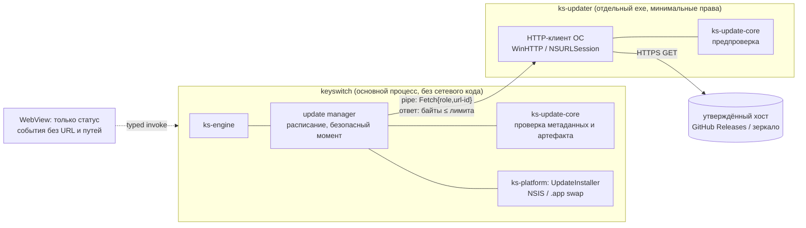

# UPDATE_SECURITY_ARCHITECTURE — система автоматических обновлений KeySwitch

Статус: **проект (предложение AGENT 03)** · Редакция 1 · 2026-11-10 · ветка `docs/governance-v3`
Основание: директива V7 §3, решение D-25 (обновления включены по умолчанию, единственный сетевой канал runtime), D-11 (подпись кода), D-22(6) (платные услуги), правило CLAUDE.md №2.
Требуемые одобрения: **CISO и CLO (обязательно, D-25)**, GATE 10. Изменение корневой системы доверия и механизмов подписи — **LEVEL 3 (владелец)**, V7 п.11.
Связанные документы: `UPDATE_RELEASE_CHECKLIST.md`, `UPDATE_FAILURE_RECOVERY.md`, `adr/ADR-0009-update-channel-only-network.md`; будущие `EMERGENCY_PATCH_POLICY.md` и `SIGNING_KEY_MANAGEMENT.md` (CISO + AGENT 09) детализируют процедуру и хранение ключей и не должны противоречить этому документу.

Метки: **[SRC]** — прочитано в исходниках опубликованного crate (указан файл); **[REG]** — реестр crates.io/npm, запрос 2026-11-10; **[DOC]** — официальная документация; **[HYP]** — гипотеза, проверяется спайком U-1; **UNVERIFIED** — проверить сейчас невозможно (причина указана).

---

## 1. Резюме

1. **Решение (предложение):** собственный минимальный механизм обновлений из двух частей — чистая библиотека проверки `ks-update-core` (без I/O, как `ks-core`) и отдельный сетевой процесс `ks-updater` с минимальными правами. Официальный `tauri-plugin-updater` **не используется** (остаётся в бан-листе SR-62), но **формат артефактов и подписи Tauri сохраняется** (`createUpdaterArtifacts`, minisign/Ed25519 с версией в доверенном комментарии), поэтому подписывать можно штатным `tauri signer`, а проверять — той же библиотекой `minisign-verify`, что и плагин.
2. Причины отказа от плагина «как есть» (проверено по исходникам 2.14.0/2.14.1): манифест **не подписан** (подписан только артефакт); нет срока действия метаданных (freeze/replay), нет `min_safe_version`, отзыва версий, ротации и порога ключей; плагин работает **в процессе с WebView и пользовательским текстом** и тянет TLS-стек `reqwest`+`rustls`; JS-команды позволяют WebView задавать `proxy`/`target`/заголовки.
3. **Модель доверия «TUF-lite»:** офлайн-корень (порог 2 из 3) → ключи ролей `release`, `timestamp`, `policy`; у каждого файла метаданных — монотонный номер и срок действия; HTTPS обязателен, но **не является** основой доверия.
4. **Сеть:** единственный исходящий канал runtime — `ks-updater` к утверждённым хостам; основной процесс `keyswitch` и `ks-sandbox` сетевого кода не содержат. Запрос — только GET статических файлов, без идентификаторов и пользовательских данных.
5. **Хостинг:** GitHub Releases публичного репозитория (бесплатно; лимит 2 GiB на файл, ограничений трафика нет [DOC]). Свой домен, подпись кода Windows/Apple, аппаратные токены для корневых ключей — **LEVEL 3** (§15).

## 2. Требования и трассировка

| # | Требование (V7 §3 / D-25 / задача) | Где в проекте |
|---|---|---|
| R-1 | Каналы STABLE и EMERGENCY SECURITY | §9 |
| R-2 | Проверка при запуске и периодически в фоне, с джиттером | §9.3 |
| R-3 | Подпись и целостность артефакта; HTTPS + подпись (HTTPS недостаточно) | §6, §7, §8 |
| R-4 | Платформа/архитектура/минимальная ОС | §8 шаг 7 |
| R-5 | Защита от downgrade, rollback, подмены, freeze/replay | §8, §16 |
| R-6 | Critical/High — установка без обычного подтверждения, в безопасный момент | §9.1, §10.1 |
| R-7 | Офлайн — догон после подключения | §9.4 |
| R-8 | Корпоративные политики не обходятся | §11 |
| R-9 | Emergency-политики: подписанные, ограниченные, без исполнения кода | §12 |
| R-10 | Kill-switch неудачного обновления | §13, `UPDATE_FAILURE_RECOVERY.md` |
| R-11 | Телеметрии нет; запрос без пользовательских данных | §14 |
| R-12 | Ключи только в защищённых секретах CI, ротация/отзыв | §6 |
| R-13 | Сетевой процесс отделён от процесса с пользовательским текстом | §5 |

## 3. Оценка официального `tauri-plugin-updater`

Проверено: crates.io API (версии, даты, зависимости) **[REG]**; исходники опубликованных архивов `tauri-plugin-updater-2.14.0.crate` и `-2.14.1.crate` со `static.crates.io` (файлы `src/updater.rs`, `src/config.rs`, `src/commands.rs`, `permissions/default.toml`) **[SRC]**; ветка `v2` plugins-workspace совпадает с 2.14.1; `tauri-cli-2.12.4.crate` (`src/helpers/updater_signature.rs`) **[SRC]**.

| Аспект | Факт | Оценка для KeySwitch |
|---|---|---|
| Версии | 2.14.1 (2026-10-28, **13 дней — моложе 2 недель**), 2.14.0 (2026-10-14), линия 3.0.0-alpha.3 (2026-10-14). Лицензия Apache-2.0 OR MIT. MSRV 1.90 [REG] | Допустима бы была `=2.14.0` |
| Зависимости | `reqwest ^0.13` (+`rustls ^0.23` по умолчанию), `zip`, `tar`, `flate2`, `tempfile`, `infer`, `semver`, `time`, `tokio`, `minisign-verify ^0.3`, macOS: `osakit` [REG] | TLS-стек в процессе приложения; противоречит SR-62 |
| Подпись | minisign (Ed25519): `PublicKey::verify(data, sig, true)` над **байтами артефакта**; один `pubkey` в конфиге [SRC `updater.rs` `verify_signature`] | Нет ротации, порога, отзыва ключа |
| Привязка версии | доверенный комментарий подписи `timestamp:…\tfile:…\tversion:X` (Tauri CLI 2.12.4, флаг `--app-version`) [SRC]; проверяется только при `requireSignedVersion = true`, **по умолчанию `false`** [SRC `config.rs`] | Без флага подписанный старый артефакт можно выдать за новую версию (downgrade) — это прямо описано в комментарии кода |
| Манифест | JSON `{version, notes, pub_date, platforms{"windows-x86_64": {url, signature}}}` или динамический `{version, url, signature}`; **не подписан**; нет срока действия, `min_safe_version`, каналов, отзыва [SRC] | Freeze/replay не обнаруживаются |
| Сравнение версий | по умолчанию `release.version > current`; `allowDowngrades` → «не равно»; можно задать свой comparator [SRC] | Нужен свой comparator с правилами §8 |
| Транспорт | в release-сборке эндпоинты обязаны быть `https`, но есть флаги `dangerousInsecureTransportProtocol`, `dangerousAcceptInvalidCerts/Hostnames` [SRC] | Флаги должны быть запрещены |
| Запрос | User-Agent `tauri-plugin-updater/<версия>`; шаблоны URL `{{current_version}}`, `{{target}}`, `{{arch}}`, `{{bundle_type}}`; произвольные заголовки [SRC] | Версия в URL/UA — лишние данные |
| Windows | проверка байтов в памяти → запись в `%TEMP%\<app>-<ver>-updater-*` → `ShellExecuteW` NSIS (`/P` или `/S`, `/UPDATE`, `/R`, `/ARGS`) или `msiexec /i` → `std::process::exit(0)` [SRC] | Окно TOCTOU между проверкой и запуском из каталога, доступного на запись; нет проверки Authenticode; резкий выход посреди возможной операции |
| macOS | `.app.tar.gz` → распаковка на тот же том → `chmod 755` → атомарный обмен бандлов, иначе переименование с резервной копией; при `PermissionDenied` — AppleScript `with administrator privileges` (запрос пароля администратора) [SRC] | Повышение прав противоречит правилу 8; нет проверки подписи кода |
| WebView | команды `check/download/install/download_and_install`; набор `default` разрешает все четыре; `check` принимает из JS `headers`, `timeout`, `proxy`, `target` [SRC `commands.rs`, `permissions/default.toml`] | XSS в WebView мог бы перенаправить прокси/цель; WebView не должен иметь прав на обновления |

**Вывод:** криптографическое ядро плагина корректно (minisign, привязка версии), но модель метаданных и процессная модель не удовлетворяют R-5, R-9, R-10, R-13. Использовать плагин можно только как запасной вариант B (§4).

## 4. Альтернативы

| Вариант | Плюсы | Минусы | Вердикт |
|---|---|---|---|
| **A.** `tauri-plugin-updater` в основном процессе, `requireSignedVersion = true`, свой comparator, без прав WebView | минимум своего кода; поддерживается Tauri | TLS в процессе с текстом; манифест не подписан (freeze, отзыв, политики — всё равно писать самим); macOS — запрос пароля администратора | **Нет** |
| **B.** Плагин во вспомогательном процессе Tauri + наш подписанный «надманифест» | переиспользует установщики плагина | вспомогательный процесс тянет весь Tauri/WebView; `UpdaterBuilder::new` требует `AppHandle` [SRC]; TOCTOU и AppleScript остаются | Запасной, если U-1 провалит C |
| **C. Свой `ks-updater` + `ks-update-core`, формат артефактов Tauri** | полный контроль правил §8; сеть изолирована; одна крипто-зависимость `minisign-verify` (0 зависимостей); HTTP через ОС (WinHTTP / NSURLSession) — без `rustls` | ~1,5–2,5 тыс. строк своего кода + тесты/fuzz (оценка [HYP]); своя ответственность за установку | **Рекомендовано** |
| D. Velopack (`velopack` 1.2.161, 2026-09-29, MIT [REG]) | дельта-обновления, Windows+macOS | собственный формат пакетов и установщик вместо NSIS Tauri; новая крупная зависимость; модель доверия — не TUF | Нет (пересмотреть, если нужны дельты) |
| E. WinSparkle (Windows) + Sparkle 2 (macOS) | зрелые, EdDSA-подпись appcast | две нативные C/ObjC-библиотеки, два формата, appcast не TUF; UNVERIFIED версии (сайты недоступны) | Нет |
| F. Магазины (Microsoft Store/MSIX, Mac App Store) | обновление средствами ОС | App Sandbox несовместим с Accessibility на macOS [HYP]; публикация — коммерческое решение | Отдельный канал позже (LEVEL 3) |
| G. Только уведомление о версии, без автоустановки | минимальный риск канала | не выполняет V7 §3 (Critical/High без подтверждения) | Нет; остаётся режимом «только уведомлять» для пользователя/админа |
| H. `tough` (TUF, awslabs) 0.24.0 (2026-07-10) [REG] | полный TUF | `aws-lc-rs` (C-код), `tokio`, `reqwest`/`rustls` — тяжело и против SR-62 | Нет; берём только модель ролей |

## 5. Компоненты и разделение процессов



| Компонент | Ответственность | Чего у него нет |
|---|---|---|
| `ks-update-core` (crate, `#![forbid(unsafe_code)]`, без I/O) | разбор и проверка `root/timestamp/channel/policy`, порогов подписей, сроков, номеров; решение «ставить / не ставить / срочно»; проверка артефакта (SHA-256 + minisign + версия в комментарии); выбор платформы/архитектуры; анти-откат | ОС, сеть, файлы, время (время передаётся аргументом) |
| `ks-updater` (exe) | только загрузка по запросу основного процесса: фиксированный список хостов, HTTPS, лимиты размера/времени; предпроверка подписи перед записью на диск | доступа к буферу, UIA, вводу, пользовательскому тексту, настройкам; прав на установку |
| update manager (в `keyswitch`) | расписание, джиттер, политики админа, повторная проверка уже загруженного, выбор безопасного момента, запуск установщика, health-check после обновления | сетевого кода |
| `UpdateInstaller` (трейт в `ks-platform`; `ks-platform-win`, `ks-platform-mac`) | запуск NSIS / обмен `.app`, перезапуск | логики доверия |

**Права `ks-updater`:**
- Windows: AppContainer с единственной capability `internetClient` (без доступа к файлам пользователя, Low IL), Job Object (без дочерних процессов, лимит памяти 128 МБ, UI-ограничения как у песочницы); каталог загрузки — каталог контейнера [HYP: путь и наследование ACL проверяются в U-1].
- macOS: helper в бандле с App Sandbox и единственным entitlement `com.apple.security.network.client` [DOC Apple, UNVERIFIED дословно — developer.apple.com недоступен из сессии].
- Запускается основным процессом только на время проверки/загрузки, без аргументов-путей; протокол — кадры с лимитами (как `ks-sandbox-proto`), `deny_unknown_fields`.

**Почему проверка в обоих процессах:** `ks-updater` отбрасывает мусор до записи на диск; основной процесс **повторно** проверяет всё по байтам, которые сам прочитал из открытого с запретом записи файла, — компрометация `ks-updater` (баг HTTP/разбора) не даёт установить неподписанное.

**WebView:** права плагина/команд обновления не выдаются; UI получает событие `ks://update-state {state, available_version, severity, restart_required}` и вызывает 3 команды без параметров-URL: `update_check_now`, `update_install_now`, `update_postpone`. Опасные изменения (отключение обновлений) — через нативный диалог (SR-71).

**Зависимости (предложение, требует PR по правилу 3):**

| Crate | Версия (дата) [REG] | Лицензия | Назначение | Риск |
|---|---|---|---|---|
| `minisign-verify` | `=0.3.0` (2026-09-25), 0 зависимостей | MIT | Ed25519/minisign проверка метаданных и артефактов | маленький, автор — jedisct1 (автор minisign); тот же crate у плагина Tauri |
| `sha2` | `=0.11.1` (2026-10-12) | MIT OR Apache-2.0 | SHA-256 артефактов | уже запланирован (DEP) |
| `semver` | `=1.0.28` (2026-04-04) | MIT OR Apache-2.0 | сравнение версий | в графе Tauri [HYP] |
| `serde`/`serde_json` | в графе | MIT OR Apache-2.0 | разбор метаданных | — |
| `windows` (фичи `Win32_Networking_WinHttp`, `Win32_Security_WinTrust`) | `=0.62.2` (в графе) | MIT OR Apache-2.0 | HTTPS через WinHTTP; Authenticode | фичи существуют в 0.62.2 [REG] |
| macOS HTTP | NSURLSession через `objc2-foundation` (в графе Tauri на macOS) | MIT | HTTPS | версия — UNVERIFIED до появления macOS-сборки |

Отклонены: `reqwest`/`rustls`/`ureq` (SR-62, второй TLS-стек), `tough`, `ed25519-dalek` (не нужен при minisign), `self_update`, `velopack`.

## 6. Модель доверия: роли и ключи

| Роль | Подписывает | Где хранится ключ | Порог | Срок действия подписанного файла |
|---|---|---|---|---|
| `root` | `root.json`: список ключей ролей, пороги, сроки | **офлайн**: 3 ключа на аппаратных токенах или офлайн-носителях у владельца, CISO и (третий) в сейфе/у доверенного лица; в CI нет | **2 из 3** | 365 дней |
| `release` | `channel/<stable\|emergency>.json` (манифест канала) и minisign-подписи артефактов | секрет GitHub Environment `release` с обязательным одобрением (владелец; CISO для EMERGENCY по политике) | 1 (+ проверка `root` для смены) | STABLE 30 дней, EMERGENCY 30 дней |
| `timestamp` | `timestamp.json`: номера и SHA-256 актуальных манифестов и политики | секрет Environment `timestamp`, используется только плановым workflow | 1 | **7 дней**, переподписывается ежедневно |
| `policy` | `policy/emergency-policy.json` (§12) | секрет Environment `policy`, одобрение CISO + PD | 1 [предложение: 2 из 2 при наличии двух ключей] | ≤ 30 дней |

- Встроенное доверие: в бинарь зашивается **SHA-256 исходного `root.json` v1** (первичный якорь). Новый `root.json` vN принимается, только если подписан порогом ключей **и** vN-1, **и** vN (как в TUF); номера только растут.
- Ротация `release/timestamp/policy` — новый `root.json` (офлайн-церемония, LEVEL 3). Отзыв скомпрометированного ключа — то же; клиенты получают новый `root.json` при следующей проверке.
- Ключи артефактов (minisign `release`) и ключи метаданных — разные пары; ключ подписи кода ОС (Authenticode/Apple Developer ID) — третий независимый уровень (D-11).
- Подробности хранения, церемонии, резервирования и действий при компрометации — `SIGNING_KEY_MANAGEMENT.md` (CISO + AGENT 09; ещё не написан).

## 7. Форматы

Все файлы — UTF-8 JSON; подпись minisign — отдельный файл `<name>.json.minisig` (для `root.json` — массив подписей в `root.json.sigs`). **Подписываются байты файла как есть**; разбор JSON — только после проверки подписи и размера (≤ 256 КиБ для метаданных); `deny_unknown_fields`; глубина ≤ 8; повтор ключей JSON — ошибка.

`timestamp.json`:
```json
{ "type": "timestamp", "spec": 1, "seq": 1043, "issued_at": "2026-11-10T03:00:00Z", "expires_at": "2026-11-17T03:00:00Z",
  "meta": { "channel/stable.json": {"seq": 12, "sha256": "…", "size": 4210},
            "channel/emergency.json": {"seq": 3, "sha256": "…", "size": 1980},
            "policy/emergency-policy.json": {"seq": 2, "sha256": "…", "size": 640},
            "root.json": {"version": 1} } }
```

`channel/stable.json` (так же `emergency.json`):
```json
{ "type": "channel", "spec": 1, "channel": "stable", "seq": 12,
  "issued_at": "2026-11-10T03:00:00Z", "expires_at": "2026-12-10T03:00:00Z",
  "min_safe_version": "1.2.0",
  "revoked_versions": ["1.3.0"],
  "releases": [ {
      "version": "1.3.1", "release_time": "2026-11-09T18:00:00Z",
      "severity": "high", "advisories": ["KS-SA-2026-0001"],
      "rollout": { "percent": 25, "salt": "b1f4…" , "halted": false },
      "artifacts": [
        { "platform": "windows", "arch": "x86_64", "os_min": "10.0.19045", "bundle": "nsis",
          "path": "v1.3.1/KeySwitch_1.3.1_x64-setup.exe", "size": 8412160, "sha256": "…",
          "minisign": "<base64 содержимого .sig Tauri>" },
        { "platform": "macos", "arch": "aarch64", "os_min": "13.0", "bundle": "app-tar-gz",
          "path": "v1.3.1/KeySwitch_aarch64.app.tar.gz", "size": 9120440, "sha256": "…", "minisign": "…" } ] } ] }
```
- `path` — относительный; хост берётся **только** из встроенного списка или политики администратора (§11); абсолютные URL в манифесте запрещены.
- `severity ∈ {none, low, medium, high, critical}`; `advisories` — идентификаторы собственных бюллетеней (публикуются в репозитории).
- `min_safe_version` — любая установленная версия ниже считается уязвимой → срочное обновление (§9.1). `revoked_versions` — никогда не устанавливаются; если запущена отозванная — приоритетный переход на следующую исправную (roll-forward).

## 8. Алгоритм проверки на клиенте (`ks-update-core`)

Локальное состояние (файл `%LOCALAPPDATA%\KeySwitch\update-state.json` / `~/Library/Application Support/KeySwitch/`): доверенный `root.json`, последние принятые `seq` и `issued_at` каждой роли, `highest_installed_version`, `min_safe_floor` (максимум из виденных `min_safe_version`), локальный `rollout_bucket` (случайное 0–99, **никогда не передаётся**).

1. Получить `root.json` vN+1… пока есть (обновление корня, §6). Ошибка подписи/порога → стоп, состояние не меняется.
2. Получить `timestamp.json`; проверить подпись ключом `timestamp` из корня; `seq ≥ сохранённого` и `issued_at ≥ сохранённого` (анти-replay); `expires_at > now` (анти-freeze). Если `seq` равен сохранённому — файл должен совпасть побайтно.
3. Для каждого изменившегося файла `meta`: получить, сверить `size` и `sha256` с `timestamp.json`, проверить подпись своей роли, `seq` монотонен, срок не истёк, `channel` совпадает с запрошенным.
4. Обновить `min_safe_floor = max(min_safe_floor, min_safe_version)`; он **никогда не уменьшается**.
5. Выбрать кандидата: максимальная версия в разрешённых каналах, `version > current`, `version ≥ min_safe_floor`, не в `revoked_versions`, `rollout.halted = false`, `bucket < percent` (для EMERGENCY с `severity ∈ {high, critical}` или если текущая версия < `min_safe_floor` / отозвана — rollout игнорируется).
6. **Никогда** не выбирать `version ≤ highest_installed_version` (анти-downgrade, в т.ч. после ручной установки старой версии пользователем — тогда только уведомление).
7. Артефакт: `platform`, `arch` (фактическая архитектура процесса и ОС; Windows on ARM — отдельная `aarch64`), `os_min ≤ версии ОС`, `bundle` = способ установки текущей копии. Нет подходящего — уведомление «обновите вручную».
8. Загрузить артефакт (лимит `size`, таймаут); проверить `size`, SHA-256, minisign ключом `release`, **версию в доверенном комментарии = `version`** (обязательно, как `requireSignedVersion`). Любая ошибка → артефакт удаляется, повтор по расписанию; три подряд ошибки подписи одного файла → состояние «канал недоверен», уведомление в Диагностике.
9. Перед установкой: повторно открыть файл с запретом записи/удаления другими, повторить шаг 8 по этим байтам; Windows — `WinVerifyTrust` + совпадение издателя (после D-11); macOS — проверка подписи кода и Team ID (§10.3).
10. Время: проверки срока используют системные часы, но `now` не может быть меньше максимума виденных `issued_at` (защита от перевода часов назад).

## 9. Каналы, расписание, офлайн

### 9.1 STABLE и EMERGENCY SECURITY
| | STABLE | EMERGENCY SECURITY |
|---|---|---|
| Содержимое | функции и исправления; может содержать security-фиксы Low/Medium | только исправления уязвимостей High/Critical (минимальный diff от последней STABLE) или поднятие `min_safe_version` |
| Подписка по умолчанию | да | да (отключить может только администратор, §11) |
| Установка | загрузка в фоне; установка в безопасный момент **после согласия** или при следующем запуске/выходе — по настройке «устанавливать автоматически» (по умолчанию вкл.) | **без обычного подтверждения** (V7 §3, политика `EMERGENCY_PATCH_POLICY.md`): уведомление «обновление безопасности будет установлено через 60 с», кнопка «Отложить на 1 ч» не более 3 раз за 24 ч, затем установка в первый безопасный момент |
| Поэтапный выпуск | 5 % → 25 % → 100 % с паузами ≥ 24 ч (checklist) | 100 % сразу после внутреннего канареечного прогона; `halted` доступен |
| Версия | обычный semver | patch-версия той же линии (1.3.0 → 1.3.1) |

### 9.2 Безопасный момент
Установка начинается, только если одновременно: нет активной операции конвертации (поколение операций idle, окно выбора закрыто), не выполняется макрос и песочница не запущена, нет несохранённого текста в Macro Studio (иначе черновик сохраняется локально перед установкой), не идёт показ нативного диалога, сессия не заблокирована/не secure desktop. Engine переходит в состояние `Draining` (новые хоткеи → отказ `Busy`), выполняет сохранение, снимает `RegisterHotKey`, после чего запускается установщик. Таймаут ожидания безопасного момента для EMERGENCY — 15 мин, затем повтор; принудительного прерывания операции нет.

### 9.3 Расписание
- Первая проверка — через 2–5 мин после запуска (случайно), не блокирует старт.
- Далее — каждые 6 ч ± случайно до 60 мин; после пробуждения из сна — через 1–10 мин.
- `timestamp.json` маленький; манифесты/артефакты загружаются только при изменении `seq`.
- Повторы при ошибке — экспоненциально 5 мин → 6 ч; никаких повторов чаще 5 мин.

### 9.4 Офлайн и догон
- Нет сети → тихие повторы; при восстановлении — обычная проверка; при наличии ожидающего EMERGENCY — установка в ближайший безопасный момент.
- Если метаданные не удаётся обновить > 14 дней или `timestamp` истёк — состояние «обновления не проверялись N дней» в трее/Диагностике (SR-63); **ничего не устанавливается по устаревшим метаданным**.
- Ранее загруженный, но не установленный артефакт ставится только если свежие метаданные всё ещё его разрешают.

## 10. Установка и перезапуск

### 10.1 Общее
- Установщик запускает основной процесс (не `ks-updater`), после `Draining`, через `CreateProcessW` (Windows) с фиксированными аргументами, без оболочки и без `ShellExecute`.
- Перед запуском — запись `pending_update {from, to, started_at}`; после перезапуска — health-check (§10.4).
- Перезапуск приложения после установки — обязателен (Windows: аргумент NSIS `/R` [SRC плагина: NSIS-шаблон Tauri принимает `/UPDATE`, `/S|/P`, `/R`; HYP — проверка в U-1]; macOS: helper запускает новый бандл после выхода старого).

### 10.2 Windows
- Пакет — NSIS `currentUser` (уже в `tauri.conf.json`): установка в профиль пользователя, **без повышения прав** (правило 8). MSI для массового развёртывания организации — их инструментами, у таких установок автообновление выключено политикой (§11).
- Артефакт копируется в `%LOCALAPPDATA%\KeySwitch\updates\<version>\`, открыт с запретом записи на всё время проверки и запуска; повторная проверка §8 шаг 9.
- Аргументы: `/S /UPDATE /R` (тихо, только для EMERGENCY и автоматической STABLE) или `/P /UPDATE /R` (по нажатию пользователя).
- Authenticode: до решения D-11 сборки не подписаны — проверка `WinVerifyTrust` включается вместе с подписью (обязательна для GATE 15). SmartScreen для неподписанного NSIS — UNVERIFIED поведение при тихой установке.

### 10.3 macOS
- Пакет — `.app.tar.gz` (формат Tauri). Распаковка во временный каталог **на том же томе**, проверка подписи кода (Developer ID, Team ID, hardened runtime, notarization) через Security framework [HYP, U-1/macOS], атомарный обмен бандлов (`renamex_np(RENAME_SWAP)`), перезапуск.
- **Если бандл не доступен пользователю на запись** (например, `/Applications` у стандартного пользователя) — **не запрашивать пароль администратора** (в отличие от плагина): уведомление «обновите вручную / через MDM».
- Разрешение Accessibility (TCC) привязано к подписи кода приложения: при неподписанной/ad-hoc сборке оно, вероятно, теряется после каждого обновления [HYP — проверить]; поэтому **автообновление на macOS практически требует Developer ID** (LEVEL 3, §15).

### 10.4 После обновления
- Первый запуск новой версии выполняет самопроверку без пользовательских данных: встроенные синтетические примеры `ks-core`, самопроверка песочницы (SR-56), регистрация хоткеев, открытие БД и миграции.
- Сбой самопроверки или 2 аварийных завершения за 10 мин → «безопасный режим» (§3 `UPDATE_FAILURE_RECOVERY.md`): Macro Studio и W2 отключены, конвертация — только W1/W3, ускоренная проверка обновлений каждые 30 мин. Возврат к предыдущей версии — только по подписанному разрешению (там же).

## 11. Корпоративные политики

Читаются только из мест, доступных на запись администратору; локальная политика может быть **только строже** настроек пользователя.

| Параметр | Windows: `HKLM\SOFTWARE\Policies\KeySwitch\Update` (затем `HKCU\…\Policies\…`) | macOS: управляемые настройки (профиль MDM, `CFPreferencesAppValueIsForced`) | Значения |
|---|---|---|---|
| `UpdatesEnabled` | DWORD | bool | 0 — никакой сети и проверки; 1 — по умолчанию |
| `Channels` | REG_SZ | string | `stable+emergency` (по умолчанию) / `emergency` / `none` |
| `AutoInstall` | DWORD | int | 0 — только уведомлять; 1 — по правилам §9.1 |
| `DeferStableDays` | DWORD | int | 0–60 |
| `UpdateBaseUrl` | REG_SZ | string | внутреннее зеркало, только `https://`; доверие — всё равно наши подписи |
| `AcceptRemotePolicies` | DWORD | bool | 1 по умолчанию; 0 — emergency-политики игнорируются (организация берёт риск) |
| `MetadataMaxAgeDays` | DWORD | int | 7–30: допуск истёкшего `timestamp` для изолированных сетей; по умолчанию 7 |

- Зеркало — побайтная копия статических файлов; подменить содержимое без ключей нельзя; зеркало обязано синхронизироваться чаще срока `timestamp`.
- Учитываются ОС-ограничения: Windows — лимитное подключение (STABLE не загружается, EMERGENCY — да), режим экономии батареи; macOS — режим «Экономия данных» [HYP API]. Системный прокси и корпоративные корневые сертификаты учитываются автоматически за счёт HTTP-стека ОС.
- Пользователь (без политики) может переключить «только уведомлять»; полное отключение — в «Дополнительно» с предупреждением (открытый вопрос владельцу, §19).

## 12. Emergency-политики (подписанные, ограниченные, без кода)

`policy/emergency-policy.json`, подпись ролью `policy`, срок ≤ 30 дней, монотонный `seq`, область `{platforms, versions: ">=1.2.0 <1.3.1"}`.
**Допустимые ключи — закрытый список (`deny_unknown_fields`; неизвестный ключ = отклонение всей политики):**

| Ключ | Эффект | Направление |
|---|---|---|
| `macro_studio.enabled = false` | запуск макросов запрещён | только выключение |
| `macro.runtime.{js,python}.enabled = false` | отключение одного рантайма | только выключение |
| `macro.clipboard_read.enabled = false` | запрет чтения буфера макросами | только выключение |
| `app_profile.<profile_id>.disabled = true` | конвертация для профиля → отказ | только выключение |
| `write_method.paste.enabled = false` | запрет W2 | только выключение |
| `write_method.sendinput.max_chars = N` | понижение порога W3 | только уменьшение |
| `scope.full_field.enabled = false` | только выделение/фрагмент | только выключение |
| `notice.message_id = "KS-SA-…"` | показать заранее локализованное сообщение из встроенного каталога | без свободного текста и URL |

Правила: политика **никогда** не включает функции, не повышает лимиты, не содержит кода/скриптов/URL/путей/строк для показа; применяется `ks-engine` как `effective = min(user, admin, emergency)`; истечение срока → эффект снимается (если не продлена); версия, где проблема исправлена, исключается из `versions`. Пользователь видит баннер с идентификатором бюллетеня.

## 13. Kill-switch неудачного обновления
1. `rollout.halted = true` в манифесте (подпись `release`, распространяется через `timestamp` ≤ 6 ч): клиенты, ещё не установившие версию, удаляют загруженный артефакт.
2. `revoked_versions += X` + выпуск X+1 (roll-forward); установившие X получают X+1 в приоритете, независимо от rollout.
3. До выхода X+1 — emergency-политика отключает сломанную функцию.
4. Возврат на предыдущую версию — только §5 `UPDATE_FAILURE_RECOVERY.md` (подписанное разрешение, предыдущая ≥ `min_safe_floor`).

## 14. Сетевой запрос и приватность
- Только `GET https://<утверждённый хост>/<фиксированный путь>`; методы кроме GET запрещены; тело запроса пустое.
- Заголовки: `Host`, `User-Agent: KeySwitch-Updater` (**без версии**), `Accept`. Без cookies (хранилище отключено), без `Referer`, без условных запросов (`If-None-Match`/ETag) — исключает ETag-трекинг.
- В URL нет версии, ОС, архитектуры, языка, идентификатора: путь одинаков для всех клиентов канала; выбор артефакта — на клиенте.
- Постоянного идентификатора нет; `rollout_bucket` хранится только локально.
- Неустранимо видны хосту/CDN/резолверу: IP-адрес, время запроса, факт использования KeySwitch, TLS-отпечаток HTTP-стека ОС. Раскрывается в Privacy Policy (BL-LEG-07); правовая оценка — CLO (§19).
- Телеметрии, отчётов об ошибках, «пингов» установки — **нет**. Сведения об успешности выпуска — только из внутренних тестов, CI и добровольных обращений пользователей.
- Лимиты: метаданные ≤ 256 КиБ, артефакт ≤ `size` из манифеста и ≤ 200 МБ; таймаут соединения 15 с, загрузки — по размеру; редиректы — только на хосты из списка (GitHub Releases перенаправляет на `release-assets.githubusercontent.com`/`objects.githubusercontent.com` — UNVERIFIED, github.com недоступен из сессии; проверяется в U-1).

## 15. Хостинг и затраты (LEVEL 3 — решения владельца)

| Пункт | Вариант по умолчанию | Стоимость | Решение |
|---|---|---|---|
| Хост метаданных и артефактов | GitHub Releases публичного репозитория (тег `updates-meta` для метаданных + теги версий) | 0; лимит 2 GiB на файл, 1000 файлов на релиз, без ограничения трафика [DOC: github/docs `about-releases.md`, `data/variables`] | рекомендую; PD |
| Свой домен (`updates.<имя>`) поверх GitHub Pages | независимость от URL репозитория, возможность сменить хостинг без нового бинаря | домен ~10–20 USD/год (UNVERIFIED цены) | **LEVEL 3**, после выбора названия (D-22(5)) |
| Корневые ключи (3 аппаратных токена) | офлайн-носители допустимы на этапе бета | ~50–80 USD за токен (UNVERIFIED) | **LEVEL 3** (V7 п.11 — корень доверия) |
| Подпись кода Windows | Authenticode (сертификат или облачная подпись) | платно, UNVERIFIED | **LEVEL 3**, D-11 |
| Apple Developer Program (Developer ID, нотаризация) | обязательно для автообновления на macOS (§10.3) | 99 USD/год [UNVERIFIED — сайт Apple недоступен] | **LEVEL 3** |
| Утверждение корневой церемонии и держателей ключей | владелец + CISO + третий держатель | — | **LEVEL 3** |

## 16. Модель угроз канала обновлений

| ID | Угроза | Последствие | Меры | Остаток |
|---|---|---|---|---|
| U-01 | Компрометация ключа `release` (утечка секрета CI) | вредоносная версия всем | ключ в Environment с обязательным одобрением; артефакт дополнительно подписан кодовой подписью ОС (независимый ключ, D-11); отзыв через `root` (2 из 3); `timestamp` отдельно — злоумышленник без него не опубликует свежие метаданные; аудит журналов Actions | High до появления подписи кода → Medium |
| U-02 | Компрометация `timestamp` | freeze/replay в пределах подписанных `release` файлов | `seq` монотонен; без `release` нельзя создать новую версию; ротация через `root` | Low |
| U-03 | Компрометация `root` | полная подмена доверия | офлайн, порог 2 из 3, разные держатели, церемония, без CI | Low (организационный) |
| U-04 | Компрометация хоста/зеркала/аккаунта GitHub | подмена файлов, удаление, старые файлы | подписи и хэши; `expires_at` (заморозка ≤ 7 дн. обнаруживается); `seq`; анти-downgrade; 2FA и защита веток/тегов (SEC-39) | Medium (отказ в обслуживании) |
| U-05 | Freeze attack (выдаются старые валидные метаданные) | клиент не видит исправления | `expires_at` 7 дн., предупреждение после 14 дн., `issued_at` монотонен | Low |
| U-06 | Downgrade / rollback на уязвимую версию | возврат уязвимости | `version > highest_installed`; `min_safe_floor` не убывает; версия в доверенном комментарии minisign; `revoked_versions` | Low |
| U-07 | Вредоносный/искажённый манифест (переполнение, глубина, unknown fields) | RCE/DoS в разборщике | подпись до разбора; лимиты размера/глубины; разбор в `ks-update-core` (safe Rust) сначала в `ks-updater` (AppContainer); fuzz | Low |
| U-08 | MITM / поддельный сертификат / корпоративный TLS-прокси | подмена ответов | HTTPS ОС; доверие только подписям; MITM даёт максимум DoS | Low |
| U-09 | DNS-спуфинг / захват домена | перенаправление | то же, что U-08; редиректы только на список хостов | Low (DoS) |
| U-10 | Подмена загруженного файла на диске перед запуском (TOCTOU) | запуск чужого установщика | файл открыт с запретом записи; повторная проверка; Authenticode/codesign; процесс того же пользователя и так может заменить установленный exe (вне модели) | Low |
| U-11 | Злоупотребление emergency-политикой (подписанной) | отключение функций у всех (DoS) | только выключающие ключи; срок ≤ 30 дн.; отдельный ключ и одобрение CISO+PD; админ может отказаться | Low |
| U-12 | Компрометация `ks-updater` (баг HTTP-стека/разбора) | доступ к сети из процесса | AppContainer `internetClient`, нет доступа к данным пользователя и тексту; основной процесс перепроверяет | Low |
| U-13 | Неудачное легитимное обновление (ломает конвертацию/запуск) | потеря функции, массовый сбой | поэтапный выпуск, канарейки, health-check, безопасный режим, kill-switch §13 | Medium |
| U-14 | Приватность: хост видит IP и факт использования | профилирование | без идентификаторов, без версии в запросе, одинаковые пути; раскрытие в Privacy Policy | Low (решение CLO) |
| U-15 | Перевод системных часов | обход срока действия | монотонный `issued_at` | Low |
| U-16 | Подмена политики администратора пользователем | обход запрета обновлений организации | ключи `HKLM\…\Policies` / управляемые профили недоступны на запись обычному пользователю | Low |

## 17. Влияние на правила и другие документы (не вношу — владельцы указаны)
- **SR-62** (бан-лист): оставить `tauri-plugin-updater`, `rustls`, `reqwest` и др. запрещёнными; ни один сетевой crate не нужен (WinHTTP/NSURLSession). Владелец — CISO.
- **SR-90** (нет сети): заменить на «0 не-loopback соединений у всех процессов дерева, кроме `ks-updater`; у `ks-updater` — только к хостам списка, только во время проверки». Владелец — CISO.
- **CLAUDE.md правило 2**: уточнение формулировки под D-25 (единственный сетевой канал — `ks-updater`) — меняет только владелец.
- Capabilities Tauri: без изменений (нет плагина; 3 собственные команды без параметров).
- `SYSTEM_ARCHITECTURE.md` §11 «Обновления» и §8 macOS — внесено.
- `BACKLOG.md`: BL-UPD-03 «спайк U-1: Tauri updater…» → предлагаю переименовать в «спайк U-1: `ks-updater` + `ks-update-core`, тестовый канал, тестовые ключи» (владелец — PD).

## 18. Проверка (критерии GATE 10)
1. `ks-update-core`: unit + proptest на все правила §8 (expired, seq назад, issued_at назад, неверный порог, чужой ключ, revoked, ниже `min_safe_floor`, чужая платформа/arch, подмена версии в комментарии, 1 байт артефакта); fuzz разборщика ≥ 10⁶ входов.
2. CI U-1 (Windows и macOS-раннеры): тестовый канал на отдельном репозитории/теге с **тестовыми** ключами: успешное обновление; отказ при подмене файла, downgrade, freeze (истёкший timestamp), MITM-прокси с поддельным сертификатом, редиректе на чужой хост.
3. Сеть: у `keyswitch.exe` и `ks-sandbox.exe` 0 соединений; у `ks-updater.exe` — только к списку (SR-90 изменённый).
4. Права `ks-updater`: токен AppContainer, одна capability, нет доступа к `%USERPROFILE%\Documents` (тест).
5. Безопасный момент: установка не начинается во время операции/макроса (fake-платформа + интеграционный тест).
6. Политики администратора: каждый параметр §11 на Windows CI (запись в HKLM от администратора раннера); macOS — профиль конфигурации вручную.
7. Emergency-политика: неизвестный ключ → отклонена; попытка включить функцию → отклонена; истечение → снята.

## 19. Открытые вопросы
- **Владелец (LEVEL 3):** держатели корневых ключей (предложение: владелец, CISO, третий — резерв в сейфе) и покупка токенов; хостинг (GitHub Releases) и свой домен; подпись кода Windows и Apple Developer ID; может ли пользователь полностью отключить обновления (предложение: да, в «Дополнительно», с предупреждением; EMERGENCY по умолчанию включён).
- **CISO:** порог роли `policy` (1 или 2 подписи); кто одобряет Environment `release` для EMERGENCY в отсутствие владельца (V7 п.11 — заранее одобренный автоматизированный процесс); срок `timestamp` 7 дн. vs 3 дн.; допустим ли запуск `ks-updater` в AppContainer с `internetClient` вместо LPAC.
- **CLO:** IP-адрес в запросах к GitHub (контроллер/процессор, правовое основание, раскрытие); условия GitHub для распространения закрытого ПО через Releases публичного репозитория; CRA — обязанности по обновлениям безопасности и сроку поддержки; формулировка EULA об автоматической установке без подтверждения.
- **U-1:** путь и ACL каталога AppContainer; аргументы NSIS-шаблона Tauri `/UPDATE /R`; поведение SmartScreen; сохранение TCC-разрешений на macOS.

## 20. Предложения к журналу решений (утверждает владелец)
| ID | Предложение |
|---|---|
| P-U1 | Механизм обновлений — свой (`ks-update-core` + отдельный процесс `ks-updater`), формат артефактов и подписи Tauri; `tauri-plugin-updater` не используется. |
| P-U2 | Модель доверия TUF-lite: `root` (офлайн, 2 из 3), `release`, `timestamp` (7 дн.), `policy`; ротация — через `root` (LEVEL 3). |
| P-U3 | HTTP — только стек ОС (WinHTTP / NSURLSession); TLS-crate не добавляются (SR-62 без исключений). |
| P-U4 | Без повышения прав при обновлении: Windows — NSIS `currentUser`; macOS — без запроса пароля администратора. |
| P-U5 | Запрос обновления без версии/ОС/идентификатора; поэтапный выпуск — по локальному случайному числу. |
| P-U6 | Emergency-политики — закрытый список только выключающих параметров, срок ≤ 30 дн. |
