# KeySwitch — Архитектура v2 (предложение для GATE 2)

Статус: **исследование / предложение** · Автор: System Architect (Agent 03) · Дата: 2026-11-09 · Ветка: `research/phase-1`
Основано на: `docs/00-decisions.md` (D-01…D-15), `docs/02-architecture.md` (черновик v1), `docs/spikes/S-1-converter-model.md`, существующем коде (`crates/ks-core`, `app/`), исследовании `docs/research/arch-windows-field-replacement.md` (далее — **[FR]**), подборе зависимостей `docs/research/arch-dependencies.md` (далее — **[DEP]**).

**Редакция 2026-11-10 (BL-ARCH-01):** внесены 13 исправлений из `review-arch-on-security.md` §2 (метки `[испр. N]`); принятые решения — в `docs/SYSTEM_ARCHITECTURE.md`, решения CISO — `docs/SECURITY_REVIEW.md` §4.

Метки достоверности — как в [FR] §0: **[DOC]**, **[SRC]**, **[WR]**, **[HYP]**, **[VER-C]**.
Документ ничего не меняет в `02-architecture.md` и `00-decisions.md`: всё ниже — предложения (P-xx), требующие одобрения владельца.

---

## 1. Критика черновика `docs/02-architecture.md`

### 1.1 Сохраняю
| Что | Почему |
|-----|--------|
| Принципы §1 (ядро без ОС, минимум зависимостей, песочница — отдельный процесс, текст только в памяти) | Верны и согласуются с D-08, CLAUDE.md. |
| Разделение на `ks-core` / `ks-platform` / `ks-platform-win` / `ks-engine` / `ks-sandbox-host` / `ks-storage` | Правильные границы ответственности. |
| Конвейер «любая ошибка до Write → Abort; до Write изменений нет» (§5) | Становится инвариантом I-1 [FR §2]. |
| Операции сериализованы, повтор хоткея во время операции игнорируется | Простая и безопасная модель. |
| Песочница: скрипт возвращает действия, применяет ядро после политики | Ключ к T-01/T-02. |
| CSP, минимальные capabilities, без `fs`/`shell`/`http` | T-10, T-11. |
| Таблица рисков R-1…R-6 | Переношу с уточнениями в §9. |

### 1.2 Меняю
| # | Было в черновике | Проблема | Стало (v2) |
|---|------------------|----------|-----------|
| C-1 | Трейты со статическими функциями без `self`: `fn focused() -> Result<FocusTarget>` | Нельзя подменить в тестах; нет состояния (COM-объект UIA); `FocusTarget` с COM-указателями нельзя передавать между потоками (MTA-квартира [DOC: [UIA threading](https://learn.microsoft.com/en-us/windows/win32/winauto/uiauto-threading)]). | Объектные трейты `&self`; **сессия поля** (`FieldSession`) живёт в потоке платформы, наружу — только непрозрачные идентификаторы и метаданные (§3). |
| C-2 | `TextAccess::read_scope / select` | Нет порядка «сначала пароль, потом текст», нет проверки выделения, нет повторной проверки цели и текста, нет трёхзначной логики «неизвестно». | `inspect()` (без текста) → политика → `read()` → `verify()` → `select_verified()`; признаки `Tri::{Yes,No,Unknown}`; `Unknown` для пароля = отказ. |
| C-3 | `Input::type_unicode / paste` как равноправные методы, выбор по профилю | Нет критериев выбора; `paste` без протокола восстановления буфера. | Выбор метода записи — **политика в `ks-engine`** по возможностям поля (`FieldCaps`) [FR §6.3]; платформа даёт примитивы W1/W2/W3. |
| C-4 | `Clipboard::put_private / restore_if_unchanged`, «профильная задержка восстановления» | Задержка не гарантирует, что приложение уже прочитало буфер → может вставиться **старое** содержимое пользователя. | Транзакция буфера (RAII) с «сигналом потребления» через delayed rendering (`WM_RENDERFORMAT`) [FR §5.10, P-05]; предварительная проба безопасности snapshot [FR §5.9, P-04]. |
| C-5 | Модель потоков не описана (только «RegisterHotKey в отдельном потоке») | UIA нельзя вызывать из главного STA-потока Tauri; нет таймаутов и стратегии зависания провайдера. | §4: 5 потоков, роли, квартиры COM, дедлайны, сторож. |
| C-6 | `app-profiles.toml` с задержками | TOML — лишняя зависимость; задержки — антипаттерн (см. C-4). | Профили — JSON-данные (serde_json уже в графе), флаги возможностей, без таймингов; переопределения пользователя — в SQLite. |
| C-7 | Конвейер §5 | Нет: ожидания модификаторов, выделения с проверкой, пост-проверки, правила «не переключать раскладку при неподтверждённом результате», повторной проверки после диалога. | Машина состояний §5. |
| C-8 | Песочница: «WASI без preopen-каталогов» | CPython WASI нуждается в stdlib (файлы `.py`/`.pyc`) — без доступа к ним интерпретатор не стартует [WR]. | ~~P-12: read-only preopen каталога stdlib~~ — **отозвано** [испр. 1]. Решение CISO XR-07: stdlib — встроенный zip (`include_bytes!`) в неизменяемом дереве в памяти, **ноль host-preopen** (вариант A); A+ — то же + Wizer-снимок в CI; B (preopen каталога с одним `python314.zip`) — только письменным решением CISO по итогам S-3 при условиях `SECURITY_REVIEW.md` §4.6. |
| C-9 | Песочница: только AppContainer + Job Object | Не учтены UI-ограничения Job (буфер обмена, глобальные атомы, рабочий стол), политики смягчения процесса, LPAC, совместимость JIT Wasmtime с ACG. | §6: AppContainer (или LPAC) + Job с `JOB_OBJECT_UILIMIT_*` + mitigation policies; вопрос JIT/ACG — в S-3. |
| C-10 | Крейт `ks-layouts` (TOML + сгенерированные таблицы) | S-1 уже хранит раскладки как данные в `ks-core/layouts/*.layout` со своим парсером — отдельный крейт не нужен. | Удалить `ks-layouts`; добавить `ks-types`, `ks-platform-fake`, `ks-sandbox-proto` (§2). |
| C-11 | Хранение в `%APPDATA%\KeySwitch\` | `%APPDATA%` = Roaming: в доменных сетях скрипт макроса может синхронизироваться на сервер — противоречит ТЗ §14 «настройки и скрипты — локально». | `%LOCALAPPDATA%\KeySwitch\` (P-13). |
| C-12 | Плагины Tauri «tray, autostart, single-instance — если нужны» | Трей в Tauri 2 — фича ядра `tray-icon`, а не плагин [SRC: список features `tauri` 2.12.5 на crates.io]; autostart и global-shortcut добавляют JS-API и зависимости. | Трей — `tauri/tray-icon`; single-instance — плагин; autostart и хоткеи — свои реализации (§7, [DEP]). |
| C-13 | Не учтено: `[workspace.lints.rust] unsafe_code = "forbid"` | `forbid` нельзя ослабить `#[allow]` внутри крейта, а `ks-platform-win` неизбежно содержит `unsafe` (FFI). | `ks-platform-win` (и только он) объявляет собственные `[lints]`: `unsafe_code = "deny"` + `#[allow(unsafe_code)]` на модулях FFI + `clippy::undocumented_unsafe_blocks = "deny"`. Остальные крейты — `workspace = true` (forbid). |
| C-14 | Окно выбора языка не описано | Окно WebView2 медленно создаётся и имеет особенности фокуса [WR]; правила `SetForegroundWindow` [DOC]. | Нативное Win32-окно в `ks-platform-win` (P-07), локализованные строки из общих словарей. |
| C-15 | Нет тестового двойника платформы | `ks-engine` невозможно тестировать на Linux CI. | `ks-platform-fake`: детерминированная модель полей, буфера, фокуса с инъекцией сбоев. |

---

## 2. Структура крейтов и модулей

```
keyswitch/
├─ crates/
│  ├─ ks-core/            # (есть) конвертер, детектор, n-граммная модель, раскладки-данные. Без I/O, без ОС, без unsafe.
│  ├─ ks-types/           # общие типы без ОС: UserText (zeroize), LangId, AbortReason, AllowedKey, MacroAction,
│  │                      #   OperationOutcome, Tri, Chord. Без I/O. Зависимости: zeroize, serde (только для не-текстовых типов).
│  ├─ ks-platform/        # трейты адаптеров + типы ошибок/метаданных. Без ОС-зависимостей.
│  ├─ ks-platform-win/    # реализация для Windows (windows crate). Единственный крейт с unsafe (кроме, возможно, sandbox-host).
│  ├─ ks-platform-fake/   # тестовая реализация трейтов (in-memory), используется тестами ks-engine на Linux.
│  ├─ ks-engine/          # политика безопасности, профили, машина состояний операции, выбор scope/метода записи, применение MacroAction.
│  ├─ ks-sandbox-proto/   # протокол host↔sandbox: сообщения (serde), версии, лимиты, кодек кадров с ограничением длины.
│  ├─ ks-sandbox-host/    # бинарь `ks-sandbox.exe`: Wasmtime + WASI p1 + ks-core (для ks.convert). Не знает про UI/буфер/ввод.
│  └─ ks-storage/         # SQLite (rusqlite): настройки, слот макроса, исключения, переопределения профилей, журнал без текста.
├─ guests/                # скрипты сборки и манифест хешей для quickjs.wasm и python.wasm (+ stdlib); сами бинари — артефакты CI
├─ app/
│  ├─ src/                # React/TS UI: экраны, дизайн-система, i18n-словари
│  └─ src-tauri/          # crate `keyswitch`: связывание, команды IPC, трей, запуск engine/hotkeys
├─ tests/
│  ├─ fixtures/           # корпус конвертации (синтетический)
│  └─ win-fixtures/       # тестовые окна для S-2 / интеграционных тестов (dev-only)
└─ tools/ks-probe/        # консольный пробник Windows-интеграции (dev-only, S-2)
```

**Граф зависимостей (стрелка = «зависит от»):**
```
ks-core ─────────────┐
ks-types ◄───────────┼──────────────┐
ks-platform ──► ks-types            │
ks-engine ──► ks-core, ks-types, ks-platform (только трейты), ks-sandbox-proto
ks-platform-win ──► ks-platform, ks-types, windows
ks-platform-fake ──► ks-platform, ks-types
ks-sandbox-proto ──► ks-types, serde, serde_json
ks-sandbox-host ──► ks-sandbox-proto, ks-core, wasmtime, wasmtime-wasi, sha2
ks-storage ──► ks-types, rusqlite
keyswitch (app) ──► всё выше + tauri
```
Правила: `ks-engine` **не** зависит от `ks-platform-win`, `tauri`, `rusqlite`; `ks-core` не зависит ни от чего, кроме std; `ks-sandbox-host` не зависит от `ks-platform*` (песочнице не нужны ОС-адаптеры).

---

## 3. API между слоями (Rust-сигнатуры)

Сигнатуры — проектные; имена могут уточниться при реализации. Все вызовы платформы — **синхронные с дедлайном**: операция и так выполняется в выделенном потоке, async здесь добавил бы только сложность.

### 3.1 `ks-types`
```rust
/// User text. No Debug/Display/Serialize/Clone (copies are explicit and reviewed). Zeroized on drop (T-09). [испр. 3]
pub struct UserText(zeroize::Zeroizing<String>);
impl UserText {
    pub fn new(s: String) -> Self;
    pub fn expose(&self) -> &str;               // grep-able: every call site is reviewed
    pub fn char_len(&self) -> usize;
    pub fn has_line_break(&self) -> bool;
    pub fn keyed_digest(&self, key: &DigestKey) -> TextDigest; // per-operation random key; for I-3
}
pub struct DigestKey([u8; 32]);                 // random per operation, never persisted
#[derive(Clone, Copy, PartialEq, Eq)] pub struct TextDigest([u8; 32]);

#[derive(Clone, Copy, Debug, PartialEq, Eq)] pub enum Tri { Yes, No, Unknown }
#[derive(Clone, Debug, PartialEq, Eq, Hash)] pub struct LangId(pub String);  // "en", "ru" (D-15)

#[derive(Clone, Copy, Debug, PartialEq, Eq)]
pub enum AllowedKey { Enter, Tab, Left, Right, Up, Down, Backspace, Delete, Home, End } // D-07, closed enum

pub enum MacroAction { None, Insert(UserText), Replace(UserText), Keys(Vec<AllowedKey>) }

#[derive(Clone, Copy, Debug, PartialEq, Eq, serde::Serialize)]
pub enum AbortReason { /* codes from [FR] §6.2 */ SecureDesktop, Excluded, Elevated, NoFocusedField,
    Password, ReadOnly, UnsupportedControl, ScopeUndetermined, MultiSelection, TooLong, EmbeddedObjects,
    ImeActive, LowConfidence, Cancelled, ModifiersHeld, TargetChanged, SelectionNotConfirmed,
    NoSafeWriteMethod, Timeout, Busy, Disabled, SelfElevated /* own token elevated [испр. 8] */,
    SelfTarget /* focus in KeySwitch window, XR-06 */, ClipboardListenerInterference, MacroPolicyDenied,
    Platform(PlatformErrorKind) }

#[derive(Clone, Debug, serde::Serialize)]
pub enum OperationOutcome {
    Applied { method: WriteMethod, layout_switched: Tri },
    WriteUnverified { method: WriteMethod },
    Aborted(AbortReason),
}
#[derive(Clone, Copy, Debug, PartialEq, Eq, serde::Serialize)]
pub enum WriteMethod { NativeEditReplace /*W1*/, Paste /*W2*/, TypeUnicode /*W3*/ }
```

### 3.2 `ks-platform` — трейты
```rust
pub struct Deadline(std::time::Instant);
pub type PResult<T> = Result<T, PlatformError>;

#[derive(Debug, Clone)]
pub struct PlatformError { pub kind: PlatformErrorKind, pub detail: &'static str } // no user text inside
#[derive(Debug, Clone, Copy, PartialEq, Eq, serde::Serialize)]
pub enum PlatformErrorKind { Timeout, AccessDenied, ElementGone, NotSupported, Busy, Os }

/// Everything the policy needs before any text is read.
pub trait Environment: Send + Sync {
    fn input_desktop_is_default(&self) -> PResult<bool>;
    fn foreground(&self, dl: Deadline) -> PResult<ForegroundInfo>;
}
pub struct ForegroundInfo {
    pub app: AppIdentity,                 // exe file name (for exclusions/profiles/diagnostics), pid, start time
    pub window_class: String,
    pub integrity: IntegrityRelation,     // Lower | Same | Higher | Unknown
}

/// Field access is session-based: COM objects stay on the platform thread.
pub trait FieldAccess: Send + Sync {
    /// Focused element metadata. MUST NOT read text.
    fn inspect(&self, dl: Deadline) -> PResult<FieldInfo>;
    /// Reads the requested scope (≤ limit chars + 1 to detect overflow).
    fn read(&self, s: SessionId, req: ScopeRequest, limit: usize, dl: Deadline) -> PResult<ReadOutcome>;
    /// Target still the same (fingerprint) and region text unchanged (digest).
    fn verify(&self, s: SessionId, r: RegionId, expect: TextDigest, key: &DigestKey, dl: Deadline) -> PResult<bool>;
    /// Select region programmatically, re-read selection, compare (I-4). Never Ctrl+A here.
    fn select_verified(&self, s: SessionId, r: RegionId, dl: Deadline) -> PResult<bool>;
    /// W1: only if FieldCaps::native_edit_replace. Undoable replace of current selection.
    fn native_replace_selection(&self, s: SessionId, text: &UserText, dl: Deadline) -> PResult<()>;
    /// Post-write check: text of the region that should now contain `expect`.
    fn read_back_matches(&self, s: SessionId, expect: TextDigest, key: &DigestKey, dl: Deadline) -> PResult<Tri>;
    fn end(&self, s: SessionId);          // releases COM objects; idempotent
}
pub struct FieldInfo {
    pub session: SessionId,
    pub fingerprint: TargetFingerprint,   // opaque, PartialEq; hwnds/pid/start-time/runtime-id inside
    pub kind: FieldKind,                  // Win32Edit | Win32RichEdit | UiaEdit | UiaDocument | UiaGroupText | UiaDataItem | Other
    pub caps: FieldCaps,
    pub password: Tri, pub read_only: Tri, pub multiline: Tri,
    pub app: AppIdentity,
}
pub struct FieldCaps { pub text_pattern: bool, pub caret_range: bool, pub programmatic_select: bool,
                       pub native_edit_replace: bool, pub ctrl_a_fallback_allowed: bool }
pub enum ScopeRequest { Selection, WholeField, LastFragmentToCaret }
pub enum ReadOutcome {
    Text { region: RegionId, text: UserText, embedded_objects: bool },
    TooLong, Empty, MultiSelection, NoCaret,
}

pub trait InputSynth: Send + Sync {
    fn wait_modifiers_released(&self, chord: &Chord, dl: Deadline) -> PResult<bool>;
    fn type_unicode(&self, text: &UserText, dl: Deadline) -> PResult<()>;       // W3; rejects '\n', '\r', '\t' [испр. 6]; batches ≤ 64, focus+modifiers re-checked per batch
    fn send_paste_chord(&self) -> PResult<()>;                                  // Ctrl+V (part of W2)
    fn press_allowed(&self, keys: &[AllowedKey], dl: Deadline) -> PResult<()>;  // macros (D-07); modifiers re-checked before every batch [испр. 8]
    fn ctrl_a(&self) -> PResult<()>;   // D-04 fallback; engine calls only after policy check
}

pub trait ClipboardAccess: Send + Sync {
    fn probe(&self, dl: Deadline) -> PResult<ClipboardProbe>;  // restorable? sensitive? size? owner hung?
    /// Begins a paste transaction: allow-listed snapshot taken, private text offered with delayed
    /// rendering and D-13 exclusion formats. Dropping the transaction NEVER restores blindly [испр. 4].
    fn begin_paste(&self, text: &UserText, dl: Deadline) -> PResult<Box<dyn PasteTx + '_>>;
    /// Macro read access (D-07): only called when the slot permission is on.
    fn read_text_for_macro(&self, dl: Deadline) -> PResult<Option<UserText>>;
}
pub struct ClipboardProbe { pub restorable: bool /* only allow-listed formats, ≤ 16 MiB */, pub sensitive: bool, pub total_bytes: usize, pub owner_hung: bool, pub remote_session: bool }
pub trait PasteTx {
    /// Wait until the target requested our data (WM_RENDERFORMAT) — [FR] §5.10.
    fn wait_consumed(&mut self, dl: Deadline) -> PResult<bool>;
    /// Restores only if consumption was signalled by the target (or profile broker) AND post-verify == Yes;
    /// seq is compared under OpenClipboard. Otherwise keeps corrected text and arms "restore clipboard" (120 s).
    fn finish(self: Box<Self>, post_verify: Tri) -> PResult<RestoreOutcome>;
}
pub enum RestoreOutcome { Restored, NotRestoredNoSignal /* user can restore manually */, ChangedByOthers, Failed }

pub trait KeyboardLayouts: Send + Sync {
    fn current_for(&self, s: SessionId) -> PResult<Option<LangId>>;   // tie-breaker (D-02); None = unknown
    fn switch_for(&self, s: SessionId, lang: &LangId, dl: Deadline) -> PResult<Tri>; // Yes=confirmed, Unknown
    fn ime_active(&self, s: SessionId) -> PResult<Tri>;
}

pub trait Chooser: Send + Sync {         // mixed-text picker, native WS_EX_NOACTIVATE window (X-4) [испр. 7]
    /// Never takes focus; T1 registers temporary RegisterHotKey 1/2/Esc only while shown (RAII guard, 10 s).
    fn choose_language(&self, options: &[LangId], dl: Deadline) -> PResult<ChooserResult>;
}
pub enum ChooserResult { Chosen(LangId), Cancelled /* Esc, timeout, or temp hotkey registration failed */ }

pub trait Hotkeys: Send + Sync {
    fn register(&self, id: HotkeyId, chord: &Chord) -> Result<(), HotkeyError>;   // RegisterHotKey + MOD_NOREPEAT (D-14)
    fn unregister(&self, id: HotkeyId);
    fn events(&self) -> std::sync::mpsc::Receiver<HotkeyEvent>;
}
pub enum HotkeyError { Conflict, Reserved /* F12, Win */, NoNonModifierKey, Os }

pub trait Autostart: Send + Sync { fn enabled(&self) -> PResult<bool>; fn set(&self, on: bool) -> PResult<()>; }

pub trait SandboxLauncher: Send + Sync {          // AppContainer + Job Object on Windows
    fn spawn(&self, image: &SandboxImage, limits: &ProcessLimits) -> PResult<Box<dyn SandboxChannel>>;
}
pub trait SandboxChannel: Send {
    fn send(&mut self, frame: &[u8], dl: Deadline) -> PResult<()>;
    fn recv(&mut self, max: usize, dl: Deadline) -> PResult<Vec<u8>>;
    fn kill(&mut self);
}

/// Aggregate passed to the engine.
pub trait Platform: Send + Sync + 'static {
    fn env(&self) -> &dyn Environment;   fn fields(&self) -> &dyn FieldAccess;
    fn input(&self) -> &dyn InputSynth;  fn clipboard(&self) -> &dyn ClipboardAccess;
    fn layouts(&self) -> &dyn KeyboardLayouts; fn chooser(&self) -> &dyn Chooser;
}
```
Почему `SessionId`/`RegionId`, а не COM-объекты: UIA-элементы и диапазоны привязаны к квартире потока [DOC] и могут инвалидироваться при маршалинге; сессия хранит их в арене платформенного потока; `end()` освобождает. Для macOS та же модель (AXUIElement — CF-объект; держим в адаптере).

### 3.3 `ks-engine`
```rust
pub struct Engine<P: Platform> { platform: Arc<P>, converter: Arc<ks_core::Converter>,
                                 policy: Policy, profiles: Profiles, diag: Arc<dyn DiagSink>, sandbox: SandboxClient }
impl<P: Platform> Engine<P> {
    pub fn run_conversion(&self, trigger: &HotkeyEvent) -> OperationOutcome;
    pub fn run_macro(&self, trigger: &HotkeyEvent, slot: &MacroSlot) -> OperationOutcome;
    pub fn check_macro(&self, slot: &MacroSlot) -> Result<Vec<ScriptDiagnostic>, SandboxError>;
}
pub struct Policy { pub max_chars: usize /*5000, D-03*/, pub op_deadline: Duration, pub exclusions: ExclusionList }
pub struct Profiles { /* built-in JSON + user overrides from ks-storage */ }
pub struct AppProfile { pub chat_composer: bool, pub allows_sendinput: bool,
                        pub sendinput_max: usize /* profile parameter, default 200; raised only by S-2 data + CISO review [испр. 6] */,
                        pub allows_paste: bool /* false for unknown apps [испр. 6] */, pub paste_broker: Option<ExeId>,
                        pub fragment_in_document: bool, pub chromium_retry: bool, pub supported: SupportLevel }
pub trait DiagSink: Send + Sync { fn record(&self, e: DiagEvent); }  // DiagEvent has no text fields
```

### 3.4 `ks-storage`
```rust
pub struct Store { /* rusqlite::Connection on a dedicated thread or behind Mutex */ }
impl Store {
    pub fn open(path: &Path) -> Result<Self, StoreError>;          // migrations via PRAGMA user_version
    pub fn settings(&self) -> Result<Settings, StoreError>;  pub fn save_settings(&self, s: &Settings) -> Result<(), StoreError>;
    pub fn macro_slot(&self) -> Result<Option<MacroSlot>, StoreError>; pub fn save_macro_slot(&self, m: &MacroSlot) -> Result<(), StoreError>;
    pub fn append_diag(&self, e: &DiagEvent) -> Result<(), StoreError>;  // ring of 1000
    pub fn diag_page(&self, before: Option<i64>, n: u32) -> Result<Vec<DiagEvent>, StoreError>;
}
```

### 3.5 `ks-sandbox-proto`
```rust
pub const PROTO_VERSION: u16 = 1;
pub const MAX_FRAME_GUEST_TO_HOST: usize = 64 * 1024;   // untrusted direction [испр. 2]
pub const MAX_FRAME_HOST_TO_GUEST: usize = 256 * 1024;  // script source + context
pub const MAX_SOURCE: usize = 64 * 1024;
pub const MAX_ACTION_CHARS: usize = 5_000;              // D-03 / FR-MACRO-4
pub const MAX_KEYS: usize = 16;  pub const MAX_JSON_DEPTH: usize = 8;
// length-prefixed (u32 LE) JSON frames; every frame carries request_id
#[derive(Serialize, Deserialize)] #[serde(deny_unknown_fields)] pub enum HostMsg {
    Hello { proto: u16 },
    Check { request_id: u64, lang: ScriptLang, source: WireText },
    Run { request_id: u64, lang: ScriptLang, source: WireText, ctx: MacroCtx, limits: GuestLimits },
}
#[derive(Serialize, Deserialize)] #[serde(deny_unknown_fields)] pub enum GuestMsg {
    Ready { proto: u16 },
    Checked { request_id: u64, diagnostics: Vec<ScriptDiagnostic> },
    Done { request_id: u64, action: WireAction, output_truncated: bool },   // exactly one Done|Failed per run
    Failed { request_id: u64, kind: GuestErrorKind },  // Timeout, OutOfMemory, Trap, InvalidAction, SyntaxError
}
/// Wire wrapper for user text [испр. 3]: no Debug/Display/Clone, zeroized on drop;
/// converted into `UserText` immediately after decoding (host) / before use (guest prologue).
pub struct WireText(zeroize::Zeroizing<String>);
pub enum WireAction { None, Insert(WireText), Replace(WireText), Keys(Vec<AllowedKey>) } // engine re-validates
pub struct MacroCtx { pub text: Option<WireText>, pub clipboard: Option<WireText> /* D-07 flag; null if source had privacy marks */ }
```
Протокол несёт пользовательский текст → на обеих сторонах те же правила T-09 (никаких логов содержимого); строки — только `WireText` и сразу преобразуются в `UserText` [испр. 3]. `serde_json` с проверкой длины кадра **до** разбора; неизвестные поля — ошибка (`deny_unknown_fields`); глубина ≤ 8; ответ с чужим/повторным `request_id` или после дедлайна — отбрасывается, процесс завершается [испр. 2].

---

## 4. Модель потоков

| Поток | COM | Владеет окнами | Назначение | Блокирующие вызовы |
|-------|-----|----------------|-----------|--------------------|
| **T0 main** (Tauri/tao) | STA (OLE для WebView2) [WR] | главное окно, трей | UI, IPC-команды, трей | никогда не вызывает UIA/буфер напрямую |
| **T1 platform-msg** | STA или без COM | скрытые message-only окна: хоткеи, владелец буфера (delayed rendering), окно выбора языка | `RegisterHotKey`/`WM_HOTKEY` [DOC], `WM_RENDERFORMAT`, нативный диалог | только цикл сообщений; никаких UIA |
| **T2 operation worker** | **MTA** (`COINIT_MULTITHREADED`) [DOC: UIA threading] | нет | `ks-engine` + UIA-клиент (`CUIAutomation8`, таймауты 500/1000 мс) | UIA, `SendMessageTimeout`, `SendInput` |
| **T3 watchdog** | нет | нет | дедлайн операции; при зависании T2 — пометить операцию `Timeout`, создать новый T2 (старый «отравлен», завершится сам) | нет |
| **T4 sandbox supervisor** | нет | нет | запуск `ks-sandbox.exe`, обмен кадрами, kill по таймауту | чтение pipe с таймаутом |
| tokio pool (Tauri) | — | нет | async-команды, вызовы `ks-storage` | SQLite |

### 4.1 Поток событий горячей клавиши
```
T1: WM_HOTKEY(id) ──mpsc──► T2: engine.run_conversion()
T2: env/inspect/read (UIA) ─► analyze (ks-core) ─► [mixed?] ──request──► T1: Chooser (WS_EX_NOACTIVATE + temp hotkeys)
T1 ──ChooserResult──► T2: verify → wait modifiers → select_verified → write
T2 (W2): begin_paste ─► T1 owns clipboard window, answers WM_RENDERFORMAT, signals T2 ─► T2 post-verify ─► restore only if signal ∧ Yes
T2 ──OperationOutcome──► diag (ks-storage via channel) and T0 (status event, без текста)
```
- Очередь операций — одна; во время операции новые `WM_HOTKEY` отбрасываются с диагностикой `Busy`.
- Почему владелец буфера — T1, а не T2: при W2 T2 ждёт сигнала потребления; `WM_RENDERFORMAT` приходит окну-владельцу синхронно (SendMessage от читающего процесса) [DOC: Clipboard Operations], поэтому его поток обязан крутить цикл сообщений, а не ждать.
- Почему UIA не в T1: T1 владеет окнами (диалог), а UIA-клиент, обращающийся и к собственному UI, должен работать в потоке без окон, MTA [DOC].

### 4.2 Таймауты (предлагаемые значения, уточняются в S-2)
| Где | Значение |
|-----|----------|
| UIA ConnectionTimeout / TransactionTimeout | 500 мс / 1000 мс (вместо 2 с / 20 с по умолчанию [DOC]) |
| `SendMessageTimeout(SMTO_ABORTIFHUNG)` | 200 мс |
| Ожидание отпускания модификаторов | 1 с (FR-HK-4) |
| Snapshot буфера | 300 мс, ≤ 16 МБ, только белый список форматов [испр. 5] |
| Ожидание сигнала потребления (W2) | 750 мс |
| Возврат фокуса после диалога | 500 мс |
| Общий дедлайн без диалога | 1,5 с; жёсткий сторож — 3 с |
| Песочница: запуск + выполнение | старт по замеру S-3; выполнение 2 с (FR-MACRO-4) |

### 4.3 Окно выбора языка (P-07, изменено решением CISO X-4) [испр. 7]
Нативное маленькое Win32-окно `WS_EX_NOACTIVATE | WS_EX_TOOLWINDOW | WS_EX_TOPMOST`: **не получает фокус**, фокус поля не меняется (нет побочных эффектов blur в веб-композерах, нет гонки возврата фокуса). Выбор — временные `RegisterHotKey` для `1`/`2`/`Esc`, которые T1 регистрирует только на время показа и снимает RAII-guard'ом на любом выходе и по таймауту 10 с; если регистрация любого из них не удалась — операция отменяется (никаких хуков). Окно не показывает текст пользователя; строки — из общих i18n-словарей. После выбора T2 перечитывает область, сравнивает хэш и отпечаток фокуса/foreground. Запасной вариант с активацией — только после данных S-2 и повторного одобрения CISO (`SECURITY_REVIEW.md` §4.5). Согласование внешнего вида — UI/UX Designer.

---

## 5. Машина состояний операции конвертации

```mermaid
stateDiagram-v2
  [*] --> Gate
  Gate --> Aborted: Disabled / Busy / SecureDesktop / Excluded / Elevated / SelfElevated / SelfTarget
  Gate --> Inspect
  Inspect --> Aborted: NoFocusedField / Password / ReadOnly / UnsupportedControl
  Inspect --> Read
  Read --> Aborted: ScopeUndetermined / MultiSelection / TooLong / EmbeddedObjects
  Read --> Analyze
  Analyze --> Aborted: NoLetters
  Analyze --> Choose: Mixed or Low confidence
  Analyze --> Prepare: Single + High
  Choose --> Aborted: Cancelled
  Choose --> Prepare
  Prepare --> Aborted: ModifiersHeld / ImeActive / TargetChanged (verify) / NoSafeWriteMethod
  Prepare --> Select
  Select --> Aborted: SelectionNotConfirmed
  Select --> Write
  Write --> Restore: W2
  Write --> PostVerify: W1 / W3
  Restore --> Unverified: NoConsumptionSignal (буфер НЕ восстановлен; действие «Вернуть буфер» 120 с) [испр. 4]
  Restore --> PostVerify
  PostVerify --> Unverified: read-back mismatch / unknown
  PostVerify --> SwitchLayout
  SwitchLayout --> Applied
  Applied --> [*]
  Unverified --> [*]
  Aborted --> [*]
```


Инварианты (проверяются тестами `ks-engine` на `ks-platform-fake`):
1. Ни один переход в `Aborted` из состояний до `Write` не вызывает методов, изменяющих поле, буфер или раскладку (I-1). Тест: fake-платформа фиксирует журнал вызовов.
2. `Write` достижим только после `verify == true` и `select_verified == true` в рамках **текущей** сессии.
3. `SwitchLayout` выполняется только после подтверждённой пост-проверки (`Tri::Yes`); при `Unknown` (поле не читается обратно) — по профилю.
4. Любой выход из `Write`/`Restore` завершает транзакцию буфера (RAII — `Drop` у `PasteTx`); `Drop` **не восстанавливает** буфер без сигнала потребления и пост-проверки [испр. 4].
5. Сессия поля закрывается (`end`) на любом выходе (guard).

Состояние `Gate` также отказывает при собственном повышенном токене KeySwitch (`SelfElevated`) и фокусе в собственном окне (`SelfTarget`) — до любых вызовов UIA [испр. 8].
Модуль **`ks-engine::macro_policy`** (окно × действие) [испр. 8]: исключения D-05 + строгий список (консоли, «Выполнить», адресные строки, табличные процессоры) проверяются до запуска песочницы и повторно перед применением действия; `Keys` и текст с `\n`/`\t` — только при разрешении слота; модификаторы проверяются перед **каждым** пакетом ввода; Esc/повторный хоткей прерывает.
Макрос (`run_macro`) использует те же состояния: `Inspect`/`Read` (если слот запрашивает контекст) → `Sandbox` (вместо `Analyze`) → валидация `MacroAction` → `Insert` (W1/W2/W3 без выделения) или `Replace` (полный путь `Prepare…PostVerify`) или `Keys` (`wait_modifiers_released` → `press_allowed`).

---

## 6. Процесс-модель песочницы макросов (D-08)

### 6.1 Слои изоляции
1. **Wasm (Wasmtime).** Гостевой код не имеет доступа к памяти/syscall хоста, кроме явно связанных импортов. WASI p1 контекст: без сокетов, без env, `args` фиксированы, stdout/stderr — в ограниченный буфер, часы — по умолчанию без высокого разрешения, **ни одного host-preopen** для обоих рантаймов; stdlib Python — из памяти (вариант A/A+, XR-07), изменяющие вызовы → `EROFS`/`ENOTCAPABLE`; обязательный unit-тест «список preopen пуст» [испр. 1]. Лимиты: `StoreLimits` (память 64 МБ, FR-MACRO-4), прерывание по epoch (таймер хоста) или fuel; лимит таблиц/инстансов. Wasmtime: линейная память по умолчанию с 2 ГБ guard-регионом, базовые меры против Spectre [DOC: [wasmtime security](https://github.com/bytecodealliance/wasmtime/blob/main/docs/security.md)]. Версия — LTS 48 [DEP].
2. **Процесс `ks-sandbox.exe`.** Отдельный бинарь (не тот же exe с флагом — меньше кода в процессе и меньшая поверхность); в импортах PE нет `user32`/`gdi32`, статический CRT; при старте — **самопроверка** (SR-56): токен AppContainer/LPAC, Low IL, членство в Job и его лимиты (`QueryInformationJobObject`), действующие mitigation policies — иначе немедленный выход [испр. 9]. Импорты хоста для гостя: только `ks.convert(text, to)` (вызов `ks-core` в том же процессе песочницы) — больше ничего. Буфер обмена, ввод, UIA в этом процессе **не реализованы вообще**.
3. **AppContainer** без capability SID: нет сети, нет доступа к файлам пользователя, Low IL; изоляция окон и процессов [DOC: [AppContainer isolation](https://learn.microsoft.com/en-us/windows/win32/secauthz/appcontainer-isolation), [Launch an AppContainer](https://learn.microsoft.com/en-us/windows/win32/secauthz/implementing-an-appcontainer)]. Вариант **LPAC** — ещё строже (без capability `lpacCom` нет COM, без `registryRead` — реестра) [DOC: там же] — предпочтителен, если Wasmtime и CRT стартуют в LPAC (проверка в S-3, [HYP]). Документация прямо отмечает, что клавиатура и мышь «всегда доступны» AppContainer [DOC: AppContainer isolation] — поэтому дополнительные UI-ограничения Job обязательны.
4. **Job Object:** `KILL_ON_JOB_CLOSE`, `DIE_ON_UNHANDLED_EXCEPTION` [испр. 9], `ACTIVE_PROCESS = 1` (запрет дочерних процессов), `JOB_MEMORY`, `PROCESS_MEMORY` лимит (например 256 МБ на процесс: wasm 64 МБ + рантайм), `JOB_OBJECT_UILIMIT_*`: `READCLIPBOARD`, `WRITECLIPBOARD`, `HANDLES`, `GLOBALATOMS`, `DESKTOP`, `DISPLAYSETTINGS`, `SYSTEMPARAMETERS`, `EXITWINDOWS` [DOC: [Job Objects](https://learn.microsoft.com/en-us/windows/win32/procthread/job-objects); перечень UI-флагов — по структуре `JOBOBJECT_BASIC_UI_RESTRICTIONS`, UNVERIFIED дословно]. Закрытие последнего дескриптора Job убивает процесс [DOC].
5. **Process mitigation policies** при `CreateProcess` (`PROC_THREAD_ATTRIBUTE_MITIGATION_POLICY`, `PROC_THREAD_ATTRIBUTE_CHILD_PROCESS_POLICY`, `PROC_THREAD_ATTRIBUTE_HANDLE_LIST` — наследуются только 2 pipe-дескриптора) [DOC: [UpdateProcThreadAttribute](https://learn.microsoft.com/en-us/windows/win32/api/processthreadsapi/nf-processthreadsapi-updateprocthreadattribute)]. Полный список [испр. 9]: запрет дочерних процессов (`CHILD_PROCESS_POLICY`), **win32k lockdown** (песочнице не нужен GUI), запрет удалённых и низкоцелостных образов, только образы, подписанные Microsoft/нами — по замеру (`BINARY_SIGNATURE` [HYP]), strict handle checks, запрет extension points, `IMAGE_LOAD_PREFER_SYSTEM32`, CFG/CET по возможности; **ACG** — только если S-3 покажет приемлемую скорость Pulley (ACG несовместим с JIT Cranelift/Winch; Pulley — Tier 2 [DOC: [stability-tiers](https://github.com/bytecodealliance/wasmtime/blob/main/docs/stability-tiers.md)]). **Безопасность не зависит от ACG**: при Cranelift без ACG остаются Wasm-изоляция + LPAC + Job + win32k lockdown; остаточный High принимает владелец (review-arch §3 п.4). Каталог песочницы (если понадобится) — ACL только чтение для SID контейнера, без symlink/junction [испр. 9]. [HYP: совместимость каждой меры со std/CRT — S-3].
6. **Политика ядра (T-02, T-03):** `WireAction` повторно валидируется `ks-engine`: длина ≤ 5 000 символов [испр. 2]; запрещены C0/C1 (кроме `\n`/`\r`/`\t` — только при отдельном разрешении слота, как Enter/Tab, SEC-07), U+0000, bidi-override (U+202A–U+202E, U+2066–U+2069), zero-width (U+200B–U+200D, U+FEFF) — по SR-47; `Keys` ≤ 16, только `AllowedKey`; `Replace` проходит **весь** конвейер безопасности поля; политика окна × действие — модуль `macro_policy` (§5) [испр. 8].

### 6.2 Жизненный цикл
- Запуск по требованию (первая проверка синтаксиса или запуск макроса), «тёплый» процесс держится N секунд (настройка, по умолчанию 60 с), затем завершается — NFR-2 (≤ 80 МБ без песочницы).
- Один процесс = один язык? Предложение: один процесс, два модуля, **новый `Store` и инстанс на каждый запуск** (состояние между запусками не сохраняется — проще рассуждать об изоляции). Слот с доступом к буферу — **новый процесс на каждый запуск** (решение CISO Q-9); «тёплый» процесс никогда не получает буфер.
- Целостность модулей (T-13): `quickjs.wasm`, `python.wasm` и `python314.zip` (stdlib) **встраиваются в `ks-sandbox.exe` через `include_bytes!`** (не устанавливаются отдельными файлами) с SHA-256, собранным CI из закреплённых SHA; проверка хэша перед `Module::new` [испр. 11]. Предкомпиляция (`.cwasm` + `Module::deserialize`, который `unsafe` и доверяет входу [WR]) допустима только после проверки хеша и только для артефактов, собранных той же версией Wasmtime; решение — по замеру старта в S-3.

### 6.3 JS и Python внутри Wasm
- **JS:** QuickJS-ng, сборка WASI **reactor** (`qjs-wasi-reactor.wasm`) или command (`qjs-wasi.wasm`), собирается официальным workflow quickjs-ng через wasi-sdk 29 [SRC: [quickjs-ng release.yml](https://github.com/quickjs-ng/quickjs/blob/master/.github/workflows/release.yml)]. Рекомендация: собирать **у себя в CI** из закреплённого тега тем же способом (воспроизводимость, хеш в манифесте). Альтернатива — гостевой Rust-модуль на `rquickjs`, собранный в `wasm32-wasip1` ([DEP]); гостевые crate — **вне workspace** хоста со своим `Cargo.lock`/`deny.toml` (бан-лист SR-62) [испр. 13].
- **Python:** CPython для WASI — платформа Tier 2 с 3.13; для 3.14 — WASI 0.1 и WASI SDK 24; SDK 26 и 27 пропущены из-за бага с зависаниями [DOC: [PEP 11](https://peps.python.org/pep-0011/), [PEP 816](https://peps.python.org/pep-0816/), исходники в github.com/python/peps]. Официальных бинарных сборок python.org для WASI нет; есть неофициальные сборки core-разработчика (brettcannon/cpython-wasi-build) [WR]. Рекомендация: собирать в CI из тега CPython 3.14.x скриптом `Tools/wasm/wasi` (в репозитории CPython он есть [SRC: `Tools/wasm/wasi/__main__.py`]), урезать stdlib (D-08), хеши — в манифест.
- Обёртка API: перед скриптом пользователя исполняется наш пролог (JS/Python), который читает `MacroCtx` из stdin (JSON), даёт объект `ks` и сериализует результат в stdout. Скрипт не получает ничего сверх этого.

---

## 7. Tauri: IPC и оболочка

### 7.1 Команды (UI → backend), все — собственные, без плагинов в WebView
| Команда | Назначение | Пользовательский текст? |
|---------|-----------|------------------------|
| `get_state` / `set_enabled` | статус, временное отключение | нет |
| `get_settings` / `save_settings` | тема, язык UI, автозапуск, звук, исключения | нет |
| `validate_hotkey` / `apply_hotkeys` | проверка и регистрация (FR-HK-2/3) | нет |
| `list_layouts` | установленные языки/раскладки (D-15) | нет |
| `get_macro_slot` / `save_macro_slot` | слот макроса | **да** — код скрипта (данные пользователя, хранится локально) |
| `check_macro` | синтаксическая проверка в песочнице | да (код) |
| `test_macro` | пробный запуск на тексте, введённом в Macro Studio | да (только в ответе команды) |
| `diag_page` | журнал без текста | нет |
| `convert_preview` (опционально) | демонстрация конвертации в Overview | да (введённое в UI) |

### 7.2 События (backend → UI)
Только `ks://state-changed { enabled, last_outcome: AbortReason | WriteMethod }` и `ks://diag-appended { id }`. Документация Tauri: система событий «не предназначена для низкой задержки и высокой пропускной способности» и **не поддерживает capabilities для тонкого контроля данных событий** [DOC: [Calling the Frontend](https://v2.tauri.app/develop/calling-frontend/), прочитано по исходнику tauri-docs]. Поэтому правило P-14: **пользовательский текст никогда не передаётся событиями**, только ответами на команды, инициированные пользователем в UI.

### 7.3 Capabilities и конфигурация
- `capabilities/main.json`: окно `main`; `core:default` → сузить до явного списка (`core:window:*` по необходимости, `core:tray:*` не нужен в WebView — трей управляется из Rust) + permissions собственных команд (генерация через `tauri-build` app manifest — [HYP: механизм `AppManifest::commands` в tauri-build 2.7, проверить при реализации]).
- `withGlobalTauri: false` (уже), CSP как в `tauri.conf.json` (уже строгая).
- Трей — фича `tray-icon` крейта `tauri` [SRC].
- Single instance — `tauri-plugin-single-instance` 2.5.4 [DEP]: Win-реализация через именованный mutex + `WM_COPYDATA` [SRC: plugins-workspace].
- Автозапуск — своя реализация `Autostart` (HKCU `...\CurrentVersion\Run`, ~40 строк) вместо плагина (плагин тянет `auto-launch` и JS-API) [SRC].
- Горячие клавиши — свой поток T1 с `RegisterHotKey` вместо `tauri-plugin-global-shortcut`: плагин/`global-hotkey` тоже используют `RegisterHotKey` (через скрытое окно, всегда с `MOD_NOREPEAT`) [SRC: [global-hotkey windows/mod.rs](https://github.com/tauri-apps/global-hotkey/blob/dev/src/platform_impl/windows/mod.rs)], т.е. D-14 не нарушают, но привязывают события к главному циклу tao и дают JS-API — нам нужно, чтобы событие сразу попадало в T2 без участия WebView.

---

## 8. Хранение, локализация, UI-состояние, macOS

### 8.1 Хранение (`ks-storage`)
- `rusqlite` с фичей `bundled` (одна версия SQLite во всех установках) [DEP]; путь `%LOCALAPPDATA%\KeySwitch\keyswitch.db` (P-13).
- `PRAGMA secure_delete = ON` (удалённый текст скрипта затирается в файле), `journal_mode = DELETE` (без долгоживущего `-wal` файла), `foreign_keys = ON`.
- Миграции: `PRAGMA user_version` + массив SQL-шагов в коде (без отдельной зависимости).
- Таблицы: `settings(key TEXT PRIMARY KEY, value TEXT /*JSON*/)`, `macro_slot(id INTEGER PRIMARY KEY CHECK(id = 1), kind TEXT, source TEXT, read_clipboard INTEGER, read_clipboard_granted_for BLOB /*SHA-256 исходника на момент разрешения [испр. 10]*/, allow_enter_tab INTEGER, enter_tab_granted_for BLOB, context TEXT, updated_at INTEGER)` (архитектура допускает N слотов — снять CHECK), `exclusions(exe TEXT PRIMARY KEY, source TEXT /*builtin|user*/)`, `profile_overrides(exe TEXT PRIMARY KEY, json TEXT)`, `diag_log(id INTEGER PRIMARY KEY, ts INTEGER, exe TEXT, op TEXT, outcome TEXT, reason TEXT, method TEXT, duration_ms INTEGER)` — кольцо 1000 записей; **ни одного текстового поля с содержимым пользователя**, кроме `macro_slot.source`.
- Разрешения слота (чтение буфера, Enter/Tab и `\n`/`\t`) действуют, только если `granted_for` равен хэшу текущего исходника; любое изменение скрипта → разрешение снято, буфер = `null` [испр. 10].
- Поток доступа: `Mutex<Connection>` в состоянии Tauri, вызовы из async-команд через `spawn_blocking`; запись диагностики из T2 — через канал в тот же владелец соединения.

### 8.2 Локализация
- UI: собственный минимальный слой без библиотеки: `app/src/i18n/{en,ru}.json` — плоские ключи; тип ключей выводится из `en.json` (`typeof en`), отсутствующий ключ в `ru.json` — ошибка `tsc`; множественное число — `Intl.PluralRules('ru')` (one/few/many/other); язык UI хранится в настройках backend. Новый язык = новый файл (по аналогии с D-15).
- Rust-сторона (трей, окно выбора языка, системные звуки/подсказки): те же JSON-файлы, встраиваются `include_str!` в `keyswitch`/`ks-platform-win` и читаются `serde_json` один раз при старте. Один источник строк для UI и нативных окон.
- Альтернатива — `i18next` + `react-i18next` ([DEP]); не рекомендую: ~два пакета ради ~150 строк интерфейса.

### 8.3 Состояние UI
Источник истины — backend. Во фронтенде — `useSyncExternalStore` поверх маленького модуля-хранилища (подписка на события `ks://state-changed`), без библиотеки; если экранов/состояния станет больше — `zustand` 5.0.16 ([DEP]).

### 8.4 Путь на macOS (`ks-platform-mac`)
Трейты спроектированы без Windows-типов (HWND, RuntimeId — внутри `TargetFingerprint`; `SessionId`/`RegionId` непрозрачны), поэтому `ks-engine`, `ks-core`, UI и песочница не меняются. Соответствия (все — [WR], требуют отдельного исследования перед реализацией):
| Трейт | macOS |
|-------|-------|
| `FieldAccess` | Accessibility API: `AXUIElementCreateSystemWide` → `kAXFocusedUIElementAttribute`, `kAXSelectedTextRangeAttribute`, `kAXValueAttribute`, роль `AXSecureTextField` = пароль; разрешение «Универсальный доступ» (`AXIsProcessTrusted`) |
| `InputSynth` | `CGEventPost` + `CGEventKeyboardSetUnicodeString`; `CGEventSourceKeyState` для модификаторов |
| `ClipboardAccess` | `NSPasteboard`; аналог D-13 — конвенции nspasteboard.org (`org.nspasteboard.TransientType`, `ConcealedType`); `changeCount` вместо sequence number |
| `KeyboardLayouts` | TIS: `TISCopyCurrentKeyboardInputSource`, `TISSelectInputSource` |
| `Hotkeys` | Carbon `RegisterEventHotKey` (без event tap — аналог D-14) |
| `SandboxLauncher` | App Sandbox / отдельный helper с entitlements; `sandbox-exec` устарел [WR] |
| `Chooser` | нативное `NSPanel` |
Различие, влияющее на ядро: на macOS переключение раскладки глобально, а «поле» в Electron/Chromium отдаётся через AX аналогично Windows. Решение по macOS — после v1.

---

## 9. Технические риски и неопределённости

Шкала: вероятность (В) и влияние (Вл) — Низк/Сред/Выс/Крит.

| ID | Риск | В | Вл | Митигация | Чем снимается |
|----|------|---|----|-----------|---------------|
| R-A1 | Поле Telegram (Qt) или contenteditable Discord/WhatsApp отдаёт неполный/искажённый текст через UIA или не поддерживает `Select` | Выс | Выс | Профили «проверено/не проверено»; для неподтверждённых — только выделение пользователя; отказ при встроенных объектах | S-2 (Qt/Electron фикстуры) + ручная приёмка |
| R-A2 | Гонка вставки: буфер восстановлен до чтения → вставлено старое содержимое пользователя | Сред | Крит | «Сигнал потребления» через delayed rendering (P-05); пост-проверка; W3 для коротких текстов | S-2 P-07 |
| R-A3 | Ctrl+Z не возвращает исходный текст одним шагом (D-12) при W3 и в JS-редакторах | Выс | Сред | W1 где возможно; W2 для длинных; матрица Undo в ручной приёмке; при необходимости — уточнение D-12 владельцем («≤ 2 шага») | S-2 P-05/P-06 + ручная приёмка |
| R-A4 | Кастомное поле пароля без `IsPassword` (canvas, кастомные контролы, веб без `type=password`) | Сред | Крит | Исключения по умолчанию (менеджеры паролей), `Unknown` = отказ, эвристики (имя/AutomationId «password/пароль») — только как доп. отказ; пользовательский список исключений; **остаточный риск — на решение владельца** | Security review + ручная приёмка |
| R-A5 | Неактивируемое окно выбора: временные хоткеи `1/2/Esc` не регистрируются (заняты) или не сняты после выхода | Сред | Сред | `WS_EX_NOACTIVATE` + временные `RegisterHotKey` (X-4); неудача регистрации → отмена; RAII-guard + таймаут 10 с; повторная проверка цели и текста [испр. 7] | S-2 п.5 + ручная |
| R-A6 | Зависший UIA-провайдер/владелец буфера блокирует T2/snapshot | Сред | Сред | Таймауты UIA, `SMTO_ABORTIFHUNG`, `IsHungAppWindow`, сторож T3 с заменой потока | S-2 P-16 |
| R-A7 | CI не воспроизводит реальные приложения (Office, Telegram, Discord, Win11 Notepad) и UAC/secure desktop | Опред. | Сред | Фикстуры по семействам; D-10 ручная приёмка по чек-листу; честная маркировка «не проверено» | — |
| R-A8 | Ловушка Alt-меню и Win-клавиши в сочетаниях | Сред | Сред | P-06; проверка фокуса перед записью | S-2 P-14 |
| R-A9 | Чувствительный буфер (менеджеры паролей): наш restore ломает их автоочистку → пароль дольше в буфере | Сред | Выс | P-04: W2 запрещён при чувствительном буфере | Security review + ручная |
| R-A10 | Сторонние менеджеры буфера игнорируют форматы исключения D-13 | Сред | Выс | Предпочтение W1/W3; документировать остаточный риск | ручная |
| R-A11 | Включение UIA-режима в Chromium/Electron увеличивает их потребление ресурсов | Сред | Низк | Только запросы по хоткею, без подписок на события | замер в S-2 |
| R-A12 | `windows` crate: следующая версия (0.100 в master) меняет схему features на «группы заголовков» | Выс | Низк | Изолировать в `ks-platform-win`; закрепить `=0.62.2` (та же, что в дереве Tauri); миграция — отдельный `chore/` | — |
| R-A13 | Wasmtime выпускает мажор ежемесячно; патчи безопасности моложе 2 недель конфликтуют с правилом CLAUDE.md п.3 | Выс | Сред | LTS 48 (поддержка 24 мес. [DOC: stability-release]); процедура исключения «security patch» с одобрения владельца | — |
| R-A14 | CPython WASI: нет официальных бинарей; размер (~десятки МБ) и время старта | Сред | Выс | Сборка в CI из тега по PEP 816; урезанная stdlib; тёплый процесс; замеры | S-3 |
| R-A15 | Wasmtime JIT несовместим с ACG; AppContainer/LPAC/win32k-lockdown ломают старт процесса | Сред | Выс | Матрица «JIT vs Pulley × AC vs LPAC × mitigations» в S-3 | S-3 |
| R-A16 | Антивирусная эвристика (глобальные хоткеи + SendInput + буфер ≈ кейлоггер) | Выс | Выс | Без хуков и инъекций (D-14), подпись (D-11), прозрачное описание, отправка на анализ AV-вендорам перед релизом | перед GATE 9 |
| R-A17 | Установленные IME / нестандартные раскладки; `WM_INPUTLANGCHANGEREQUEST` отвергнут приложением | Сред | Низк | Отказ при IME; переключение — best effort с диагностикой | S-2 P-15 + ручная |
| R-A18 | Утечка пользовательского текста в WebView через события или в лог песочницы | Низк | Выс | P-14; `UserText` без `Debug`; ревью вызовов `expose()`; тест-«канарейка» | ревью + тест |
| R-A19 | Лицензия частотных данных модели (R-7 из S-1, CC-BY-SA) | Опред. | Выс | Решение владельца до GATE 9 | — |
| R-A20 | Неверная классификация «однострочное поле / поле чата» → замена большего объёма, чем ожидал пользователь | Сред | Выс | P-02; лимит 5000; Document/Group — только выделение; профили только для проверенных приложений | S-2 + ручная |
| R-A21 | Зависший владелец буфера держит `OpenClipboard` / блокирует snapshot [испр. 12] | Сред | Сред | `IsHungAppWindow`, snapshot со сторожем 300 мс в «отравляемом» потоке, W2 запрещён → W3 или отказ | S-2 review-arch §4 п.3 |
| R-A22 | Pulley (Tier 2) хуже по скорости/поддержке, а без него нет ACG [испр. 12] | Сред | Выс | матрица S-3; безопасность не зависит от ACG; решение владельца по остаточному High | S-3 п.2, п.9 |
| R-A23 | Wizer-снимок фиксирует состояние PRNG/хэш-сида CPython одинаковым у всех установок [испр. 12] | Сред | Сред | пересев PRNG и hash seed при старте инстанса; тест различия между запусками | S-3 п.1 |

### 9.1 Что обязано быть доказано спайками до GATE 2/5/6
**S-2 (Windows integration probe)** — дизайн в [FR] §8:
1. Матрица ControlType/IsPassword/IsReadOnly/TextPattern/Select для фикстур Win32 Edit/RichEdit, WPF, Qt (PySide6), Chromium (Edge/WebView2/Electron), Firefox.
2. «Выделить → перечитать → сравнить» работает на каждой фикстуре или даёт корректный отказ.
3. W1 + Ctrl+Z на Edit/RichEdit; гранулярность Undo для W2/W3 на всех фикстурах.
4. Сигнал потребления через delayed rendering (P-05) срабатывает в Edge/WebView2/Electron/WPF/Qt/Win32 и приходит от процесса цели/брокера; restore — только при сигнале и пост-проверке, побайтно корректен; нет сигнала → не восстанавливать [испр. 4]; отказ при форматах вне белого списка.
5. Таймауты и сторож при зависшем окне; отказ при смене фокуса/текста; отказ для High-IL цели при Medium-IL пробнике.
6. Нативное окно выбора `WS_EX_NOACTIVATE`: фокус поля не меняется; временные хоткеи сняты по таймауту и после аварийного выхода [испр. 7].
**S-3 (sandbox)**:
1. Wasmtime 48 LTS + WASI p1 запускает `qjs-wasi(-reactor).wasm` и `python.wasm` 3.14 со stdlib из памяти (вариант A, без preopen) и, отдельно, A+ (Wizer-снимок, пересев PRNG/хэшей); замеры размера установщика, RAM, времени холодного/тёплого старта.
2. AppContainer vs LPAC; Job с UI-ограничениями; mitigation policies (win32k lockdown, child process) — что совместимо.
3. JIT (Cranelift/Winch) vs Pulley: время выполнения типовых макросов; возможность ACG при Pulley.
4. Набор враждебных скриптов T-01/T-12 (fs, net, subprocess, env, ctypes, бесконечный цикл, 4 ГБ, глубокая рекурсия, огромный вывод) отклоняется на Windows CI.
5. Проверка хешей модулей (T-13) и поведение при подмене.
**Вне спайков, но до GATE 5:** ручная приёмка владельцем (D-10) по чек-листу из S-2: Word, Excel, Telegram, Discord, WhatsApp, Win11 Notepad, Firefox, Win+V/облако, UAC.

### 9.2 Предложения к журналу решений (сводно)
P-01…P-08 — см. [FR] §10. Дополнительно из этого документа:
| ID | Предложение |
|----|-------------|
| P-09 | Принять структуру крейтов §2 (удалить `ks-layouts`; добавить `ks-types`, `ks-platform-fake`, `ks-sandbox-proto`). |
| P-10 | Сессионный API платформы (§3.2) и модель потоков (§4), UIA — только в MTA-потоке T2. |
| P-11 | Свои реализации хоткеев (`RegisterHotKey` в T1) и автозапуска; из плагинов Tauri — только `single-instance`; трей — фича `tray-icon`. |
| P-12 | ~~Read-only preopen каталога stdlib~~ — **отозвано**; заменено решением CISO XR-07 (stdlib из памяти, ноль preopen; запасной вариант B — только письменно CISO после S-3) [испр. 1]. |
| P-13 | База и данные — в `%LOCALAPPDATA%\KeySwitch\` (не Roaming). |
| P-14 | Пользовательский текст не передаётся в WebView событиями; только ответами на команды, инициированные в UI. |
| P-15 | `ks-platform-win` — единственный крейт с собственными `[lints]` (`unsafe_code = "deny"` + `allow` на FFI-модулях + `clippy::undocumented_unsafe_blocks`). |
| P-16 | Wasmtime — линия LTS (48.x); процедура исключения из правила «≥ 2 недель» для патчей безопасности — только с одобрения владельца. |

## 10. Открытые вопросы
- **Q-B1.** Допустимо ли D-12 трактовать как «Ctrl+Z (возможно, 2 нажатия) возвращает исходный текст» для приложений, где одношаговый откат недостижим при W3/JS-редакторах? Или такие приложения — только W2?
- **Q-B2.** Окно выбора языка — нативное (P-07) или в стиле приложения через WebView2 (медленнее, хуже фокус)?
- **Q-B3.** Нужен ли «тёплый» процесс песочницы (быстрее, но держит ~десятки МБ RAM) или запуск на каждое нажатие?
- **Q-B4.** Разрешено ли использовать в CI dev-only фикстуры под LGPL (PySide6) и MIT (Electron) — они не входят в продукт?
