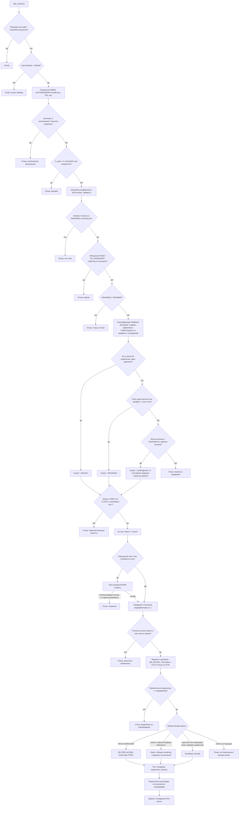

# Исследование: безопасное чтение и замена текста активного поля в Windows 10/11

Статус: **исследование (Research, этап 0)** · Автор: System Architect (Agent 03) · Дата: 2026-11-09 · Ветка: `research/phase-1`
Связанные решения: D-03, D-04, D-05, D-12, D-13, D-14 · Угрозы: T-04…T-08, T-15

**Редакция 2026-11-10 (BL-ARCH-01):** внесены исправления из `review-arch-on-security.md` §2 (п. 4–7; метки `[испр. N]`) по решениям CISO Q-1 и X-4 (`docs/SECURITY_REVIEW.md` §4). Действующая архитектура — `docs/SYSTEM_ARCHITECTURE.md`.

## 0. Как читать этот документ

Каждое утверждение помечено:

| Метка | Значение |
|-------|----------|
| **[DOC]** | Документировано официально; ссылка приведена. |
| **[SRC]** | Проверено по исходному коду продукта (Chromium, Qt, Tauri и т.п.); ссылка на файл. |
| **[WR]** | Широко известно в сообществе (форумы, баг-трекеры, статьи), официальной документации нет. |
| **[HYP]** | Гипотеза. **Требует теста** (в S-2 на CI или при ручной приёмке владельцем). |
| **[VER-C]** | Проверено мной компиляцией на этом хосте (`cargo +1.97.0 check --target x86_64-pc-windows-msvc`), т.е. сигнатура API существует; поведение **не** проверено. |

**Ограничения исследования (честно).**
- `learn.microsoft.com` и `developer.chrome.com` недоступны из облачной сессии (DNS блок). Документация Microsoft прочитана по **исходникам тех же страниц** в репозиториях `MicrosoftDocs/sdk-api` и `MicrosoftDocs/win32` (raw.githubusercontent.com). В ссылках ниже даны канонические URL learn.microsoft.com — содержимое сверено по исходнику, а не по отрендеренной странице.
- Блог Chrome о UIA прочитан только через выдачу поиска (не открыт) — помечено как **UNVERIFIED** там, где это важно; поведение Chromium дополнительно проверено по исходному коду.
- Ни одно утверждение о поведении реальных приложений **не проверено запуском** — Windows здесь нет. Всё, что касается конкретных программ, — [WR] или [HYP], пока S-2 и ручная приёмка не покажут обратное.
- Сигнатуры всех используемых Win32/UIA-вызовов проверены компиляцией пробника на `windows = 0.62.2` (см. §9.6) — [VER-C].

---

## 1. Резюме (вердикт)

**Гарантировать безопасную замену «всего поля» во всех программах невозможно.** Возможно — для известного набора семейств, где (а) UI Automation отдаёт текст поля и позволяет выделить диапазон программно, (б) выделение можно **проверить повторным чтением** до записи, (в) запись выполняется одним из методов с предсказуемым Undo. Во всех остальных случаях правильное поведение — **отказ без изменений** (это и есть «безопасно» в смысле ТЗ §7).

Ключевая идея предлагаемого алгоритма: **«выделить → перечитать выделение → сравнить с ожидаемым → только тогда писать»**. Слепой Ctrl+A не нужен там, где работает `IUIAutomationTextRange::Select`; Ctrl+A остаётся последним резервом (D-04) и тоже проходит ту же проверку.

| Семейство | Чтение поля | Выделение без Ctrl+A | Рекомендуемая запись | Undo одним шагом | Вердикт v1 |
|-----------|------------|----------------------|----------------------|------------------|-----------|
| Win32 Edit / RichEdit (Notepad Win10, диалоги) | Да: UIA (MSAA/Win32 proxy) или `WM_GETTEXT` [DOC] | Да: `EM_SETSEL` [DOC] / UIA `Select` [HYP] | `EM_REPLACESEL(fCanUndo=TRUE)` [DOC] | Да для `EM_REPLACESEL` [DOC]; многоуровневость — нет (Edit) [WR] | **Поддерживать** (высокая уверенность) |
| Win11 Notepad (новый) | UIA TextPattern [WR] | UIA `Select` [HYP] | Paste или SendInput [HYP] | [HYP] | Поддерживать после S-2/ручной приёмки; многострочный → D-03 «последний фрагмент» |
| Chromium/Edge, `<input>`/`<textarea>` | UIA Edit + TextPattern + ValuePattern [SRC] | UIA `Select` [SRC реализовано; поведение HYP] | Paste или SendInput [HYP] | [HYP] (Blink объединяет набор) | **Поддерживать** (средне-высокая) |
| Chromium contenteditable (Discord, WhatsApp/WebView2, Slack, веб-мессенджеры) | UIA TextPattern; ControlType = Edit только при `role="textbox"`, иначе Group [SRC] | UIA `Select` [HYP] | Paste [HYP] | [HYP] | Поддерживать **только по профилю** после проверки; отказ при встроенных объектах (mentions, emoji-картинки) |
| Firefox | Native UIA по умолчанию с Firefox 143 (план Mozilla) [WR] | [HYP] | Paste/SendInput [HYP] | [HYP] | Экспериментально; только после ручной приёмки |
| Qt (Telegram Desktop) | Qt UIA backend: TextPattern, ValuePattern, IsPassword [SRC]; фактическая экспозиция поля Telegram — [HYP] | Qt `Select` реализован через `addSelection` [SRC] | Paste/SendInput [HYP] | [HYP] | Экспериментально, ручная приёмка обязательна |
| Word | UIA Document + TextPattern [WR] | Выделение диапазона через UIA [HYP] | Только **выделение пользователя** или «последний фрагмент»; Ctrl+A запрещён (T-07) | Word группирует ввод [WR] | Только выделение/фрагмент |
| Excel | Режим правки ячейки — [HYP]; вне режима — ячейка (DataItem) | — | — | — | **Отказ** вне режима правки; режим правки — экспериментально |
| Консоль / Windows Terminal | UIA отдаёт буфер, а не «поле» [WR] | Нет | — | Нет | **Отказ** (исключение по умолчанию, D-05) |
| UWP/WinUI (XAML TextBox/RichEditBox) | UIA нативно [WR] | UIA `Select` [HYP] | Paste/SendInput [HYP] | [HYP] | Поддерживать после S-2 (WPF/WinUI фикстура) |
| Окна с повышенными правами | UIA/SendInput/сообщения блокируются UIPI [DOC] | — | — | — | **Отказ** (D-05) |
| Secure desktop (UAC, экран блокировки) | Недоступно [DOC] | — | — | — | **Отказ** |

---

## 2. Что значит «безопасно» — инварианты операции

Предлагаю зафиксировать инварианты, которые проверяются тестами и ревью (основа для GATE 5):

- **I-1 (нет побочных эффектов до записи).** До фазы Write ни поле, ни буфер обмена, ни раскладка не изменены. Любая ошибка до Write → `Abort(reason)`, и мир выглядит так, будто горячую клавишу не нажимали. Единственное допустимое изменение до Write — **выделение** в целевом поле (см. I-6).
- **I-2 (тот же объект).** Запись выполняется только в тот элемент, который был прочитан: совпадают HWND верхнего окна, HWND фокуса, PID **и время старта процесса** (защита от переиспользования PID), UIA RuntimeId / `CompareElements` (T-06).
- **I-3 (тот же текст).** Непосредственно перед записью текст области перечитывается; его хеш (ключ хеша случайный на операцию, в памяти) должен совпасть с прочитанным при анализе. Иначе — пользователь продолжил печатать → отказ.
- **I-4 (то самое выделение).** После программного выделения текст выделения перечитывается и должен совпасть с ожидаемым диапазоном. Иначе — отказ (запись не начинается).
- **I-5 (без паролей).** Признак пароля проверяется **до чтения** текста: UIA `IsPassword`, стиль `ES_PASSWORD` для Win32 Edit. Неопределённость (свойство не получено) = отказ (T-08).
- **I-6 (выделение — единственное допустимое «предварительное» изменение).** При отказе после выделения KeySwitch **не** пытается восстановить исходное выделение/курсор (ТЗ §8 запрещает отдельный механизм курсора). Это осознанный компромисс; см. вопрос Q-A1 владельцу.
- **I-7 (буфер).** Буфер либо не трогается вовсе, либо восстанавливается в исходное состояние **только** при подтверждённом сигнале потребления и пост-проверке, если его не изменил кто-то другой; без сигнала — не восстанавливается, пользователю доступно «Вернуть буфер» (решение CISO Q-1) [испр. 4]; если исходное содержимое нельзя сохранить без потерь (формат вне белого списка) — путь через буфер не используется (T-05).
- **I-8 (ограниченное время).** Каждая операция имеет дедлайн (предложение: 1,5 с без учёта диалога смешанного текста); каждый вызов UIA/сообщения — свой таймаут. Превышение до Write → отказ.
- **I-9 (без текста в логах).** Текст живёт только в `UserText` (zeroize при drop), в журнал — только метаданные (T-09).

---

## 3. Механизмы доступа к полю

### 3.1 UI Automation (основной механизм)

**Получение элемента.** `IUIAutomation::GetFocusedElement` возвращает элемент с фокусом ввода; может вернуть `UIA_E_ELEMENTNOTAVAILABLE`, если элемент исчез, — клиент должен обрабатывать это (например, повтором) [DOC: [GetFocusedElement](https://learn.microsoft.com/en-us/windows/win32/api/uiautomationclient/nf-uiautomationclient-iuiautomation-getfocusedelement)].

**Свойства, нужные политике** (все — `Current*`, без кэша):
- `CurrentControlType` — Edit / Document / Group / Text / DataItem / Custom.
- `CurrentIsPassword` — «элемент содержит замаскированный пароль» [DOC: [IsPassword](https://learn.microsoft.com/en-us/windows/win32/api/uiautomationclient/nf-uiautomationclient-iuiautomationelement-get_currentispassword)]. Для Edit control type обязан быть TRUE у полей паролей, а `Value` при `IsPassword=TRUE` обязан возвращать ошибку [DOC: [Edit Control Type](https://learn.microsoft.com/en-us/windows/win32/winauto/uiauto-supporteditcontroltype)]. **Это требование к провайдеру, а не гарантия**: кастомные поля паролей (canvas, кастомные контролы) могут его не выставлять → дополнительные эвристики (§6, R-05).
- `CurrentProcessId`, `CurrentNativeWindowHandle`, `GetRuntimeId` — RuntimeId «уникален только в пределах рабочего стола и может переиспользоваться со временем», формат непрозрачен, использовать только для сравнения [DOC: [GetRuntimeId](https://learn.microsoft.com/en-us/windows/win32/api/uiautomationclient/nf-uiautomationclient-iuiautomationelement-getruntimeid)]. Поэтому RuntimeId — только одна из составляющих отпечатка (I-2), плюс `IUIAutomation::CompareElements`.
- `ValuePattern.CurrentIsReadOnly`, `IsEnabled` — `SetValue` требует `IsEnabled=TRUE` и `IsReadOnly=FALSE` [DOC: [SetValue](https://learn.microsoft.com/en-us/windows/win32/api/uiautomationclient/nf-uiautomationclient-iuiautomationvaluepattern-setvalue)]. Мы используем `IsReadOnly` как условие отказа, а сам `SetValue` для записи не используем (D-12).

**Edit vs Document.** По спецификации Edit — «однострочный контрол, только для небольших объёмов текста», Document — многостраничный форматированный текст [DOC: [Edit](https://learn.microsoft.com/en-us/windows/win32/winauto/uiauto-supporteditcontroltype), [Document](https://learn.microsoft.com/en-us/windows/win32/winauto/uiauto-supportdocumentcontroltype)]. **На практике ControlType не надёжен как признак однострочности:** Chromium отдаёт `UIA_EditControlTypeId` и для `<input>`, и для `<textarea>` (роль `kTextField`) [SRC: [ax_platform_node_win.cc](https://github.com/chromium/chromium/blob/main/ui/accessibility/platform/ax_platform_node_win.cc)], а contenteditable без ARIA-роли — `UIA_GroupControlTypeId` (роль `kGenericContainer`) при том, что TextPattern у него есть (`IsTextField()` истинно для non-atomic text field root) [SRC: там же и [ax_node_data.cc](https://github.com/chromium/chromium/blob/main/ui/accessibility/ax_node_data.cc)]. Qt отдаёт Edit для `QAccessible::EditableText`, но **подменяет на Text**, если в приложении отключена системная экранная клавиатура или используется свой IM-модуль [SRC: [qwindowsuiautils.cpp](https://github.com/qt/qtbase/blob/dev/src/plugins/platforms/windows/uiautomation/qwindowsuiautils.cpp)]. Отсюда предложение уточнить D-04 (§10, P-02).

**TextPattern / TextPattern2.**
- `DocumentRange` — диапазон «основного текста документа»; вспомогательный текст (колонтитулы, сноски) может не входить [DOC: [DocumentRange](https://learn.microsoft.com/en-us/windows/win32/api/uiautomationclient/nf-uiautomationclient-iuiautomationtextpattern-get_documentrange)].
- `GetSelection` — массив диапазонов; при одном выделении — один; при каретке без выделения — вырожденный диапазон в позиции каретки; `NULL`, если каретки нет или выделение не поддерживается; поддержку проверять через `SupportedTextSelection` [DOC: [GetSelection](https://learn.microsoft.com/en-us/windows/win32/api/uiautomationclient/nf-uiautomationclient-iuiautomationtextpattern-getselection)]. **Несколько диапазонов (мультивыделение) → отказ.**
- `GetText(maxLength)` — плоский текст диапазона, усечённый до `maxLength` [DOC: [GetText](https://learn.microsoft.com/en-us/windows/win32/api/uiautomationclient/nf-uiautomationclient-iuiautomationtextrange-gettext)]. Используем `GetText(5001)`: если вернулось 5001 символов — превышение лимита D-03, отказ **без чтения остального** (меньше пользовательских данных в памяти).
- `Select` — выделяет диапазон и снимает прежнее выделение; на вырожденном диапазоне ставит каретку [DOC: [Select](https://learn.microsoft.com/en-us/windows/win32/api/uiautomationclient/nf-uiautomationclient-iuiautomationtextrange-select)]. **Это и есть «выделение всего поля без Ctrl+A»:** `DocumentRange.Select()`.
- `TextPattern2::GetCaretRange(&isActive)` — вырожденный диапазон в каретке; при `isActive=FALSE` каретка контрола может не совпадать с системной [DOC: [GetCaretRange](https://learn.microsoft.com/en-us/windows/win32/api/uiautomationclient/nf-uiautomationclient-iuiautomationtextpattern2-getcaretrange)]. `isActive=FALSE` → отказ.
- `ExpandToEnclosingUnit(TextUnit_Paragraph)` — «нормализует» диапазон до единицы; **если единица не поддерживается — берётся следующая большая**; учитывается и **скрытый текст** [DOC: [ExpandToEnclosingUnit](https://learn.microsoft.com/en-us/windows/win32/api/uiautomationclient/nf-uiautomationclient-iuiautomationtextrange-expandtoenclosingunit)]. Следствия: (а) для «последнего фрагмента до разрыва строки» (D-03) берём Paragraph, а не Line (Line у многих провайдеров = визуальная строка с переносом) [HYP]; (б) провайдер без Paragraph отдаст Page/Document — поэтому длину и наличие `\n` проверяем сами, а если диапазон «расширился» до документа при многострочном тексте — отказ; (в) скрытый текст Word может попасть в диапазон → для Word только выделение пользователя.
- `GetChildren()` на диапазоне — встроенные объекты (картинки, ссылки, «пилюли» упоминаний). **Непустой список → отказ замены всего поля** (иначе плоский текст уничтожит упоминание/эмодзи-картинку) [HYP — поведение конкретных редакторов; API — DOC: [Embedded objects](https://learn.microsoft.com/en-us/windows/win32/winauto/uiauto-textpattern-and-embedded-objects-overview)]. Также отказ, если текст содержит U+FFFC (object replacement character).

**Потоки и COM.** Для клиента, который может обращаться и к собственному UI, все вызовы UIA делать **из отдельного потока, который не владеет окнами и инициализирован как MTA** (`CoInitializeEx(COINIT_MULTITHREADED)`); STA для обработчиков событий вызывает проблемы; элементы, маршалированные между квартирами, могут инвалидироваться при закрытии исходной квартиры [DOC: [Understanding Threading Issues](https://learn.microsoft.com/en-us/windows/win32/winauto/uiauto-threading)]. Главный поток Tauri — STA с окнами WebView2, поэтому UIA там запрещён. Решение — выделенный MTA-поток операций (см. архитектуру v2 §4).

**Таймауты.** `IUIAutomation2::ConnectionTimeout` (по умолчанию 2 с) и `TransactionTimeout` (по умолчанию **20 с**) [DOC: [ConnectionTimeout](https://learn.microsoft.com/en-us/windows/win32/api/uiautomationclient/nf-uiautomationclient-iuiautomation2-put_connectiontimeout), [TransactionTimeout](https://learn.microsoft.com/en-us/windows/win32/api/uiautomationclient/nf-uiautomationclient-iuiautomation2-put_transactiontimeout)]. 20 с недопустимо для горячей клавиши → устанавливаем ~500 мс / ~1000 мс, плюс сторожевой таймер операции (I-8). Объект создаётся через `CUIAutomation8` (Windows 8+), чтобы был доступен `IUIAutomation2` [VER-C].

**Особенности Chromium.** Chromium включает нативный UIA по умолчанию с Chrome 138 (статья Chrome for Developers от 14.08.2025, прочитана только через выдачу поиска — **UNVERIFIED**: [windows-uia-support-update](https://developer.chrome.com/blog/windows-uia-support-update)). Дерево доступности строится лениво при появлении клиента; первый запрос может вернуть неполное дерево [WR]. Предложение: если у элемента Chromium-окна нет TextPattern — одна повторная попытка через 100–150 мс, затем отказ [HYP]. Побочный эффект: включение режима доступности в браузере/Electron повышает его потребление ресурсов [WR] — это затрагивает **чужие** приложения, поэтому KeySwitch не должен держать подписки на события UIA и обращается к UIA только по горячей клавише.

### 3.2 MSAA / IAccessible (резерв, только чтение)

Для приложений без UIA-провайдера UIA сам использует прокси MSAA→UIA [WR; страница о прокси в MicrosoftDocs не найдена по ожидаемому пути — UNVERIFIED]. `IAccessible::get_accValue` у стандартного Edit отдаёт текст, но **нет диапазонов, выделения и надёжного признака пароля** (только `STATE_SYSTEM_PROTECTED`) [WR]. Вывод: прямой IAccessible-путь в v1 не нужен — достаточно того, что UIA сам проксирует MSAA. Если элемент виден только через MSAA-прокси и у него нет TextPattern — отказ (кроме Win32 Edit, у которого есть §3.3).

### 3.3 Сообщения Win32 Edit/RichEdit (межпроцессно)

- `WM_GETTEXT` для Edit возвращает содержимое контрола; у RichEdit для текста > 64K нужны `EM_STREAMOUT`/`EM_GETSELTEXT` [DOC: [WM_GETTEXT](https://learn.microsoft.com/en-us/windows/win32/winmsg/wm-gettext)]. Лимит 5 000 символов делает 64K неактуальным.
- `EM_SETSEL(0, -1)` выделяет весь текст контрола [DOC: [EM_SETSEL](https://learn.microsoft.com/en-us/windows/win32/controls/em-setsel)] — **это документированное «выделить всё» без Ctrl+A**.
- `EM_REPLACESEL(wParam=TRUE, text)` — замена выделения; `wParam` определяет, можно ли отменить операцию [DOC: [EM_REPLACESEL](https://learn.microsoft.com/en-us/windows/win32/controls/em-replacesel)]. Это единственный метод записи с **документированной** отменяемостью. В RichEdit замена берёт формат первого символа выделения [DOC: там же].
- **Межпроцессность.** Сообщения системного диапазона (< `WM_USER`) с указателями маршалируются системой между процессами; `EM_SETSEL`, `EM_REPLACESEL`, `WM_GETTEXT` — в этом диапазоне. Сообщения RichEdit в диапазоне `WM_USER+n` с указателями (`EM_EXSETSEL`, `EM_GETTEXTEX`, `EM_SETTEXTEX`) **не маршалируются** — для них нужен `VirtualAllocEx/WriteProcessMemory` в чужом процессе, что по сути инъекция и **запрещено** (CLAUDE.md п.8) [WR]. Используем только стандартные `EM_*`/`WM_*`.
- Отправка — только `SendMessageTimeout(SMTO_ABORTIFHUNG, ≤200 мс)` [VER-C], иначе зависшее приложение подвесит KeySwitch.
- Сообщения подчиняются UIPI: окно с более высоким уровнем целостности их не примет [WR; для `SendInput` — DOC, §5.1].
- Пароль: стиль `ES_PASSWORD` проверяется через `GetWindowLongPtr(GWL_STYLE)` до любых чтений; кроме того, Edit с `ES_PASSWORD` не отдаёт текст `WM_GETTEXT` из чужого процесса [WR].
- Применимость: только окна, чей **реальный** класс (`RealGetWindowClass`) — `Edit` или `RICHEDIT50W`/`RichEdit20W` и т.п., и только если HWND фокуса совпадает с HWND UIA-элемента. Суперклассированные/сабклассированные контролы могут перехватывать сообщения [HYP].

### 3.4 Вставка через буфер обмена (Ctrl+V через SendInput)

- Плюсы: одна операция вставки = как правило один шаг Undo [WR]; переносы строк вставляются как текст, а не как Enter (важно для чатов, где Enter отправляет сообщение); скорость не зависит от длины.
- Минусы: риски T-04/T-05 и гонка «восстановили буфер раньше, чем приложение его прочитало» (вставится старое содержимое!). Детали и защита — §5.7–5.10.
- `Ctrl+V` посылается виртуальными кодами (`VK_CONTROL`, `'V'`); для US/RU раскладок VK буквенных клавиш совпадают [WR]. Терминалы используют иные сочетания — они исключены (D-05).
- В Word/RichEdit вставка `CF_UNICODETEXT` принимает форматирование места вставки; Word может применить «умные пробелы» при вставке [WR] → для Word предпочтителен ввод (SendInput) для коротких фрагментов.

### 3.5 Ввод через `SendInput` + `KEYEVENTF_UNICODE`

- С флагом `KEYEVENTF_UNICODE` система кладёт в очередь потока переднего плана `WM_KEYDOWN/UP` с `VK_PACKET`; после `TranslateMessage` приложение получает `WM_CHAR` с символом [DOC: [KEYBDINPUT](https://learn.microsoft.com/en-us/windows/win32/api/winuser/ns-winuser-keybdinput)]. Символы вне BMP — пара суррогатов, два события [DOC: там же, ссылка на surrogates].
- События `SendInput` вставляются в поток ввода последовательно и не перемежаются с вводом пользователя или других `SendInput` [DOC: [SendInput](https://learn.microsoft.com/en-us/windows/win32/api/winuser/nf-winuser-sendinput)]; **но** функция не сбрасывает текущее состояние клавиатуры — нажатые клавиши вмешиваются, состояние надо проверять через `GetAsyncKeyState` [DOC: там же] → ожидание отпускания модификаторов (§5.6).
- Подчиняется UIPI: ввод только в приложения равного или меньшего уровня целостности [DOC: там же].
- Плюсы: не трогает буфер. Минусы: (а) **гранулярность Undo зависит от приложения** — набор может откатываться посимвольно/по словам [HYP; Blink и Word объединяют набор — WR]; (б) **перевод строки нельзя «набрать» безопасно**: `VK_RETURN` в поле чата отправит сообщение, а `U+000A` через `VK_PACKET` приложения трактуют по-разному [HYP] → текст с `\n` через SendInput не вводим; (в) длинные строки медленные и уязвимы к смене фокуса посреди ввода; (г) приложения, которые читают `WM_KEYDOWN` вместо `WM_CHAR` (игры, некоторые кастомные редакторы), игнорируют `VK_PACKET` [WR]; (д) при активном IME (китайский/японский и т.п.) поведение `VK_PACKET` не определено → отказ, если HKL окна — IME [HYP].
- Первый набранный символ заменяет выделение; будет ли «удаление выделения + набор» одним шагом Undo — [HYP] для каждого семейства.

### 3.6 Семантика Ctrl+A

Ctrl+A — **не системная** команда, а горячая клавиша конкретного приложения: в браузере вне поля выделяет всю страницу, в Word — весь документ, в Excel — лист/диапазон, в консоли — буфер, в Win32 Edit поддержка Ctrl+A зависит от версии comctl/приложения (Notepad обрабатывает её как акселератор меню) [WR]. Поэтому:
1. Ctrl+A используется **только** если UIA-выделение недоступно (`SupportedTextSelection = None` или `Select` вернул ошибку), и только при условиях D-04;
2. после Ctrl+A выделение **обязательно перечитывается** и сравнивается с текстом поля (I-4); несовпадение → отказ;
3. для Document, Group, DataItem, Custom и любых окон из списка «опасных» (Word, Excel, браузерная страница вне поля) Ctrl+A запрещён.

### 3.7 Сравнение методов записи

| Метод | Undo | Буфер | `\n` | Длина | Межпроцессные риски | Где применим |
|-------|------|-------|------|-------|---------------------|--------------|
| W1 `EM_REPLACESEL(TRUE)` | Документирован [DOC] | Не трогает | Да | Любая (≤5000) | Только Win32 Edit/RichEdit, UIPI | Классические Edit/RichEdit |
| W2 Paste (буфер, delayed rendering) | Обычно 1 шаг [WR] | Snapshot/restore | Да | Любая | T-04, T-05, гонки | Почти везде, кроме консоли |
| W3 SendInput Unicode | Зависит от приложения [HYP] | Не трогает | **Нет** | Короткие (≤200, FR-CLIP-1) | Фокус может уйти посреди ввода | Короткий однострочный текст |
| W4 `ValuePattern.SetValue` | Обычно стирает историю Undo [WR] | Не трогает | Да | Любая | React/контролируемые инпуты могут откатить значение [HYP] | **Не использовать** (D-12) |

Про W4 и React: `SetValue` в Chromium реализован через accessibility-действие установки значения; генерируется ли событие `input`, которое ждёт React (иначе контролируемый компонент при следующем рендере вернёт старое значение) — [HYP]. Это ещё один довод за D-12.

---

## 4. Анализ по семействам приложений

Для каждого: что отдаёт UIA, надёжность чтения, выделение без Ctrl+A, лучший метод записи, Undo, риски.

### 4.1 Классические Win32 Edit / RichEdit (Notepad Windows 10, поля диалогов, многие старые программы)

- **UIA:** через встроенные прокси Win32-контролов: TextPattern, ValuePattern (для Edit), IsPassword по `ES_PASSWORD` [WR]. Многострочный Edit Notepad'а, по сообщениям, отдаётся как **Document** («Text Editor») [HYP — проверить Inspect-эквивалентом в S-2].
- **Чтение всего поля:** надёжно — `WM_GETTEXT` (через `SendMessageTimeout`) или UIA `DocumentRange.GetText` [DOC].
- **Выделение:** `EM_SETSEL(0,-1)` [DOC] или `EM_SETSEL(start,end)` для «последнего фрагмента» (смещения в UTF-16 единицах, CRLF = 2) [DOC для семантики; расчёт — наш].
- **Запись:** W1 `EM_REPLACESEL(TRUE)` — без буфера, без ввода, без фокусных гонок.
- **Undo:** операция отменяемая [DOC]; у стандартного Edit одноуровневый Undo [WR] — Ctrl+Z вернёт исходный фрагмент, повторный Ctrl+Z вернёт замену (redo-подобное поведение) [WR].
- **Риски:** сабклассированные Edit с собственной логикой; `EN_CHANGE` и валидация приложения (например, маски ввода) [HYP]; многострочный Notepad → по D-03 только «последний фрагмент».
- **Вердикт:** поддерживать; это эталон для CI (собственное тестовое окно).

### 4.2 Новый Notepad Windows 11

- Упакованное приложение (Microsoft Store); область текста на основе RichEdit с нативным UIA-провайдером, ControlType = Document [WR/HYP]. Вкладки и автосохранение сессии.
- **Чтение:** TextPattern `DocumentRange` — чтение всего документа не требуется и нежелательно (D-03 «последний фрагмент»): `GetCaretRange` → клонировать → `ExpandToEnclosingUnit(Paragraph)` → `MoveEndpointByRange(End, caret, Start)` [VER-C сигнатур; поведение HYP].
- **Выделение:** UIA `Select` [HYP].
- **Запись:** W2 или W3 (класс окна не `Edit` → W1 неприменим) [HYP]. Многоуровневый Undo [WR].
- **Риски:** на GitHub Actions (Windows Server 2025) нового Notepad нет — **только ручная приёмка владельцем**.

### 4.3 Chromium-браузеры (Chrome, Edge) и Electron/WebView2 (Discord, Slack, VS Code — исключать?, WhatsApp Desktop)

- **WhatsApp Desktop:** с июля 2025 (бета) нативное UWP/WinUI-приложение заменено обёрткой WebView2 над web.whatsapp.com [WR: [Windows Latest/Notebookcheck](https://www.notebookcheck.net/WhatsApp-ditches-native-Windows-11-app-in-favor-of-Microsoft-WebView2.1063682.0.html), [AlternativeTo](https://alternativeto.net/news/2025/7/whatsapp-drops-its-uwp-native-app-in-favor-of-a-chromium-web-wrapper-on-windows-11)]; статья июня 2026 исходит из того, что WebView2-версия используется в релизе [WR: [windowslatest.com](https://windowslatest.com/2026/06/13/whatsapp-is-eating-1-2gb-ram-on-windows-11-even-as-microsoft-kills-web-app-slop)]. Официального заявления нет. Итого WhatsApp = семейство Chromium/contenteditable [WR].
- **UIA-маппинг (по исходникам Chromium) [SRC]:**
  - `<input>`, `<textarea>`, `role=textbox` → `UIA_EditControlTypeId`; `role=searchbox` → Edit.
  - contenteditable без роли → `UIA_GroupControlTypeId`, но TextPattern/TextEditPattern предоставляется (условие `IsPlatformDocument() || IsTextField() || IsText()`).
  - `IsPassword` = состояние `kProtected` (т.е. `<input type=password>`).
  - ValuePattern — по `IsValuePatternSupported(delegate)`.
  - Ссылка: [ax_platform_node_win.cc](https://github.com/chromium/chromium/blob/main/ui/accessibility/platform/ax_platform_node_win.cc), [ax_node_data.cc](https://github.com/chromium/chromium/blob/main/ui/accessibility/ax_node_data.cc) (ветка main на 2026-11-09).
- **Чтение всего поля:** `<input>`/`<textarea>` — надёжно через TextPattern/ValuePattern [SRC/HYP]. contenteditable-редакторы (Slate у Discord, Lexical/Draft у других) — текст есть, но с особенностями: упоминания, эмодзи-картинки, невидимые узлы, лишний завершающий `\n` [HYP].
- **Выделение:** `ITextRangeProvider::Select` реализован в Chromium [SRC — существование]; корректность для contenteditable-редакторов, которые сами управляют выделением (Slate), — [HYP].
- **Запись:** W2 (paste) — редакторы Discord/WhatsApp обрабатывают вставку своим кодом (paste-handler), что сохраняет их модель документа и Undo [HYP]. W3 — для коротких однострочных текстов; Enter никогда не посылается. W4 запрещён.
- **Undo:** Blink объединяет последовательный набор в одну команду [WR]; JS-редакторы ведут собственный стек Undo [HYP].
- **Риски:** (1) поле поиска/адресная строка браузера — это Edit в UI браузера, а не страницы; замена в омнибоксе безвредна, но бессмысленна — разрешено; (2) **страница вне поля**: если фокус на `Document` (страница), а не на поле, → отказ (D-04/T-07); (3) первая попытка может не увидеть дерево (§3.1); (4) `textarea` = Edit, но многострочный → «последний фрагмент» (D-03), если профиль не помечает его как поле чата.
- **Вердикт:** `<input>`/`<textarea>` — поддерживать; contenteditable — только приложения из проверенных профилей (Discord, WhatsApp, Slack) после S-2 (Electron-фикстура) и ручной приёмки; неизвестный contenteditable — только «выделение пользователя».

### 4.4 Firefox

- Нативный UIA: намерение включить по умолчанию с Firefox 143 (Intent to ship, август 2025); настройка `accessibility.uia.enable` (0/1/2) [WR: [dev-platform, Intent to ship](https://groups.google.com/a/mozilla.org/g/dev-platform/c/qljNUMTNtyA), [Bugzilla 762769](https://bugzilla.mozilla.org/show_bug.cgi?id=762769)]. Фактический статус в текущем релизе — UNVERIFIED. На runner-образе — Firefox 159.0 [DOC: [Windows2025-Readme](https://github.com/actions/runner-images/blob/main/images/windows/Windows2025-Readme.md)].
- Полнота TextPattern/`Select` в Firefox — [HYP].
- **Вердикт:** экспериментально; CI-тест на локальной HTML-странице в Firefox (он установлен на раннере) + ручная приёмка.

### 4.5 Qt (Telegram Desktop)

- **Qt UIA backend [SRC: [qwindowsuiamainprovider.cpp](https://github.com/qt/qtbase/blob/dev/src/plugins/platforms/windows/uiautomation/qwindowsuiamainprovider.cpp)]:** TextPattern/TextPattern2 — для всех элементов с `textInterface()`; ValuePattern — для всех, кроме StaticText; `IsPassword` = `EditableText && state.passwordEdit`. `Select` реализован как «снять выделения + `addSelection(start,end)`» [SRC: [qwindowsuiatextrangeprovider.cpp](https://github.com/qt/qtbase/blob/dev/src/plugins/platforms/windows/uiautomation/qwindowsuiatextrangeprovider.cpp)].
- **ControlType**: Edit для EditableText, но **Text**, если нативная экранная клавиатура отключена или используется свой IM-модуль [SRC: qwindowsuiautils.cpp]. Telegram собирает Qt статически со своими патчами; поле ввода — собственный `Ui::InputField` поверх `QTextEdit` с `setAccessibleName` [SRC: [lib_ui input_field.cpp](https://github.com/desktop-app/lib_ui/blob/master/ui/widgets/fields/input_field.cpp)]. Многолетняя issue о плохой доступности Telegram Desktop [WR: [tdesktop#476](https://github.com/telegramdesktop/tdesktop/issues/476)]; по сообщениям, в бете 6.9.4 улучшена доступность списка чатов (не поля ввода) [WR].
- **Что реально отдаёт поле Telegram** (ControlType, работает ли `GetText`/`Select`, разметка сущностей) — **[HYP], главный неизвестный для Telegram**.
- **Запись:** W2 предпочтительна (Telegram сам обрабатывает вставку, сохраняет Undo редактора) [HYP]; W3 — короткий текст; Enter никогда. W4 запрещён: `QWindowsUiaValueProvider::SetValue` заменит текст в обход модели сущностей Telegram [HYP].
- **CI:** Telegram на CI недоступен (нужен вход). Проверяем механизм на Qt-фикстуре (PySide6 из PyPI: `QLineEdit`, `QTextEdit`, `QPlainTextEdit`) — это проверяет Qt-бэкенд, но **не Telegram**. Telegram — ручная приёмка.

### 4.6 Microsoft Word

- Тело документа — Document с TextPattern [WR]. Скрытый текст, поля, сноски, отслеживание изменений, встроенные объекты.
- **Политика:** весь документ — никогда (T-07, D-03). Разрешено: (1) **выделение пользователя** (GetSelection, один диапазон, без встроенных объектов, ≤5000); (2) «последний фрагмент» по Paragraph от каретки — [HYP], включать только после ручной приёмки.
- **Запись:** W3 для коротких фрагментов (Word группирует набор в один шаг «Ввод» [WR]); W2 для длинных/с переносами (риск «умных пробелов» и формата вставки [WR]).
- **Undo:** [HYP] — критерий ручной приёмки.
- **CI:** Office на раннере отсутствует [DOC: Windows2025-Readme не содержит Office] → только ручная приёмка.

### 4.7 Microsoft Excel

- Вне режима правки фокус на ячейке (DataItem/«ячейка» сетки) [WR]; ввод символов **заменит содержимое ячейки целиком**, включая формулу; ValuePattern ячейки может отдавать отображаемое значение, а не формулу [HYP]. Это прямой путь к порче данных.
- В режиме правки ячейки (F2) или в строке формул появляется редактируемый элемент [HYP].
- **Политика v1:** если фокус — DataItem/ячейка → **отказ**. Режим правки — экспериментально, только после ручной приёмки (`Edit`, TextPattern, без формулы — текст не начинается с `=`).

### 4.8 Консоль (conhost) и Windows Terminal

- UIA отдаёт **буфер экрана** (TextPattern только для чтения), а не «поле ввода»; граница вводимой строки неизвестна; Ctrl+A/Ctrl+V имеют иную семантику [WR].
- `GetWindowThreadProcessId` для окна консоли возвращает данные, не совпадающие с процессом, реально владеющим окном (conhost) [WR] → определение раскладки ненадёжно.
- **Политика:** исключение по умолчанию (D-05) по классам окон `ConsoleWindowClass`, `CASCADIA_HOSTING_WINDOW_CLASS` и exe (`WindowsTerminal.exe`, `conhost.exe`, `OpenConsole.exe`) [классы — WR].

### 4.9 UWP / WinUI / WPF

- XAML TextBox/RichEditBox и WPF TextBox имеют нативные UIA-провайдеры с TextPattern/ValuePattern; PasswordBox → IsPassword [WR].
- **UWP-особенность:** окно переднего плана — `ApplicationFrameWindow` (процесс ApplicationFrameHost), а контент — `Windows.UI.Core.CoreWindow` другого процесса [WR]. Поэтому PID/поток берём **из UIA-элемента и `GetGUIThreadInfo(...).hwndFocus`**, а не из `GetForegroundWindow()`. Раскладка для UWP определяется ненадёжно (§5.5).
- **CI:** WPF-фикстура (PowerShell + PresentationFramework, .NET Framework 4.8 на раннере [DOC: Windows2025-Readme]) проверяет XAML-подобный провайдер; WinUI 3 — по возможности, иначе ручная приёмка.

---

## 5. Системные ограничения

### 5.1 Повышенные права и UIPI
- `SendInput` подчиняется UIPI: ввод только в процессы равного или более низкого уровня целостности [DOC: [SendInput](https://learn.microsoft.com/en-us/windows/win32/api/winuser/nf-winuser-sendinput)].
- Без `uiAccess` приложение работает на Medium IL и **не имеет доступа к UI повышенных процессов**; `uiAccess` требует подписи Authenticode, установки в защищённую папку и предназначен **только для ассистивных технологий** [DOC: [Security Considerations for Assistive Technologies](https://learn.microsoft.com/en-us/windows/win32/winauto/uiauto-securityoverview)]. KeySwitch не является ассистивной технологией → `uiAccess` не используем; элевированные окна — отказ (D-05, NFR-5).
- **Определение:** `OpenProcess(PROCESS_QUERY_LIMITED_INFORMATION)` целевого PID → `OpenProcessToken` → `TokenIntegrityLevel`; если IL цели > нашего или токен не открыт → отказ «elevated/unknown». Дополнительно: ошибка `E_ACCESSDENIED` от UIA трактуется как elevated [HYP].

### 5.2 Secure desktop и блокировка
- UI под SYSTEM IL (UAC consent, вход в систему) недоступен никаким образом, кроме запуска на UAC-рабочем столе под SYSTEM [DOC: uiauto-securityoverview]. Горячие клавиши в это время до нас не доходят [WR].
- Проверка: `OpenInputDesktop` + имя рабочего стола ≠ `Default` или ошибка открытия → отказ [VER-C для вызова; поведение HYP].

### 5.3 Окно выбора языка для смешанного текста и правила переднего плана
- Процесс может вызвать `SetForegroundWindow` только если выполнены все условия (процесс — не UWP, передний процесс не вызывал `LockSetForegroundWindow`, нет активных меню) **и** хотя бы одно из: истёк foreground lock timeout; вызывающий — процесс переднего плана; запущен им; нет окна переднего плана; **вызывающий получил последнее событие ввода**; отладка. Даже при выполнении условий система может отказать [DOC: [SetForegroundWindow](https://learn.microsoft.com/en-us/windows/win32/api/winuser/nf-winuser-setforegroundwindow)].
- Получатель `WM_HOTKEY` обычно считается получившим последнее событие ввода и может активировать своё окно [WR/HYP — критично, тест в S-2].
- **Протокол диалога (решение CISO X-4, заменяет прежний вариант с активацией) [испр. 7]:**
  1. до показа сохранить отпечаток цели (I-2), прочитанный текст и его хеш (I-3);
  2. показать маленькое нативное окно `WS_EX_NOACTIVATE | WS_EX_TOOLWINDOW | WS_EX_TOPMOST` — **без активации**, фокус поля не меняется; окно не показывает текст пользователя;
  3. поток T1 регистрирует временные `RegisterHotKey` для `1`, `2`, `Esc` только на время показа (RAII-guard снимает их на любом выходе, таймаут 10 с); если регистрация любого не удалась — **отмена операции** (никаких хуков как запасного пути);
  4. после выбора — скрыть окно, проверить, что foreground и отпечаток фокуса не изменились (два чтения `GetGUIThreadInfo` подряд совпадают);
  5. **перечитать** область и сравнить хеш (I-3) — пользователь мог печатать, пока окно было показано;
  6. заново проверить выделение (I-4).
- Esc / таймаут / смена foreground = «Отмена». Состояние `Refocus` и исход `CouldNotActivate` упразднены.
- Запасной вариант (активация окна и возврат фокуса через `SetForegroundWindow`) — только если S-2 покажет неработоспособность основного и после повторного одобрения CISO (условия — `SECURITY_REVIEW.md` §4.5).

### 5.4 Повторная проверка цели перед записью
Отпечаток `TargetFingerprint` = {HWND верхнего окна, HWND фокуса (`GetGUIThreadInfo`), PID + время создания процесса, путь exe, RuntimeId, ControlType, класс окна}. Проверка — непосредственно перед Write и **после** каждого «долгого» шага (диалог, ожидание модификаторов). `GetGUIThreadInfo` работает для чужих потоков, но может вернуть неверные HWND, если окно в момент вызова теряет активацию [DOC: [GetGUIThreadInfo](https://learn.microsoft.com/en-us/windows/win32/api/winuser/nf-winuser-getguithreadinfo)] → два чтения подряд должны совпасть.

### 5.5 Раскладка: определение и переключение
- **Определение (D-02, tie-breaker):** `GetKeyboardLayout(idThread)` возвращает HKL указанного потока [DOC: [GetKeyboardLayout](https://learn.microsoft.com/en-us/windows/win32/api/winuser/nf-winuser-getkeyboardlayout)]; поток берём от `hwndFocus`. HKL — «input locale identifier», может обозначать IME [DOC: там же]. С Windows 8 рекомендованный способ узнать язык — WinRT `Language.CurrentInputMethodLanguageTag` [DOC: там же] — он про **наш** процесс, для чужого окна не подходит. Для UWP (CoreWindow в другом процессе) и консоли результат ненадёжен [WR] → tie-breaker = «неизвестно», направление только по составу текста.
- **Переключение (FR-FIELD-6):** `ActivateKeyboardLayout` влияет **только на вызывающий поток/процесс** [DOC: [ActivateKeyboardLayout](https://learn.microsoft.com/en-us/windows/win32/api/winuser/nf-winuser-activatekeyboardlayout)] — для чужого окна бесполезен. Практический способ — `PostMessage(hwndFocus, WM_INPUTLANGCHANGEREQUEST, 0, hkl)`. По документации это сообщение **система** посылает окну с фокусом, а приложение принимает смену, передавая его в `DefWindowProc` (или отвергает, не передавая) [DOC: [WM_INPUTLANGCHANGEREQUEST](https://learn.microsoft.com/en-us/windows/win32/winmsg/wm-inputlangchangerequest)]. Отправка этого сообщения **сторонним** процессом не документирована как API, но широко используется переключателями раскладок [WR]. Следствия: приложение вправе отказаться; UIPI блокирует для элевированных окон; для UWP/консоли — [HYP].
- Выбор HKL: из `GetKeyboardLayoutList` — HKL с языком цели; при нескольких (например, «Русская (машинопись)») — тот, чей KLID соответствует таблице раскладки ks-core (`00000419`). Нет подходящей раскладки → не переключать, записать в диагностику.
- Проверка: через 100 мс `GetKeyboardLayout(tid)`; несовпадение → только диагностика (замена уже выполнена, откатывать её нельзя).
- Режим «своя раскладка для каждого окна» (настройка Windows) влияет на то, глобально ли переключение [WR] — тест в ручной приёмке.

### 5.6 Ожидание отпускания модификаторов
- В момент `WM_HOTKEY` пользователь держит модификаторы. `SendInput` не сбрасывает состояние клавиатуры [DOC] → Ctrl+V при зажатом Alt превратится в Ctrl+Alt+V, набор символов при зажатом Ctrl — в сочетания клавиш.
- Алгоритм: опрашивать `GetAsyncKeyState` для `VK_(L|R)(CONTROL|SHIFT|MENU)`, `VK_LWIN/RWIN` и не-модификаторной клавиши сочетания каждые 10 мс; таймаут 1 с → отказ (FR-HK-4). **Не** «отпускать» модификаторы синтетическими key-up (рассинхронизация состояния) [WR].
- **Ловушка Alt:** если сочетание состоит из Alt + клавиша, то после отпускания Alt без других нажатий Win32-приложения активируют строку меню (классическая проблема, которую AutoHotkey решает «маскирующей» клавишей) [WR]. Наш последующий ввод уйдёт в меню. Предложения: (а) не предлагать по умолчанию сочетания только с Alt; (б) перед записью проверять, что фокус всё ещё в поле (I-2) — меню-режим заберёт фокус [HYP]; (в) Win в сочетаниях запретить: сочетания с Win «зарезервированы ОС» [DOC: [RegisterHotKey](https://learn.microsoft.com/en-us/windows/win32/api/winuser/nf-winuser-registerhotkey)], а отпускание Win открывает меню Пуск [WR].

### 5.7 Ограничения `RegisterHotKey` (D-14)
По документации [DOC: [RegisterHotKey](https://learn.microsoft.com/en-us/windows/win32/api/winuser/nf-winuser-registerhotkey)]:
- `WM_HOTKEY` приходит в очередь окна или, при `hWnd=NULL`, потока, который регистрировал; регистрация из чужого потока для окна — ошибка → регистрация и цикл сообщений — в одном выделенном потоке.
- Обычно ошибка, если сочетание уже занято; некоторые системные сочетания (PrintScreen) могут быть перекрыты при переднем окне приложения → FR-HK-3: ошибка регистрации = конфликт.
- F12 зарезервирован отладчиком — не регистрировать.
- `MOD_NOREPEAT` — без автоповтора (обязательно, иначе удержание = серия операций).
- id 0x0000–0xBFFF для приложения.
- Коды VK зависят от раскладки для некоторых языков (AZERTY/QWERTZ) [HYP] — в UI показывать сочетание по физической клавише текущей раскладки.

### 5.8 Буфер обмена: исключение из истории и облака (D-13)
Зарегистрированные форматы [DOC: [Clipboard Formats → Cloud Clipboard and Clipboard History Formats](https://learn.microsoft.com/en-us/windows/win32/dataxchg/clipboard-formats)]:
- `ExcludeClipboardContentFromMonitorProcessing` — любые данные в этом формате исключают **все** форматы из истории и синхронизации;
- `CanIncludeInClipboardHistory` — DWORD 0 запрещает историю (на синхронизацию не влияет);
- `CanUploadToCloudClipboard` — DWORD 0 запрещает синхронизацию (на историю не влияет).
Ставим все три (первый — пустые данные 0 байт или 1 байт; второй и третий — DWORD 0). Сторонние мониторы буфера (менеджеры буфера) **не обязаны** соблюдать эти форматы [HYP] — остаточный риск T-04.

### 5.9 Snapshot / restore буфера и delayed rendering
- **Snapshot (белый список) [испр. 5]:** `OpenClipboard` (с повторами: буфер может быть занят другим процессом; `GetOpenClipboardWindow` показывает, кем [DOC]) → `EnumClipboardFormats` **без чтения данных** → читаются только форматы белого списка: `CF_UNICODETEXT`, `CF_TEXT`/`CF_OEMTEXT` (если нет `CF_UNICODETEXT`), `CF_LOCALE`, зарегистрированные «HTML Format», «Rich Text Format», метки D-13. Суммарный лимит **16 МБ**. Наличие любого другого формата (чужие OLE/приватные/GDI, изображения, файлы) → путь W2 **запрещён** (а не «частичное» восстановление).
- **Синтезированные форматы** (например `CF_TEXT` из `CF_UNICODETEXT`) система порождает сама [DOC: Clipboard Formats → Synthesized] — сохраняем только «исходные» [HYP по точному списку].
- **Невосстановимые:** `CF_OWNERDISPLAY`, `CF_DSP*`, частные GDI-форматы (`CF_PRIVATEFIRST…`, `CF_GDIOBJFIRST…`) — данные частных форматов система не освобождает и не может скопировать за владельца [DOC: [Clipboard Operations](https://learn.microsoft.com/en-us/windows/win32/dataxchg/clipboard-operations)]. Их наличие → путь W2 запрещён (FR-CLIP-3).
- **Delayed rendering чужого владельца:** `GetClipboardData` по формату с отложенной отрисовкой заставляет владельца отрисовать данные через `WM_RENDERFORMAT`; при тяжёлых данных владелец «зависает» на время отрисовки [DOC: Clipboard Operations → Delayed Rendering Guidance]. Значит snapshot может блокироваться **без таймаута**. Защита: (а) `IsHungAppWindow(GetClipboardOwner())` до snapshot; (б) snapshot в рабочем потоке со сторожевым дедлайном (300 мс) — превышение → отказ от W2, переход к W3 или отказ; (в) лимит суммарного размера snapshot **16 МБ** — больше → W2 запрещён [испр. 5]. **Честная оговорка:** если чужой владелец держит данные в отложенной отрисовке, наш snapshot заставляет его отрисовать их (побочный эффект в чужом процессе) и может зависнуть — поэтому при `IsHungAppWindow` или превышении дедлайна W2 не используется, а «отравленный» поток не выполняет побочных эффектов (шлюз поколений).
- **Чувствительное содержимое:** если исходный буфер сам помечен `ExcludeClipboardContentFromMonitorProcessing`/`CanIncludeInClipboardHistory=0` (так делают менеджеры паролей) — путь W2 **запрещён**: менеджер паролей часто очищает буфер по таймеру, проверяя, что владелец/содержимое не изменились; после нашего restore владельцем станем мы, и таймер очистки может не сработать — пароль останется в буфере дольше [HYP — сценарий для Security Analyst].
- **Restore** (только при условиях §5.10) [испр. 5]: `OpenClipboard` → сравнение `GetClipboardSequenceNumber` с ожидаемым **под открытым буфером** (иначе гонка с другим процессом) → `EmptyClipboard` → `SetClipboardData` всех сохранённых форматов **вместе с перенесёнными метками D-13 исходного элемента**. Восстановленный элемент сам может попасть в историю Win+V как дубликат → при restore добавляем `CanIncludeInClipboardHistory=0` и `CanUploadToCloudClipboard=0` **только если** исходный элемент этого не запрещал явно (не трогаем, если там было значение 1) [HYP по поведению истории — тест вручную].

### 5.10 Номер последовательности буфера и гонки
- `GetClipboardSequenceNumber` увеличивается при каждом изменении или очистке буфера; при **отложенной** отрисовке номер не увеличивается, пока изменения не отрисованы [DOC: [GetClipboardSequenceNumber](https://learn.microsoft.com/en-us/windows/win32/api/winuser/nf-winuser-getclipboardsequencenumber)]. Это не механизм уведомлений и не должен использоваться в цикле опроса; для уведомлений — clipboard format listener (`AddClipboardFormatListener` → `WM_CLIPBOARDUPDATE`) [DOC: [Using the Clipboard](https://learn.microsoft.com/en-us/windows/win32/dataxchg/using-the-clipboard)].
- **Главная гонка W2:** после Ctrl+V приложение читает буфер **асинхронно**. Если восстановить буфер слишком рано, вставится **исходное** содержимое пользователя — опасная ошибка (данные пользователя попадут, например, в чат). Фиксированная задержка (как в профилях черновика) не даёт гарантий.
- **Предлагаемое решение — «сигнал потребления» через delayed rendering собственных данных [HYP, центральный тест S-2]:**
  1. кладём в буфер `CF_UNICODETEXT` с `hMem = NULL` (отложенная отрисовка) + форматы исключения (D-13) — с данными;
  2. посылаем Ctrl+V;
  3. ждём `WM_RENDERFORMAT(CF_UNICODETEXT)` в окне-владельце (поток с циклом сообщений!), отдаём текст; фиксируем факт потребления и `GetOpenClipboardWindow()` (кто открыл буфер);
  4. сигнал засчитывается, только если `WM_RENDERFORMAT` пришёл **после** Ctrl+V и окно, открывшее буфер, принадлежит процессу цели (или брокеру, подтверждённому для профиля в S-2, например `msedgewebview2.exe`); `WM_RENDERFORMAT` **до** Ctrl+V → W2 прерван (`ClipboardListenerInterference`), буфер восстановлен (вставки ещё не было), переход к W3 или отказ [испр. 4];
  5. восстановление — **только** при сигнале **и** пост-проверке поля `Yes`, с проверкой seq под `OpenClipboard` [испр. 5]; **нет сигнала (таймаут ≈ 750 мс), сигнал от чужого PID или пост-проверка не `Yes` → НЕ восстанавливать** (решение CISO Q-1): подставить реальные данные вместо отложенных (с метками D-13), операция — `Unverified`, пользователю — уведомление и действие «Вернуть буфер» (снимок в обнуляемой памяти ≤ 120 с или до следующей операции) [испр. 4].
  Оговорки: (а) запрос отрисовки может прийти от монитора буфера, а не от цели — форматы исключения должны отсечь системную историю, сторонние мониторы — [HYP]; поэтому требуем, чтобы запрос пришёл **после** Ctrl+V и от процесса цели/брокера; запрос от процесса-монитора сигналом не считается; (б) WebView2/Chromium читает буфер в **браузерном** процессе (`msedgewebview2.exe`), а не в exe приложения → такой процесс указывается в профиле как брокер, подтверждённый в S-2 [HYP]; (в) при `WM_RENDERALLFORMATS`/уничтожении окна-владельца надо корректно отдать данные [DOC].
- **Пост-проверка записи:** после W1/W2/W3 перечитать область; если текст ≠ ожидаемому — операция помечается «неуверенный результат» в диагностике, раскладка **не** переключается, звуковой сигнал ошибки. Автоматический откат (Ctrl+Z) **не** делаем — он может откатить не то.

---

## 6. Предлагаемый алгоритм принятия решения

### 6.1 Блок-схема



### 6.2 Условия отказа (исчерпывающий список для v1)

| Код | Условие | Когда проверяется |
|-----|---------|-------------------|
| `SecureDesktop` | Входной рабочий стол ≠ Default | до всего |
| `Excluded` | exe/класс окна в списке исключений (менеджеры паролей, терминалы, пользовательский список) | до UIA |
| `Elevated` | IL цели выше нашего или не определён | до UIA |
| `NoFocusedField` | UIA не вернул элемент, таймаут, PID/HWND не согласуются | |
| `Password` | `IsPassword`, `ES_PASSWORD`, свойство недоступно | **до чтения текста** |
| `ReadOnly` | `IsReadOnly` или `!IsEnabled` | до чтения |
| `UnsupportedControl` | ControlType ∈ {DataItem (Excel-ячейка), Custom без TextPattern, Document без выделения пользователя, если профиль не разрешает фрагмент} | до чтения |
| `ScopeUndetermined` | нет выделения, поле многострочное, каретка неактивна/единица не определена | чтение |
| `MultiSelection` | `GetSelection` вернул > 1 диапазона | чтение |
| `TooLong` | > 5000 символов (`GetText(5001)`) | чтение |
| `EmbeddedObjects` | `GetChildren` непуст или U+FFFC | чтение |
| `ImeActive` | HKL окна — IME | до записи |
| `LowConfidence` / `Cancelled` | Low без подтверждения / «Отмена», таймаут 10 с или не удалось зарегистрировать временные хоткеи `1/2/Esc` [испр. 7] | анализ |
| `ModifiersHeld` | модификаторы не отпущены за 1 с | до записи |
| `TargetChanged` | отпечаток или хеш текста изменились | до записи |
| `SelectionNotConfirmed` | перечитанное выделение ≠ ожидаемому | до записи |
| `NoSafeWriteMethod` | W1 неприменим, W3 недопустим (длина/`\n`/профиль), W2 запрещён (невосстановимые/чувствительные/большие данные буфера, владелец завис) | до записи |
| `Timeout` | общий дедлайн операции | везде до записи |
| `NoConsumptionSignal` (исход `Unverified`) | нет `WM_RENDERFORMAT` от процесса цели/брокера после Ctrl+V за таймаут (W2) | запись; буфер **не** восстановлен, исправленный текст остаётся в буфере, действие «Вернуть буфер» 120 с [испр. 4] |
| `ClipboardListenerInterference` | `WM_RENDERFORMAT` пришёл **до** Ctrl+V (сторонний слушатель) | до записи; W2 прерван, буфер восстановлен (вставки ещё не было), переход к W3 или отказ |
| `WriteUnverified` | пост-проверка не подтвердила результат | после записи; раскладка не переключается |

### 6.3 Выбор метода записи (детализация)

```
fn choose_write(field, text, clipboard_probe, profile) -> WriteMethod:
  if field.kind == Win32Edit|Win32RichEdit and field.hwnd == focus_hwnd and same_il: return W1
  let short = text.chars().count() <= profile.sendinput_max   // profile parameter, default 200 [испр. 6]
  let has_nl = text.contains('\n') || text.contains('\r') || text.contains('\t')   // \t moves focus [испр. 6]
  if short && !has_nl && profile.allows_sendinput: return W3
  if clipboard_probe.is_safe() && profile.allows_paste: return W2   // allow-listed formats only, ≤16MB, not sensitive, owner not hung, not remote session
  if short && !has_nl && profile.allows_sendinput_fallback: return W3
  Refuse(NoSafeWriteMethod)
```
Профиль неизвестного приложения: `allows_sendinput = true`, `sendinput_max = 200`, **`allows_paste = false`** [испр. 6], `chat_composer = false`, `fragment_in_document = false`. Порог `sendinput_max` повышается только по замерам S-2 с ревью CISO.

---

## 7. Что проверяемо на CI, а что — только вручную

**GitHub Actions `windows-latest`** = Windows Server 2025 (миграция завершена к 30.09.2025 [WR: [GitHub changelog](https://github.blog/changelog/2025-07-31-github-actions-new-apis-and-windows-latest-migration-notice/)]); образ 20261101: Chrome 156, Edge 156, Firefox 159, Node 22, Python 3.12, PowerShell 7.6, .NET Framework 4.8.1 [DOC: [Windows2025-Readme](https://github.com/actions/runner-images/blob/main/images/windows/Windows2025-Readme.md)]. Office, Telegram, Discord, WhatsApp, Win11-Notepad — **отсутствуют**. В образе отключён запрос согласия UAC для администраторов (`ConsentPromptBehaviorAdmin = 0`) [SRC: [Configure-BaseImage.ps1](https://github.com/actions/runner-images/blob/main/images/windows/scripts/build/Configure-BaseImage.ps1)] — шаги задания, вероятно, выполняются с высоким IL [HYP; S-2 логирует IL].

| Проверка | CI | Ручная (владелец, D-10) |
|----------|----|-------------------------|
| Собственное окно: Edit (single/multi, `ES_PASSWORD`, `ES_READONLY`), RichEdit 5.0 | ✔ полностью | — |
| WPF TextBox / PasswordBox (PowerShell-фикстура) | ✔ | — |
| Qt QLineEdit/QTextEdit (PySide6-фикстура) | ✔ механизм Qt | Telegram — ✔ вручную |
| Edge/Chrome/WebView2: локальная HTML-страница (`input`, `textarea`, `type=password`, contenteditable, contenteditable+`role=textbox`, React-контролируемый инпут) | ✔ (через WebView2-фикстуру или Edge с локальным файлом) | Discord, WhatsApp, Slack — вручную |
| Electron-фикстура (та же страница) | ✔ (electron из npm) | — |
| Firefox с локальной страницей | ✔ экспериментально | ✔ |
| Notepad (классический на Server 2025) | ✔ [HYP: наличие `notepad.exe` классической версии на Server 2025] | Win11 Notepad — вручную |
| Word, Excel | ✘ | ✔ обязательно |
| Undo (Ctrl+Z возвращает исходный текст) | ✔ на фикстурах (Edit, RichEdit, WPF, Chromium) | ✔ на всех эталонных |
| Буфер: форматы исключения присутствуют; restore форматов белого списка (Text/Unicode/HTML/RTF/Locale); отказ W2 при любых других форматах [испр. 5] | ✔ | Win+V история и облако — вручную |
| Delayed rendering «сигнал потребления» | ✔ на фикстурах | ✔ на эталонных |
| Смена фокуса между чтением и записью (T-06) | ✔ скриптом | — |
| Elevated-цель | ✔ при условии, что probe запускается с понижением до Medium IL (см. S-2) [HYP] | ✔ |
| Secure desktop | ✘ (не воспроизводится на раннере) | ✔ (UAC-запрос) |
| Переключение раскладки | ✔ частично (нужно установить RU-раскладку в образ — `Set-WinUserLanguageList` [HYP]) | ✔ |
| Окно выбора языка и правила foreground | ✔ частично (на раннере нет реального пользователя) | ✔ обязательно |
| Ловушка Alt-меню | ✔ на Win32-фикстуре с меню | ✔ |

**Невозможно гарантировать (честно):**
1. Поведение произвольных программ, не входящих в профили (может не быть UIA, может быть некорректный провайдер, может не выставляться `IsPassword`).
2. Что контент-редакторы JS (Slate, Lexical, ProseMirror) после вставки сохранят свою модель документа идентично ручной правке (ссылки, упоминания, форматирование) — только проверка на конкретных версиях приложений; обновления приложений могут сломать поведение без нашего ведома.
3. Что сторонние менеджеры буфера соблюдают форматы исключения.
4. Ctrl+Z одним шагом при W3 и для JS-редакторов.
5. Переключение раскладки в UWP/консоли и при отказе приложения обработать `WM_INPUTLANGCHANGEREQUEST`.
6. Отсутствие гонок при одновременном вводе пользователя — можно лишь обнаружить (I-3, I-4, пост-проверка), но не исключить.

---

## 8. Дизайн спайка S-2 «Windows integration probe»

**Ветка:** `spike/win-uia-probe` · **Роль:** Rust/Windows Dev · **Таймбокс:** 5 рабочих дней · **Зависит от:** каркас CI (уже есть job `windows`).

### 8.1 Цель
Снять риски R-A1…R-A6 (архитектура v2 §9): проверить на реальной Windows (CI) механизмы §3 и алгоритм §6 на собственных фикстурах; получить таблицу фактов «проверено / не проверено» для каждой гипотезы [HYP] этого документа, помеченной как CI-проверяемая.

### 8.2 Состав
```
spike/win-uia-probe/
  crates/ks-platform-win/            # минимальная реализация трейтов (только то, что нужно пробнику)
  tools/ks-probe/                    # консольный бинарь: выполняет сценарии, печатает JSON-отчёт без пользовательского текста
  tests/win-fixtures/
    win32-fixture/   (Rust, windows crate) — окно с Edit (single), Edit (multi), Edit ES_PASSWORD, Edit ES_READONLY,
                      RichEdit50W, меню (для Alt-ловушки); тестовые строки синтетические
    web-fixture/index.html — input, textarea, password, contenteditable, contenteditable role=textbox,
                      «React-подобный» контролируемый input на чистом JS (без React-зависимости), поле с  внутри contenteditable
    webview2-fixture/ (Rust + webview2-com, уже в дереве Tauri) или Tauri-приложение-фикстура
    electron-fixture/ (electron 44.9.3 из npm, dev-only, не входит в продукт)
    wpf-fixture.ps1  (TextBox, PasswordBox, RichTextBox)
    qt-fixture.py    (PySide6: QLineEdit, QLineEdit Password, QTextEdit)
```
Тестовые строки — только синтетические (`Ghbdtn, rfr ltkf?` и т.п.), правило T-09 сохраняется.

### 8.3 Сценарии (каждый — отдельный тест с JSON-результатом)
| ID | Сценарий | Фикстуры | Критерий «пройдено» |
|----|----------|----------|---------------------|
| P-01 | GetFocusedElement + ControlType + IsPassword + IsReadOnly + RuntimeId | все | Значения совпадают с ожидаемой матрицей; пароль распознан во всех фикстурах |
| P-02 | Чтение всего поля `GetText(5001)`; лимит 5000 | все текстовые | Текст совпадает с заданным; 6000 символов → `TooLong` |
| P-03 | `DocumentRange.Select()` + перечитывание выделения | все | Выделение == всё поле; для contenteditable фиксируем факт |
| P-04 | Последний фрагмент: `GetCaretRange` + Paragraph | multi Edit, textarea, RichEdit, QTextEdit | Фрагмент == последняя строка до каретки |
| P-05 | W1 `EM_REPLACESEL(TRUE)` + Ctrl+Z | Win32 Edit, RichEdit | Замена и полный откат одним Ctrl+Z |
| P-06 | W3 SendInput Unicode (RU/EN, суррогатная пара) + Ctrl+Z | все | Текст верен; фиксируем число Ctrl+Z до исходного |
| P-07 | W2 paste с delayed rendering: приход `WM_RENDERFORMAT`, restore | все | Сигнал потребления получен от процесса цели/брокера; restore только при сигнале и пост-проверке, побайтно; без сигнала — не восстановлено |
| P-08 | Буфер: snapshot/restore белого списка (Text, Unicode, HTML, RTF, Locale); формат вне списка (DIB, CF_HDROP, OLE…) → отказ W2 [испр. 5] | — | Байтовое равенство; отказ срабатывает |
| P-09 | Форматы D-13 присутствуют в нашем элементе буфера | — | Все три формата есть |
| P-10 | Смена фокуса между чтением и записью (T-06) | Win32 | `TargetChanged`, поле не изменено |
| P-11 | Изменение текста между чтением и записью | Win32, web | `TargetChanged` |
| P-12 | Elevated-цель: probe с токеном Medium IL, фикстура High IL | Win32 | `Elevated`, ничего не изменено |
| P-13 | Встроенный `` в contenteditable | web | `EmbeddedObjects` |
| P-14 | Alt-ловушка: Alt+Z хоткей, фикстура с меню | Win32 | Документируем поведение и срабатывание `TargetChanged` |
| P-15 | Переключение раскладки `WM_INPUTLANGCHANGEREQUEST` (если удалось установить RU) | Win32, WebView2 | HKL потока == RU |
| P-16 | Зависшее окно (фикстура `Sleep` в обработчике) | Win32 | Отказ ≤ дедлайна, KeySwitch не завис |
| P-17 | Окно выбора: активация после WM_HOTKEY и возврат фокуса | Win32 | Фиксируем факт; на CI допускается «не проверено» |
| P-18 | Уровень целостности процесса шагов CI | — | Значение записано в отчёт |

### 8.4 CI
- Новый job `windows-integration` (`runs-on: windows-latest`, `timeout-minutes: 30`), actions по SHA (правило 4). Шаги: установка Python-зависимостей фикстуры из PyPI с фиксированной версией и хешем, `npm ci` для electron-фикстуры, запуск `ks-probe --all --report probe-report.json`, загрузка отчёта артефактом.
- Тесты, требующие интерактивного рабочего стола, помечаются; если раннер не даёт рабочий стол (SendInput вернул 0) — тест «не проверено», а не «провален»; это отражается в отчёте.
- Job не блокирует merge до закрытия S-2 (информационный), после — становится обязательным для `feat/platform-win`.

### 8.5 Результат спайка
- `docs/spikes/S-2-win-uia-probe.md`: матрица «фикстура × сценарий × результат», для каждого [HYP] из этого документа — подтверждено/опровергнуто/не проверено.
- Обновлённые профили приложений и уточнённые предложения P-01…P-08.
- Чек-лист ручной приёмки для владельца (Word, Excel, Telegram, Discord, WhatsApp, Win11 Notepad, Firefox, Win+V история, UAC-окно).
- **Критерий закрытия:** P-01…P-13, P-16 выполнены на CI (зелёные или с объяснённым фактом); нет сценария, где KeySwitch изменил поле вопреки отказу; отчёт без пользовательского текста.

---

## 9. Детали реализации, проверенные компиляцией

### 9.1 Минимальный набор вызовов (Rust, `windows = 0.62.2`) — [VER-C]
Проверено `cargo +1.97.0 check --target x86_64-pc-windows-msvc` на пробном крейте вне репозитория:
`CoInitializeEx(COINIT_MULTITHREADED)`, `CoCreateInstance(&CUIAutomation8)`, `IUIAutomation2::SetConnectionTimeout/SetTransactionTimeout`, `GetFocusedElement`, `CurrentControlType`, `CurrentIsPassword`, `CurrentProcessId`, `CurrentNativeWindowHandle`, `GetRuntimeId`, `CompareElements`, `GetCurrentPatternAs::<IUIAutomationTextPattern2>(UIA_TextPattern2Id)`, `DocumentRange`, `GetText`, `GetSelection`, `GetCaretRange`, `Clone`, `ExpandToEnclosingUnit(TextUnit_Paragraph)`, `MoveEndpointByRange`, `GetChildren`, `Select`, `IUIAutomationValuePattern::CurrentIsReadOnly`, `SupportedTextSelection`, `GetForegroundWindow`, `GetWindowThreadProcessId`, `GetGUIThreadInfo`, `GetKeyboardLayout`, `PostMessageW(WM_INPUTLANGCHANGEREQUEST)`, `GetClipboardSequenceNumber`, `RegisterClipboardFormatW`, `GetAsyncKeyState`, `RegisterHotKey(MOD_NOREPEAT)`, `SendMessageTimeoutW(SMTO_ABORTIFHUNG)`, `OpenInputDesktop`, `SendInput(KEYEVENTF_UNICODE)`, `IsHungAppWindow`.
Нужные features: `Win32_Foundation, Win32_System_Com, Win32_System_Variant, Win32_System_Ole, Win32_UI_Accessibility, Win32_UI_WindowsAndMessaging, Win32_UI_Input_KeyboardAndMouse, Win32_System_DataExchange, Win32_System_Memory, Win32_System_Threading, Win32_Security, Win32_System_StationsAndDesktops` (+ `Win32_System_JobObjects, Win32_Security_Isolation` для песочницы).

---

## 10. Предложения к решениям (требуют подтверждения владельца)

| ID | Предложение | Затрагивает |
|----|-------------|-------------|
| P-01 | Принцип «выделить → перечитать → сравнить → писать» (I-4) обязателен для всех путей; Ctrl+A — только резерв, когда UIA `Select` недоступен. | D-04 (уточнение) |
| P-02 | Критерий «однострочное поле» определять не по ControlType, а по совокупности: Win32 Edit без `ES_MULTILINE`; либо UIA Edit, текст без переводов строк; либо профиль приложения «поле чата» (только для проверенных приложений). Document/Group разрешены только для Scope=Selection и (по профилю) LastFragment. | D-03, D-04 |
| P-03 | Порядок методов записи: W1 (Win32 Edit) → W3 (≤ `sendinput_max` профиля, по умолчанию 200, без `\n`/`\r`/`\t`) → W2 (paste с delayed rendering, только по профилю) → отказ. `ValuePattern.SetValue` не используется вообще. | D-12, FR-CLIP-1/2 |
| P-04 | W2 разрешён только при «безопасном» snapshot: только форматы белого списка, ≤16 МБ, не RDP-сессия, владелец не завис, **исходный буфер не помечен как чувствительный** (форматы исключения/менеджер паролей). | D-13, FR-CLIP-3, T-05 |
| P-05 | Восстановление буфера — только после «сигнала потребления» (`WM_RENDERFORMAT` от процесса цели/брокера после Ctrl+V) **и** пост-проверки `Yes`, не по таймеру. Нет сигнала → **не восстанавливать**, «Вернуть буфер» 120 с (решение CISO Q-1) [испр. 4]. | FR-CLIP-2 |
| P-06 | Запретить Win в горячих клавишах; не предлагать по умолчанию сочетания «Alt + клавиша»; предупреждать о ловушке меню. | D-14, FR-HK-2 |
| P-07 | Excel вне режима правки ячейки, Word «весь документ», консоль/терминал — безусловный отказ в v1. | D-05 |
| P-08 | При отказе после выделения KeySwitch не восстанавливает исходное выделение (ТЗ §8). Пользователь видит выделенное поле без изменений. | ТЗ §8 |

## 11. Открытые вопросы владельцу
- **Q-A1.** Допустимо ли, что при отказе на поздней стадии поле останется **выделенным** (текст не изменён)? Альтернатива — снимать выделение установкой каретки в конец (это «механизм курсора», формально запрещённый ТЗ §8).
- **Q-A2.** Какие конкретно приложения входят в «эталонный список» для GATE 5 (версии Telegram/Discord/WhatsApp/Office)? Без списка нельзя завершить профили.
- **Q-A3.** Если в поле чата (Discord/Telegram) есть упоминания/кастомные эмодзи — отказ (предложение) или замена только выделенного пользователем текста?
- **Q-A4.** Отправлять ли звуковой сигнал при `WriteUnverified` (результат неизвестен) иначе, чем при обычном отказе?

## 12. Источники
Microsoft (канонические URL; прочитаны по исходникам в github.com/MicrosoftDocs/sdk-api и github.com/MicrosoftDocs/win32, ветка `docs`, 2026-11-09):
- SetForegroundWindow — https://learn.microsoft.com/en-us/windows/win32/api/winuser/nf-winuser-setforegroundwindow
- SendInput — https://learn.microsoft.com/en-us/windows/win32/api/winuser/nf-winuser-sendinput ; KEYBDINPUT — https://learn.microsoft.com/en-us/windows/win32/api/winuser/ns-winuser-keybdinput
- RegisterHotKey — https://learn.microsoft.com/en-us/windows/win32/api/winuser/nf-winuser-registerhotkey
- GetKeyboardLayout — https://learn.microsoft.com/en-us/windows/win32/api/winuser/nf-winuser-getkeyboardlayout ; ActivateKeyboardLayout — https://learn.microsoft.com/en-us/windows/win32/api/winuser/nf-winuser-activatekeyboardlayout ; WM_INPUTLANGCHANGEREQUEST — https://learn.microsoft.com/en-us/windows/win32/winmsg/wm-inputlangchangerequest
- GetGUIThreadInfo — https://learn.microsoft.com/en-us/windows/win32/api/winuser/nf-winuser-getguithreadinfo
- Clipboard Formats — https://learn.microsoft.com/en-us/windows/win32/dataxchg/clipboard-formats ; Clipboard Operations — https://learn.microsoft.com/en-us/windows/win32/dataxchg/clipboard-operations ; Using the Clipboard — https://learn.microsoft.com/en-us/windows/win32/dataxchg/using-the-clipboard ; GetClipboardSequenceNumber — https://learn.microsoft.com/en-us/windows/win32/api/winuser/nf-winuser-getclipboardsequencenumber
- UIA Threading — https://learn.microsoft.com/en-us/windows/win32/winauto/uiauto-threading ; Security for AT — https://learn.microsoft.com/en-us/windows/win32/winauto/uiauto-securityoverview ; Edit Control Type — https://learn.microsoft.com/en-us/windows/win32/winauto/uiauto-supporteditcontroltype ; Document Control Type — https://learn.microsoft.com/en-us/windows/win32/winauto/uiauto-supportdocumentcontroltype ; Embedded objects — https://learn.microsoft.com/en-us/windows/win32/winauto/uiauto-textpattern-and-embedded-objects-overview
- IUIAutomation* методы — https://learn.microsoft.com/en-us/windows/win32/api/uiautomationclient/ (GetFocusedElement, get_CurrentIsPassword, GetRuntimeId, put_ConnectionTimeout, put_TransactionTimeout, IUIAutomationTextPattern::GetSelection / get_DocumentRange, IUIAutomationTextPattern2::GetCaretRange, IUIAutomationTextRange::Select / GetText / ExpandToEnclosingUnit, IUIAutomationValuePattern::SetValue)
- EM_SETSEL — https://learn.microsoft.com/en-us/windows/win32/controls/em-setsel ; EM_REPLACESEL — https://learn.microsoft.com/en-us/windows/win32/controls/em-replacesel ; WM_GETTEXT — https://learn.microsoft.com/en-us/windows/win32/winmsg/wm-gettext

Исходный код (прочитан 2026-11-09):
- Chromium: https://github.com/chromium/chromium/blob/main/ui/accessibility/platform/ax_platform_node_win.cc , https://github.com/chromium/chromium/blob/main/ui/accessibility/ax_node_data.cc
- Qt: https://github.com/qt/qtbase/tree/dev/src/plugins/platforms/windows/uiautomation
- Telegram lib_ui: https://github.com/desktop-app/lib_ui/blob/master/ui/widgets/fields/input_field.cpp
- GitHub runner images: https://github.com/actions/runner-images/blob/main/images/windows/Windows2025-Readme.md , https://github.com/actions/runner-images/blob/main/images/windows/scripts/build/Configure-BaseImage.ps1

Вторичные (через поиск, страницы не открывались — UNVERIFIED в деталях):
- Chrome UIA: https://developer.chrome.com/blog/windows-uia-support-update
- Firefox UIA: https://groups.google.com/a/mozilla.org/g/dev-platform/c/qljNUMTNtyA , https://bugzilla.mozilla.org/show_bug.cgi?id=762769
- WhatsApp → WebView2: https://www.notebookcheck.net/WhatsApp-ditches-native-Windows-11-app-in-favor-of-Microsoft-WebView2.1063682.0.html , https://alternativeto.net/news/2025/7/whatsapp-drops-its-uwp-native-app-in-favor-of-a-chromium-web-wrapper-on-windows-11 , https://windowslatest.com/2026/06/13/whatsapp-is-eating-1-2gb-ram-on-windows-11-even-as-microsoft-kills-web-app-slop
- Telegram доступность: https://github.com/telegramdesktop/tdesktop/issues/476
- windows-latest → Server 2025: https://github.blog/changelog/2025-07-31-github-actions-new-apis-and-windows-latest-migration-notice/
