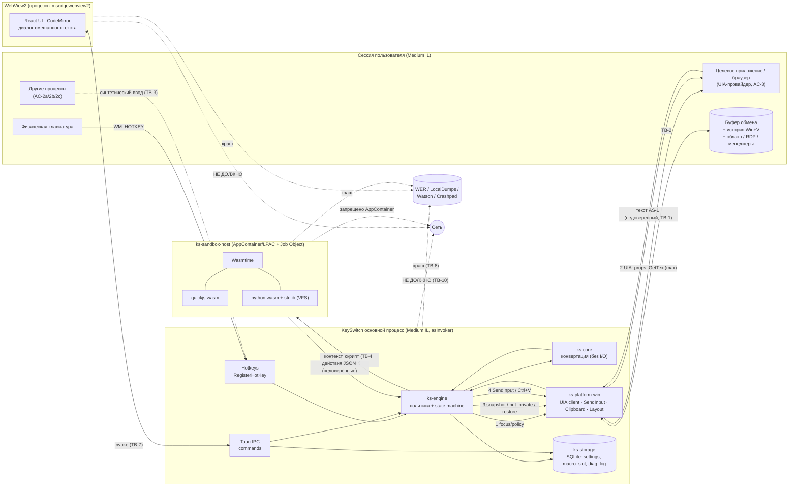

# KeySwitch — независимая модель угроз (v1)

Статус: **исследование для GATE 2** · Автор: Security Analyst (Agent 07, независимо) · Дата: 2026-11-09 · Ветка: `research/phase-1`
Метод: активы → акторы → границы доверия → поток данных → STRIDE по границам → реестр угроз ST-xx.
Связанные документы: `sec-architecture-audit.md` (аудит архитектуры и кода, вердикт GATE 2), `sec-requirements.md` (обязательные требования SR-xx и план тестов).

> Черновик `docs/03-threat-model.md` (T-01…T-16) использован только как список для сверки. Каждая угроза ниже выведена заново; соответствие T-xx ↔ ST-xx — в колонке «T-xx» реестра и в разделе 5 аудита.

## 0. Как читать уровни и пометки

| Уровень | Значение для KeySwitch |
|---|---|
| **Critical** | Произвольное выполнение кода/команд от имени пользователя, утечка секретов (пароли) третьей стороне без действия пользователя, или массовое необратимое уничтожение данных. |
| **High** | Утечка пользовательского текста/буфера за пределы машины или в чужое окно; необратимая потеря данных буфера/документа; обход изоляции одного слоя при живом втором. |
| **Medium** | Утечка внутри машины (журналы, история), DoS, обходимая потеря данных (есть Undo), ослабление второго слоя защиты. |
| **Low** | Требует уже скомпрометированной машины/учётной записи или даёт малый выигрыш атакующему. |
| **Informational** | Не уязвимость; лицензия, процесс, гигиена. |

Уровни указаны **до митигации** (inherent). Остаточный риск после выполнения SR-xx оценивается на GATE 6/8.

Пометки источников: **[проверено]** — проверено мной в этом репозитории/хосте (команда указана); **[док]** — официальная документация, прочитана; **[UNVERIFIED]** — утверждение из моих знаний, официальный источник в этой сессии недоступен (домены `learn.microsoft.com`, `docs.wasmtime.dev`, `v2.tauri.app` не резолвятся в облачной сессии; доступны только реестры пакетов и raw GitHub). Все [UNVERIFIED] надо подтвердить на GATE 2/6 — список в §9.

## 1. Активы

| ID | Актив | Где живёт | Почему ценен |
|---|---|---|---|
| AS-1 | Текст в активном поле (то, что конвертируем) | Память чужого процесса → UIA → память KeySwitch → SendInput/буфер | Переписка, документы; может содержать персональные данные |
| AS-2 | Текст в **других** полях/окнах (пароли, токены, соседние ячейки, остальной документ) | Чужие процессы | KeySwitch как UIA-клиент технически может читать всё, что видит UIA |
| AS-3 | Исходное содержимое буфера обмена (все форматы: текст, HTML, RTF, изображения, файлы, приватные форматы Office, данные менеджеров паролей) | Буфер Windows, снимок в памяти KeySwitch | Часто содержит пароли/секреты; потеря = потеря данных пользователя |
| AS-4 | Приватность буфера: история Win+V, облачная синхронизация, сторонние менеджеры буфера, RDP-перенаправление | Windows / сторонние процессы / другие машины | Утечка за пределы машины (облако, удалённый хост) |
| AS-5 | Целостность документа/страницы/таблицы, возможность Undo | Целевое приложение | Массовая или незаметная порча; отправка недописанного сообщения |
| AS-6 | Целостность системы пользователя (ФС, процессы, сеть, учётная запись) | ОС | Выход скрипта = выполнение кода от имени пользователя |
| AS-7 | Скрипт/текстовый макрос слота и настройки (горячие клавиши, исключения, разрешение чтения буфера) | SQLite (`ks-storage`) | Текстовый макрос может содержать секреты (подписи, шаблоны, иногда пароли); подмена разрешений = эскалация |
| AS-8 | Журнал диагностики и метаданные (exe, время, причины отказа) | SQLite `diag_log` | Метаданные активности пользователя |
| AS-9 | Память процессов KeySwitch (основной, WebView2, песочница) | RAM, pagefile, crash-дампы | Содержит AS-1, AS-3 в открытом виде |
| AS-10 | Целостность поставляемых бинарников (exe, `quickjs.wasm`, `python.wasm`, stdlib Python, данные моделей) | Установщик, `%LOCALAPPDATA%\Programs\KeySwitch` | Программа с правами «печатать за пользователя» — ценная цель подмены |
| AS-11 | Репутация/аутентичность дистрибутива | GitHub Releases/Actions artifacts | Неподписанное ПО с поведением «кейлоггера» легко подделать |

## 2. Акторы (источники угроз)

| ID | Актор | Возможности | Цели | В модели? |
|---|---|---|---|---|
| AC-1 | **Автор вредоносного скрипта** (соцнженерия: «вставь этот классный макрос», готовые сниппеты из форумов/LLM) | Полный контроль над кодом JS/Python в слоте; знание KeySwitch API; время подготовки | Выход из песочницы; выполнение команд через клавиатурный API; кража буфера; DoS | **Да, основной** |
| AC-2a | **Вредоносное локальное приложение того же пользователя, Medium IL** | Всё, что может пользователь: читать буфер, SendInput, UIA, править `%APPDATA%`/`%LOCALAPPDATA%` | — | **Частично**: такое приложение и так всемогуще; требование — KeySwitch не должен *добавлять* ему возможностей и не должен быть «удобным инструментом» (confused deputy) |
| AC-2b | **Локальный процесс с пониженными правами** (Low IL, AppContainer: песочница браузера, UWP-приложение, скомпрометированный рендерер) | Может синтезировать ввод только в окна своего уровня; обычно не читает буфер в фоне; может создавать окна/владеть буфером | Использовать KeySwitch (Medium IL) как мост: заставить его печатать/читать там, куда сам не может | **Да** |
| AC-2c | **Приложение-«владелец буфера»/UIA-провайдер** (любое окно, в котором стоит фокус или которое положило данные в буфер) | Управляет ответами UIA (ControlType, IsPassword, текст, задержки), отложенной отрисовкой буфера, перехватом фокуса | Спуфинг проверок политики, DoS KeySwitch, кража данных при вставке | **Да** |
| AC-3 | **Вредоносная веб-страница в активной вкладке браузера** | JS в странице: DOM, ARIA-роли, `contenteditable`, обработчики `keydown/paste/input`, смена фокуса, запись в буфер по жесту пользователя, `document.title` | Заставить KeySwitch заменить не то поле/всю страницу, украсть содержимое буфера при вставке, внедрить данные в журнал/UI KeySwitch | **Да** |
| AC-4 | **Атакующий цепочки поставок** | Вредоносная версия crate/npm-пакета, компрометация GitHub Action, подмена `python.wasm`/`quickjs.wasm`, тайпсквоттинг, подделка релиза | Внедрить код в сборку; распространить троянизированный «KeySwitch» | **Да** |
| AC-5 | **«Любопытная» инфраструктура разработки** (GitHub Actions раннеры, логи CI, облачные сессии разработки, разработчики, получающие диагностические отчёты/дампы, Microsoft WER/Watson, телеметрия WebView2) | Доступ к артефактам, логам CI, к тому, что пользователь «отправит в поддержку», к crash-отчётам | Получить пользовательский текст «случайно» | **Да** (приватность) |
| AC-6 | Второй человек за той же машиной / удалённый наблюдатель RDP | Видит экран, историю Win+V, открывает приложение KeySwitch | Прочитать историю/журнал | Ограниченно (Low) |

**Вне модели:** администратор/ядро ОС скомпрометированы; физический доступ с отладчиком; вредонос Medium IL, целенаправленно атакующий данные пользователя *независимо* от KeySwitch (KeySwitch не может защитить от него, но не должен облегчать — см. AC-2a).

## 3. Границы доверия

| ID | Граница | Кто по разные стороны | Что пересекает |
|---|---|---|---|
| TB-1 | Целевое приложение ↔ основной процесс KeySwitch | Недоверенный UIA-провайдер/окно (AC-2c, AC-3) ↔ KeySwitch Medium IL | UIA-свойства и текст (вход), SendInput, `WM_INPUTLANGCHANGEREQUEST`, фокус (выход) |
| TB-2 | Буфер обмена (общий ресурс сессии) | Все процессы сессии, история Win+V, облако, RDP, менеджеры | Снимок (вход: данные произвольного владельца), временный текст и восстановление (выход) |
| TB-3 | Пользователь ↔ KeySwitch через глобальные горячие клавиши | Физическая клавиатура + **любой** процесс, способный синтезировать ввод | `WM_HOTKEY` (вход), ввод KeySwitch смешивается с физическим |
| TB-4 | Основной процесс ↔ процесс песочницы (`ks-sandbox-host`) | Доверенный ядро/движок ↔ **недоверенный** после старта скрипта процесс | Контекст (текст, опционально буфер), скрипт → ; ← действия JSON, stdout/stderr, ошибки |
| TB-5 | Wasm-гость ↔ Wasmtime/хост-функции внутри песочницы | Код AC-1 ↔ Wasmtime, WASI, KeySwitch host API | Импорты WASI/хост-функций, линейная память, ресурсы (fuel/epoch/memory) |
| TB-6 | Процесс песочницы ↔ ОС | Возможно скомпрометированный нативный процесс ↔ ядро Windows, ФС, сеть, буфер, окна | Syscalls (win32k!), именованные объекты, файлы с ACL `ALL APPLICATION PACKAGES` |
| TB-7 | WebView2 (UI) ↔ Rust-бэкенд (Tauri IPC) | Код фронтенда (+ любой XSS) ↔ команды Tauri | `invoke`, события, capabilities |
| TB-8 | KeySwitch ↔ локальное хранилище/журналы/дампы | Процессы KeySwitch ↔ диск, синхронизация Roaming-профиля, WER | SQLite, журнал, WebView2 user data, crash-дампы |
| TB-9 | Цепочка поставок → артефакт | crates.io, npm, GitHub Actions, сборщики wasm-рантаймов ↔ установщик | Исходники, бинарники, wasm, данные |
| TB-10 | KeySwitch ↔ сеть | Процессы KeySwitch (включая WebView2 runtime) ↔ Интернет | Не должно быть ничего в runtime |

## 4. Поток данных (DFD)

Ключевое наблюдение DFD: **пользовательский текст пересекает 4 процесса** (целевое приложение, основной процесс, при диалоге — WebView2, при макросе — песочница) и **2 общих ресурса** (буфер, crash-дампы). Каждый из них — место утечки.

## 5. STRIDE по границам

| Граница | S (подмена) | T (изменение) | R (отказ) | I (раскрытие) | D (отказ в обслуживании) | E (повышение) |
|---|---|---|---|---|---|---|
| TB-1 Target↔KS | Спуфинг ControlType/IsPassword/RuntimeId провайдером (ST-09, ST-14); подмена окна в момент записи (ST-07, ST-08) | Запись не в то поле/весь документ/лист (ST-07, ST-16, ST-20); рассинхронизация (ST-18) | Нет следа, куда реально ушёл ввод (ST-42) | Чтение больше, чем нужно (ST-14), пароль (ST-09) | Медленный/огромный ответ UIA (ST-14) | KS Medium как мост для Low IL; KS elevated (ST-10) |
| TB-2 Буфер | Чужое приложение меняет данные между put и paste (ST-01, ST-05) | Затирание новых данных (ST-05); потеря форматов (ST-02) | — | История/облако/менеджеры/RDP (ST-03); снятие меток (ST-04); вставка прежнего буфера (ST-01); секреты в снимке (ST-06) | Отложенная отрисовка/зависший владелец (ST-06) | — |
| TB-3 Hotkeys/ввод | Синтетический хоткей (ST-12) | Смешение с модификаторами/физическим вводом (ST-11); отправка Enter (ST-19) | — | — | Захват сочетания, AltGr (ST-12) | Low-IL процесс запускает макрос (ST-12) |
| TB-4 Engine↔Sandbox | Скомпрометированная песочница шлёт «легитимные» ответы (ST-25) | Произвольные действия (ST-25, ST-26) | — | Буфер → печать в чужое окно (ST-27); текст в stderr → журнал/UI (ST-33) | Флуд вывода/ввода, зависание (ST-28) | Баг парсера в хосте (ST-25); XSS через вывод (ST-33) |
| TB-5 Guest↔Wasmtime | — | Повреждение памяти через баг JIT/интерпретатора (ST-22) | — | Spectre в процессе песочницы (ST-34) | Обход fuel (ST-28) | Выход из Wasm (ST-22), WASI (ST-23), хост-функции (ST-24) |
| TB-6 Sandbox↔ОС | — | Запись в доступные AppContainer файлы (ST-30) | — | Файлы ALL APP PACKAGES, буфер, окна (ST-30) | Бомбы памяти/процессов (ST-28, ST-30) | win32k LPE, наследованные дескрипторы (ST-30); in-process вариант (ST-29) |
| TB-7 WebView↔Rust | XSS вызывает команды от имени UI (ST-36) | Подмена скрипта/разрешений через IPC (ST-36) | — | Лишние core-права (ST-35); autofill/spellcheck WebView2 (ST-38) | — | devtools (ST-38); удалённый контент/навигация (ST-37); argv/deep link (ST-40) |
| TB-8 Хранилище | Подмена флагов в SQLite (ST-41, вне модели AC-2a) | То же | Нет следа изменения настроек (ST-41) | Roaming, freelist/WAL (ST-41); журнал (ST-42); дампы (ST-43); память (ST-44) | Рост журнала (ST-42) | — |
| TB-9 Поставки | Поддельный релиз (ST-50) | Вредоносный crate/npm/Action (ST-45–ST-48); подмена wasm (ST-49, ST-32) | Нет provenance (ST-48) | — | Нет обновлений (ST-39) | Код в сборке = полный контроль (ST-46, ST-47, ST-49) |
| TB-10 Сеть | — | — | — | Runtime-трафик (ST-53); bootstrapper при установке (ST-52) | — | — |

## 6. Реестр угроз

Формат каждой записи: **ID · Название · Уровень** / Описание / Сценарий эксплуатации / Компоненты / Рекомендация / Проверка / Связь (T-xx черновика, SR-xx).

### 6.1 Буфер обмена (TB-2)

**ST-01 · Восстановление буфера до того, как целевое приложение прочитало вставку → в поле уходит *прежнее* содержимое буфера · High**
- Описание: конвейер FR-CLIP-2 «вставить → дождаться потребления → восстановить». В Win32 нет надёжного сигнала «приложение закончило читать буфер»: `Ctrl+V` обрабатывается асинхронно (очередь сообщений, Electron/Chromium читают буфер в другом потоке, задержки до сотен мс под нагрузкой). Если восстановление произошло раньше, приложение вставит **исходный** буфер пользователя.
- Сценарий: пользователь скопировал пароль из менеджера, затем в Telegram/Discord нажал горячую клавишу конвертации длинного текста (>200 симв., путь через буфер). Под нагрузкой Electron прочитал буфер после восстановления → в поле чата вставлен пароль, следом пользователь жмёт Enter. Аналогично — изображение/файл вставляется в чат.
- Компоненты: `ks-platform-win` Clipboard, `ks-engine` (шаги Write/RestoreClipboard), профили `app-profiles.toml` (задержка).
- Рекомендация: (1) по умолчанию **предпочитать SendInput Unicode** для всех длин ≤ 5 000 (буфер — только fallback по профилю); (2) при пути через буфер класть данные с **отложенной отрисовкой** (`SetClipboardData(fmt, NULL)`) и считать `WM_RENDERFORMAT` сигналом начала чтения; восстанавливать только после рендеринга **и** подтверждения через UIA, что текст поля стал ожидаемым (или таймаут → *не восстанавливать*, оставить временный текст и сообщить), никогда не «восстановить по таймеру вслепую»; (3) после вставки сверить содержимое поля через UIA; при несовпадении — Abort + уведомление.
- Проверка: Windows CI — тестовое окно, которое читает буфер с искусственной задержкой 0/50/500/2000 мс; ассерт, что в поле никогда не оказывается снимок исходного буфера. Ручная — Telegram/Discord под нагрузкой CPU.
- Связь: нет в черновике (новая) · SR-10, SR-11, SR-12.

**ST-02 · Потеря данных буфера при snapshot/restore · High**
- Описание: «сохранить все форматы и восстановить» не равно исходному состоянию: (а) **отложенная отрисовка** — чтение всех форматов заставляет владельца рендерить их (Excel на большом диапазоне — сотни МБ, секунды), владелец мог завершиться → данные недоступны; (б) **дескрипторы GDI** (`CF_BITMAP`, `CF_ENHMETAFILE`, `CF_PALETTE`, `CF_METAFILEPICT`) нельзя копировать как HGLOBAL; (в) **OLE-буфер** (`OleGetClipboard`, `CFSTR_FILECONTENTS`/`FILEDESCRIPTOR` — «виртуальные файлы» из Outlook/архиваторов, IStream) Win32-снимком не сохраняется; (г) семантика владельца: Excel «бегущие муравьи», Office Clipboard, «Вставить связь», после восстановления перестают работать; (д) синтезированные форматы (`CF_TEXT`/`CF_OEMTEXT`/`CF_LOCALE` из `CF_UNICODETEXT`) при восстановлении меняют кодировку; (е) приватные форматы с указателями внутри (`CF_PRIVATEFIRST..LAST`, `CF_DSP*`).
- Сценарий: пользователь скопировал из Проводника 3 файла (CF_HDROP + Shell IDList + preferred drop effect) или диапазон Excel, затем конвертировал текст через путь буфера. После восстановления «Вставить» в Проводнике копирует не то/ничего; диапазон Excel вставляется как картинка/текст.
- Компоненты: `Clipboard::snapshot/restore_if_unchanged`.
- Рекомендация: белый список **полностью сохраняемых** форматов (`CF_UNICODETEXT`, `CF_LOCALE`, `HTML Format`, `Rich Text Format`, `CF_DIB/CF_DIBV5`, `CF_HDROP` + известные shell-форматы как байты) — **если в буфере есть хотя бы один формат вне списка или с отложенной отрисовкой** (проверять `GetClipboardOwner`/формат-перечисление без рендеринга невозможно в общем случае, поэтому: любой формат, кроме белого списка → не трогать буфер вообще) → использовать SendInput, а если профиль приложения запрещает SendInput — **Abort** (FR-CLIP-3). Лимит размера снимка (напр. 16 МБ) → иначе Abort. Таймаут на `GetClipboardData` (выполнять в отдельном потоке).
- Проверка: Windows CI — фикстуры буфера: текст+HTML+RTF, DIB, CF_HDROP, отложенная отрисовка, приватный формат, OLE-объект, 100 МБ данных; ассерт «байт-в-байт после восстановления» или «буфер не тронут, путь SendInput/Abort». Ручная — Excel диапазон, Проводник файлы, Outlook вложение.
- Связь: T-05 · SR-10, SR-13.

**ST-03 · Утечка временного текста в историю Win+V, облачный буфер, сторонние менеджеры, RDP · High**
- Описание: каждый `SetClipboardData` без меток становится элементом истории Win+V и может синхронизироваться в облако (между устройствами учётной записи Microsoft). Метки D-13: `ExcludeClipboardContentFromMonitorProcessing`, `CanIncludeInClipboardHistory`=0, `CanUploadToCloudClipboard`=0 [UNVERIFIED: названия и семантика по документации Microsoft «Clipboard Formats → Cloud Clipboard and Clipboard History Formats», https://learn.microsoft.com/en-us/windows/win32/dataxchg/clipboard-formats — недоступна в сессии]. Остаточные каналы: менеджеры буфера, не уважающие метки (Ditto, ClipboardFusion, старые версии), `rdpclip`/Citrix/VMware Tools/Hyper-V Enhanced Session (передают буфер на другую машину), Phone Link, любые процессы с `AddClipboardFormatListener`, читающие во время окна put→restore.
- Сценарий: пользователь в RDP-сессии конвертирует текст; `rdpclip` передаёт временный текст на клиентскую машину; или включён облачный буфер → текст появляется на телефоне/другом ПК.
- Компоненты: `Clipboard::put_private`.
- Рекомендация: SendInput по умолчанию (ST-01); метки ставить **в той же транзакции** `OpenClipboard…CloseClipboard` и **до** `CloseClipboard`; в RDP/удалённой сессии (`GetSystemMetrics(SM_REMOTESESSION)`) путь через буфер запрещён; окно put→restore минимально; документировать остаточный риск сторонних менеджеров.
- Проверка: Windows CI — после операции перечислить форматы (до restore) и проверить наличие трёх меток; `Windows.ApplicationModel.DataTransfer.Clipboard.GetHistoryItemsAsync` (если доступно на раннере, [UNVERIFIED]) не содержит временный текст. Ручная — Win+V, облачный буфер на второй машине, RDP.
- Связь: T-04 · SR-10, SR-14.

**ST-04 · Восстановление снимает метки приватности исходных данных · High**
- Описание: менеджеры паролей (KeePass, 1Password, Bitwarden) кладут пароль с метками исключения из истории/облака. Если snapshot сохраняет только «данные», а restore пишет их без исходных меток, KeySwitch **сам** помещает пароль в историю Win+V и облако. Кроме того, менеджер мог очистить буфер по таймеру — KeySwitch «воскрешает» пароль.
- Сценарий: пароль скопирован из Bitwarden (метки стоят), пользователь конвертирует строку в чате путём буфера; при restore метки потеряны → пароль в Win+V и в облачном буфере на всех устройствах.
- Компоненты: `Clipboard::snapshot/restore`.
- Рекомендация: снимок сохраняет **и метки как форматы**; при restore — переустанавливать их; если в снимке есть `ExcludeClipboardContentFromMonitorProcessing` → KeySwitch вообще не использует путь буфера (только SendInput или Abort) и **никогда не передаёт такой буфер в песочницу** (ST-28). Не восстанавливать, если исходный владелец буфера очистил его (seq изменился) — уже покрыто restore_if_unchanged.
- Проверка: Windows CI — фикстура «пароль с метками»; после операции метки присутствуют, история не содержит текст. Ручная — KeePass/Bitwarden.
- Связь: нет в черновике (новая) · SR-14, SR-30.

**ST-05 · Восстановление затирает новые данные (TOCTOU проверки sequence number) · Medium**
- Описание: `restore_if_unchanged` проверяет `GetClipboardSequenceNumber`; если проверка делается **до** `OpenClipboard`, между проверкой и `EmptyClipboard` пользователь/приложение может скопировать новое → оно уничтожается.
- Сценарий: пользователь сразу после хоткея нажимает Ctrl+C в другом окне; KeySwitch восстанавливает старый буфер поверх.
- Компоненты: `Clipboard::restore_if_unchanged`.
- Рекомендация: порядок `OpenClipboard(own_hwnd)` → сравнить seq с ожидаемым (seq после собственного put) → только затем `EmptyClipboard`/`SetClipboardData`; пока буфер открыт, другие не могут его изменить. Ретраи `OpenClipboard` с ограничением, при неудаче — не восстанавливать (данные не теряются, временный текст остаётся — сообщить в диагностике).
- Проверка: Windows CI — гоночный тест: второй поток пишет в буфер в случайный момент 1000 итераций; ассерт: последняя запись второго потока никогда не потеряна.
- Связь: T-05 · SR-13.

**ST-06 · Снимок втягивает чувствительные/огромные данные; зависание на владельце буфера · Medium**
- Описание: снимок читает **все** форматы, включая данные менеджеров паролей, в память KeySwitch (→ AS-9, дампы). Злонамеренный/зависший владелец с отложенной отрисовкой не отвечает на `WM_RENDERFORMAT` → поток KeySwitch висит; в это время KeySwitch держит буфер открытым → система «ломает» буфер для всех.
- Сценарий: AC-2c ставит формат с отложенной отрисовкой и никогда не отвечает → каждая конвертация вешает KeySwitch / буфер на 30+ с.
- Компоненты: Clipboard.
- Рекомендация: перечислять форматы без рендеринга; данные читать только из белого списка; читать в отдельном потоке с таймаутом (≤ 500 мс), при таймауте — Abort; снимок хранить как `Zeroizing` буфер, жить ≤ длительности операции.
- Проверка: Windows CI — фикстура «владелец, не отвечающий на WM_RENDERFORMAT»; ассерт Abort за ≤ 1 с, буфер не изменён.
- Связь: T-05 (частично) · SR-13, SR-29.

### 6.2 Win32 / UIA / ввод (TB-1, TB-3)

**ST-07 · Ввод уходит не в то окно: TOCTOU между проверкой фокуса и SendInput · High**
- Описание: FR-FIELD-4 «перед заменой проверить HWND+PID+RuntimeId» закрывает окно в секунды (диалог), но не окно в миллисекунды: SendInput кладёт события в системную очередь, они доставляются **текущему** foreground-окну на момент обработки. Окно может смениться между проверкой и обработкой каждого события: всплывающее окно (уведомление Teams, UAC не может, но «Ответить» Outlook, диалог сохранения), перехват foreground процессом, получившим последний ввод, или вредоносным приложением, которое ждёт хоткей (видит нажатие через `GetAsyncKeyState`/raw input) и выводит себя на передний план.
- Сценарий: при печати 3 000 символов через SendInput (сотни мс) всплывает окно другого чата → вторая половина текста (и Enter, если есть перевод строки) уходит другому адресату. Или AC-2a/AC-3: страница по `keydown` хоткея переводит фокус в скрытый `<textarea>`/другую вкладку — получает весь текст.
- Компоненты: `ks-engine` (шаг Write), `Input::type_unicode/paste/press`, `FocusProvider`.
- Рекомендация: (1) печатать пакетами ≤ 64 символа, перед каждым пакетом — `GetForegroundWindow`+`GetGUIThreadInfo(hwndFocus)`+PID равны зафиксированным, иначе стоп; (2) после записи — пост-проверка (тот же foreground и текст поля через UIA соответствует ожиданию), при расхождении — диагностика «операция прервана, проверьте окно»; (3) **никогда** не вызывать `SetForegroundWindow`/`AttachThreadInput` для «возврата» фокуса в чужое окно, кроме сценария диалога (ST-09); (4) лимит длины SendInput (напр. 5 000) и скорость.
- Проверка: Windows CI — тест, где второй процесс отбирает foreground через N мс после начала печати; ассерт: ≤ 1 пакета ушло в чужое окно, операция остановлена, Abort-причина в журнале. Ручная — уведомления Teams/Outlook.
- Связь: T-06 · SR-20, SR-21.

**ST-08 · Диалог смешанного текста меняет фокус; возврат фокуса перехватывается · Medium**
- Описание: модальное окно выбора «RU/EN/Отмена» активируется → целевое приложение теряет фокус (в вебе — `blur`, некоторые поля сбрасывают выделение/закрывают автокомплит, чат может переключить диалог). После выбора KeySwitch должен вернуть фокус — это `SetForegroundWindow` в чужое окно, именно здесь третий процесс может стать foreground. Окно диалога в WebView2 также переносит пользовательский текст в процессы WebView2 (ST-44).
- Сценарий: пока открыт диалог, пришло сообщение в другом чате → Telegram переключает активный чат; после «Русский» RuntimeId совпадает (тот же контрол ввода), но адресат другой.
- Компоненты: `ks-engine` Dialog, UI.
- Рекомендация: диалог **не активирующий** (`WS_EX_NOACTIVATE | WS_EX_TOPMOST`, выбор мышью или временно зарегистрированными хоткеями `1/2/Esc` через `RegisterHotKey`), чтобы фокус никогда не покидал целевое поле; если невозможно — после выбора повторно прочитать текст поля и сравнить хэш с прочитанным до диалога (не только RuntimeId), иначе Abort. Не показывать полный пользовательский текст в диалоге (или нативное окно без WebView).
- Проверка: Windows CI — смена текста/фокуса в тестовом окне во время диалога → Abort. Ручная — Telegram.
- Связь: T-06 · SR-22.

**ST-09 · Неполное распознавание полей паролей · High**
- Описание: D-05 полагается на `UIA_IsPasswordPropertyId`. Он надёжен для `ES_PASSWORD` и `<input type=password>`, но **не** для: кастомных маскирующих полей (банки, PIN-поля из отдельных `<input>` на символ, canvas-ввод), полей OTP/CVV (не пароль, но секрет), Electron/Qt/Java/Flutter приложений с неполным UIA, терминалов `sudo`/`ssh` (TTY без эха), RDP/VM окон (весь гость = один контрол), полей, которые страница (AC-3) объявила `role=textbox` поверх password. Чтение такого поля помещает секрет в память KeySwitch и, при пути через буфер, в буфер/историю.
- Сценарий: пользователь по ошибке нажал хоткей в поле PIN банка (кастомный input) — PIN оказывается в буфере → истории Win+V (если метки не поставлены) или в памяти/дампе.
- Компоненты: `FocusProvider`, политика `ks-engine`.
- Рекомендация: многосигнальная политика отказа до чтения текста: `IsPassword`; `ControlType` ∈ {Edit, (Document — только выделение)}; `autocomplete`/`AutomationId`/`Name` с маркерами `password|pin|otp|cvv|cvc|код|пароль` (эвристика); UIA `FrameworkId` неизвестен → консервативный профиль; списки исключений по exe (менеджеры паролей, терминалы, RDP/VM клиенты: `mstsc.exe`, `vmconnect.exe`, `vmware*.exe`, `VirtualBox*.exe`, `msrdc.exe`); никогда не путь буфера для неизвестных фреймворков.
- Проверка: Windows CI — тестовые окна `ES_PASSWORD`, WebView2-страница с `type=password`, кастомным маскирующим полем (`-webkit-text-security`), `autocomplete="one-time-code"`; ассерт: отказ **до** вызова `GetText` (проверяется счётчиком вызовов в моке/логах провайдера). Ручная — 3 банковских сайта, KeePass.
- Связь: T-08 · SR-23.

**ST-10 · UIPI/повышенные окна: молчаливое частичное выполнение; KeySwitch, запущенный с повышенными правами · Medium**
- Описание: SendInput в окно более высокого IL блокируется UIPI, причём «ни возвращаемое значение, ни GetLastError не укажут, что сбой из-за UIPI» [UNVERIFIED, цитата по памяти из https://learn.microsoft.com/en-us/windows/win32/api/winuser/nf-winuser-sendinput]. Итог: выделение могло примениться, а вставка — нет, или часть операций (переключение раскладки PostMessage) прошла. Обратная проблема: если пользователь запустил KeySwitch «от имени администратора» (или автозапуск в elevated-сессии), KeySwitch с WebView2 и песочницей работает High IL и может печатать в любые окна, включая админские консоли — расширение возможностей для AC-1.
- Сценарий: AC-1-скрипт с `keys: [Enter]` и текстом команды, когда в фокусе админская PowerShell, а KeySwitch запущен elevated → выполнение команды с правами администратора.
- Компоненты: `FocusProvider` (elevated), манифест приложения, `Autostart`.
- Рекомендация: проверять IL/elevation целевого процесса (`OpenProcess(PROCESS_QUERY_LIMITED_INFORMATION)` + `TokenIntegrityLevel`; не открывается → считать elevated → отказ) **до** чтения; манифест `asInvoker`, `uiAccess=false`; при старте, если собственный токен elevated → отказаться работать (или показать предупреждение и выключить конвертацию/макросы).
- Проверка: Windows CI — запустить тестовое окно elevated (раннер GitHub работает как admin [UNVERIFIED], нужен механизм понижения KeySwitch через `CreateProcessAsUser`/`runas /trustlevel` — возможно только вручную); ручная — `regedit`/админ-PowerShell.
- Связь: T-15 · SR-24.

**ST-11 · Инжектируемые клавиши смешиваются с удерживаемыми модификаторами и физическим вводом · High**
- Описание: хоткей (например `Ctrl+Alt+Q`) нажат, пользователь ещё держит модификаторы; SendInput `Tab`/`Enter`/`Delete`/стрелки превращаются в `Ctrl+Tab`, `Alt+Tab`, `Ctrl+Enter` («отправить» в Outlook/Teams/Slack), `Ctrl+Delete`, `Ctrl+Shift+End` (выделить до конца документа) и т.п. Удерживаемый `Win` + инжектированные символы = системные сочетания (Win+R/Win+X). Unicode-ввод (`KEYEVENTF_UNICODE`, VK_PACKET) при нажатом Ctrl может интерпретироваться приложениями как сочетания [UNVERIFIED, зависит от приложения]. Пользователь может продолжать печатать физически во время инъекции — символы перемешиваются.
- Сценарий: AC-1-макрос возвращает `keys: [Tab, Enter]` — при удерживаемом Alt это `Alt+Tab` (переключение в другое окно), затем `Alt+Enter`/`Enter` в нём.
- Компоненты: `Input::wait_modifiers_released`, `Input::press`, `ks-engine`.
- Рекомендация: перед **каждым** пакетом проверять `GetAsyncKeyState` для Shift/Ctrl/Alt/Win (L/R) и CapsLock-состояние; если нажаты — ждать до 1 с, затем Abort (FR-HK-4), никогда не «отпускать» модификаторы синтетическими key-up (это ломает состояние у пользователя); при обнаружении физического ввода во время инъекции (изменение `GetAsyncKeyState`/`GetLastInputInfo`) — стоп. Сочетания хоткеев с `Win` запретить (D-14 требует не-модификаторную клавишу, но Win разрешён как модификатор — запретить).
- Проверка: Windows CI — тест удержания Ctrl/Alt синтетически перед операцией → ассерт Abort, ни одного события не отправлено. Ручная — удержание Ctrl+Alt дольше 1 с.
- Связь: T-02 (частично) · SR-25.

**ST-12 · Горячие клавиши: синтетический запуск, конфликты AltGr, перехват сочетания · Medium**
- Описание: (а) `RegisterHotKey` срабатывает и на синтетический ввод: любой процесс, способный сделать SendInput в текущий foreground, может запустить конвертацию/макрос в выбранный им момент (в т.ч. AC-2b Low IL, если foreground — его окно [UNVERIFIED поведение UIPI для хоткеев]) → KeySwitch Medium IL становится мостом; (б) сочетания `Ctrl+Alt+<клавиша>` == **AltGr+<клавиша>** на польской/немецкой/чешской и др. раскладках: `Ctrl+Alt+Q` = `@` в немецкой раскладке → каждое `@` запускает конвертацию поля; (в) другое приложение регистрирует то же сочетание раньше (squatting) — конвертация «молча» не работает; (г) популярные сочетания (`Ctrl+Q` — выход во многих приложениях) глобально «съедаются».
- Сценарий: немецкий пользователь пишет e-mail `name@host` — на `@` срабатывает конвертация и поле переписывается.
- Компоненты: `Hotkeys`, UI Hotkeys.
- Рекомендация: запретить сочетания `Ctrl+Alt+X` и `AltGr` (или предупреждать, если в системе установлена раскладка с AltGr-символом на этой клавише — проверка `VkKeyScanEx` по всем `GetKeyboardLayoutList`); запретить `Win`; не допускать сочетаний без Ctrl/Alt; для макроса с действиями `keys`/чтением буфера — требовать «осознанное» сочетание (2 модификатора); защищаться от синтетического запуска невозможно без LL-хука (запрещён D-14) — принять остаточный риск, но: макрос с разрешением чтения буфера не выполнять, если foreground-процесс имеет Low IL/AppContainer.
- Проверка: Linux unit — валидатор сочетаний (таблица запрещённых); Windows CI — `VkKeyScanEx` проверка для немецкой раскладки; ручная — немецкая раскладка + `@`.
- Связь: нет в черновике · SR-26, SR-27.

**ST-13 · Побочные эффекты переключения раскладки · Low**
- Описание: `WM_INPUTLANGCHANGEREQUEST` в чужое окно: при глобальной (не per-app) раскладке меняет её для всех окон; приложения могут обрабатывать сообщение нестандартно; при смене фокуса между записью и переключением раскладка меняется не в том окне (следующий ввод пароля в другом окне — не в той раскладке → блокировка учётной записи после N неудачных попыток).
- Сценарий: после конвертации фокус ушёл в окно входа VPN; раскладка переключилась там → пользователь трижды вводит пароль в RU раскладке → блокировка.
- Компоненты: `KeyboardLayout::switch`.
- Рекомендация: переключать только если foreground/фокус всё ещё целевой (повторная проверка), только после успешной записи; никогда не для password/elevated окон.
- Проверка: Windows CI — смена фокуса перед SwitchLayout → переключение не выполнено.
- Связь: нет · SR-21.

**ST-14 · KeySwitch как UIA-клиент: недоверенный провайдер, чрезмерное чтение, зависание · Medium**
- Описание: UIA-провайдер целевого приложения (AC-2c, AC-3 через ARIA) полностью контролирует ответы: `ControlType`, `IsPassword`, `RuntimeId` (может совпасть у разных элементов или меняться), `TextPattern` диапазоны, текст. Вызовы UIA кросс-процессные и могут блокироваться (по умолчанию тайм-ауты десятки секунд [UNVERIFIED]). `GetText(-1)` у Word/браузера возвращает весь документ (мегабайты) — данные, которые KeySwitch не должен видеть. Подписка на UIA-события (если появится) делает KeySwitch пассивным читателем всего ввода — функционально кейлоггер.
- Сценарий: страница выставляет `role=textbox` на `contenteditable`, содержащий всю страницу, и задерживает ответы → KeySwitch висит; или отдаёт 50 МБ текста.
- Компоненты: `ks-platform-win` UIA, `TextAccess::read_scope`.
- Рекомендация: `IUIAutomation2::put_ConnectionTimeout/put_TransactionTimeout` (напр. 1–2 с); `GetText(5001)` вместо `-1` и Abort при длине > 5 000; не подписываться на UIA-события фокуса/текста глобально (только запрос по хоткею); кэшировать/читать только нужные свойства; сравнивать RuntimeId **и** HWND **и** PID **и** хэш текста; все UIA-вызовы — в выделенном потоке с отменой.
- Проверка: Windows CI — фейковый UIA-провайдер (WinForms/Win32 тестовое окно с собственным провайдером): медленный ответ, 10 МБ текста, меняющийся RuntimeId → Abort за ≤ 2 с, память не растёт > N МБ.
- Связь: нет в черновике · SR-28, SR-29.

**ST-15 · Secure desktop, блокировка, смена сессии/RDP во время операции · Low**
- Описание: блокировка (Win+L), UAC, смена пользователя или отключение RDP посреди операции → SendInput/буфер недоступны, операция частично выполнена, буфер не восстановлен.
- Сценарий: пользователь нажал хоткей и сразу Win+L; временный текст остаётся в буфере.
- Компоненты: `ks-engine`.
- Рекомендация: `WTSRegisterSessionNotification` → при `WTS_SESSION_LOCK/REMOTE_DISCONNECT` Abort и попытка восстановления буфера по возвращении (если seq не менялся).
- Проверка: ручная.
- Связь: нет · SR-21.

### 6.3 Замена всего поля (AS-5)

**ST-16 · Массовое изменение документа/страницы · High**
- Описание: «всё поле» опасно, когда фокус-элемент — rich-редактор: `contenteditable` (Gmail, Notion, Confluence, Google Docs — canvas с собственным a11y-слоем), Word (Document), VS Code/Monaco (Edit-подобные элементы), Electron-приложения, где UIA отдаёт `Edit` для всего документа. Ctrl+A в таком элементе выделяет весь документ (D-04 проверяет `Edit`, но `role=textbox` объявляется страницей, AC-3).
- Сценарий: AC-3 или просто сложный редактор: страница оформляет весь документ как `
`; KeySwitch считает его однострочным полем, Ctrl+A + вставка → документ заменён одной строкой; автосохранение уничтожает документ на сервере.
- Компоненты: `ks-engine` политика D-03/D-04, профили приложений.
- Рекомендация: «всё поле» только если одновременно: `ControlType=Edit`, **нет** `IsMultiline`/`AriaRole`≠textbox-multiline, длина ≤ 5 000, длина по `ValuePattern.Value` == длина `TextPattern.DocumentRange` (согласованность), фреймворк в белом списке профилей; для браузеров — только **выделение** или фрагмент до разрыва строки по умолчанию; Ctrl+A после проверки — только для приложений в белом списке профилей; «последний фрагмент» выделять через `TextPattern` `Move/ExpandToEnclosingUnit` и проверять выделение повторным `GetSelection` до записи.
- Проверка: Windows CI — WebView2-страница с `contenteditable role=textbox` содержащей 10 абзацев → отказ или замена только выделения; ручная — Word, Gmail, Notion, Google Docs.
- Связь: T-07 · SR-31, SR-32.

**ST-17 · Потеря Undo · Medium**
- Описание: SendInput по символу создаёт в некоторых приложениях много шагов Undo или сливается с предыдущим вводом; `ValuePattern.SetValue` (отклонён D-12) стирает историю Undo; web-поля React теряют undo-стек при программной смене value.
- Сценарий: Ctrl+Z после конвертации удаляет только последний символ, исходный текст не восстанавливается.
- Компоненты: Input, профили.
- Рекомендация: путь «выделить → вставить одной операцией» (paste или одна пачка SendInput) — проверить по профилю; хранить (в памяти, `Zeroizing`, ≤ 30 с) исходный текст для собственного «отката последней операции»? — нет, это расширяет время жизни текста (AS-9); вместо этого — тест-матрица D-12 на эталонных приложениях и отказ, если профиль не подтверждён.
- Проверка: ручная матрица (D-10).
- Связь: нет (D-12) · SR-33.

**ST-18 · Рассинхронизация фреймворков (React controlled inputs), перехват клавиш страницей · Medium**
- Описание: React/Vue хранят значение в состоянии; программная запись в DOM/UIA (`SetValue`) не вызывает `onChange` → форма отправит старое значение или React перезапишет поле. SendInput/paste корректно генерируют события, но страница (AC-3) может `preventDefault` на `Ctrl+A`/`paste`, изменить значение после вставки, вставить не туда (`execCommand`) → дублирование текста.
- Сценарий: Ctrl+A перехвачен страницей → вставка добавляет конвертированный текст к исходному.
- Компоненты: Input, `ks-engine` пост-проверка.
- Рекомендация: только SendInput/paste (не SetValue); пост-проверка значения через UIA (ожидаемый текст == фактический), при расхождении — сообщить «проверьте поле, нажмите Ctrl+Z».
- Проверка: Windows CI — WebView2-страница с React controlled input и страница, перехватывающая Ctrl+A.
- Связь: нет · SR-34.

**ST-19 · Случайная отправка сообщения (Enter) и автозамены · High**
- Описание: конвертированный текст сохраняет переводы строк (FR-CONV-2). SendInput `\r`/`\n` (VK_PACKET 0x0D или VK_RETURN) в поле чата = **отправка** недописанного сообщения (Telegram, WhatsApp, Discord, Slack, Teams — Enter = Send). Аналогично `Tab` перемещает фокус на кнопку «Отправить». Автодополнение (эмодзи `:)` → 🙂, упоминания `@`, автокоррекция Word `--`→`—`, автозакрытие скобок в IDE) меняет результат так, что пост-проверка не сходится.
- Сценарий: в Telegram многострочное сообщение: KeySwitch печатает первую строку и Enter → сообщение ушло неполным и неотзываемым (адресат увидел).
- Компоненты: `Input::type_unicode`, `ks-engine`, профили.
- Рекомендация: текст с `\r`/`\n`/`\t` **никогда** через SendInput посимвольно в приложения с профилем «chat» или неизвестные — только путь вставки (paste) или отказ; для текстовых макросов и `insert/replace` из скриптов — запрет управляющих символов (кроме `\n`, разрешаемого только при пути paste); ⇒ см. ST-26.
- Проверка: Windows CI — тестовое окно, считающее WM_KEYDOWN VK_RETURN/WM_CHAR 0x0D: при конвертации многострочного текста их 0. Ручная — Telegram/WhatsApp/Discord.
- Связь: нет в черновике · SR-35.

**ST-20 · Excel: семантика ячеек, массовая перезапись, формулы · High**
- Описание: (а) если ячейка не в режиме редактирования, фокус-элемент — ячейка/таблица, Ctrl+A выделяет **весь лист**, вставка перезаписывает диапазон; (б) вставка текста с `\t`/`\n` раскладывается по соседним ячейкам → перезапись соседних данных; (в) текст, начинающийся с `= + - @`, становится формулой (formula injection: `=HYPERLINK`, `=WEBSERVICE`, DDE `=cmd|...` в старых версиях) — особенно в результате скрипта-макроса; (г) вставка заменяет формат ячейки; (д) Undo в Excel для вставки работает, но сбрасывается макросами VBA.
- Сценарий: AC-1-макрос `replace` возвращает текст, начинающийся с `=` (формула с внешней ссылкой), + Enter в Excel → данные листа могут уйти наружу при пересчёте (если внешние ссылки разрешены политикой Excel). Или пользователь конвертирует «всё поле» в ячейке, не в режиме редактирования → Ctrl+A = весь лист.
- Компоненты: профили (`EXCEL.EXE`), `ks-engine`.
- Рекомендация: профиль Excel: только если UIA показывает режим редактирования (элемент Edit внутри ячейки/строки формул) — иначе отказ; никакого Ctrl+A; запрет вставки текста с `\t`/`\n`; для результатов скриптов: если первый символ ∈ `= + - @ \t \r` и целевое приложение — табличный процессор (Excel, LibreOffice Calc, Google Sheets в браузере — определить нельзя → общий запрет ведущих формульных символов для макросов, кроме явного разрешения).
- Проверка: ручная Excel (D-10); Windows CI невозможен без Office [UNVERIFIED наличие Office на windows-latest — по известным мне данным отсутствует].
- Связь: T-07 (частично) · SR-36.

**ST-21 · IME/автокоррекция/автодополнение искажают вставляемый текст · Low**
- Описание: при активном IME (китайский/японский) или автокоррекции SendInput-текст преобразуется приложением. Целостность, не конфиденциальность.
- Сценарий: при активном IME KeySwitch печатает латиницу, IME превращает её в иероглифы.
- Компоненты: Input.
- Рекомендация: если активен IME (`ImmGetContext`/`ImmGetOpenStatus` для foreground) — путь paste или отказ; пост-проверка текста.
- Проверка: ручная.
- Связь: нет · SR-34.

### 6.4 Рантаймы макросов (TB-4, TB-5, TB-6)

Исходные факты, проверенные мной:
- Локальная база RustSec (обновлена 2026-11-09, `~/.cargo/advisory-dbs`) содержит **67 advisory для `wasmtime`**, из них **44 за 2026 год**, и **10 за 2026 для `wasmtime-wasi`** [проверено: `grep -l '^date = "2026' …/crates/wasmtime/*.md | wc -l`]. Среди них: обходы песочницы ФС (`RUSTSEC-2026-0352` «Filesystem sandbox escape when renaming symlinks with trailing slashes», `RUSTSEC-2026-0149` «path_open(TRUNCATE) bypasses FilePerms::WRITE», `RUSTSEC-2026-0188` «hard links and renames bypass FilePerms»), обход fuel (`RUSTSEC-2026-0321` «WASI preview 0 poll_oneoff circumvents fuel consumption»), сетевой (`RUSTSEC-2026-0420` «wasip3 UDP send can deliver a datagram to an address only allowed for receiving»), Windows-специфичный (`RUSTSEC-2024-0438` «doesn't fully sandbox all the Windows device filenames»), исторические OOB read/write гостем (`RUSTSEC-2023-0090`, CVE-2023-26489, «Guest-controlled out-of-bounds read/write on x86_64», CVSS C:H/I:H/A:H), miscompilation (`RUSTSEC-2026-0380`), type confusion (`RUSTSEC-2026-0423`).
- Официальный документ безопасности Wasmtime [док: https://raw.githubusercontent.com/bytecodealliance/wasmtime/main/docs/security.md, прочитан]: изоляция памяти, guard-регион 2 ГБ, явные проверки стека, обнуление памяти; WASI — capability-модель («приложения имеют доступ только к файлам и каталогам, которые им дали»). Документ признаёт, что «bugs or issues inevitably arise», поэтому есть defense-in-depth.
- CPython WASI: официальный раннер по умолчанию запускает `wasmtime run --dir {CHECKOUT}::/ --dir /dev …` — «Map the checkout to / to load the stdlib from /Lib» [док: https://raw.githubusercontent.com/python/cpython/main/Platforms/WASI/__main__.py, строки 20–27, прочитан]. WASI — tier 2 по PEP 11 [док: Platforms/WASI/README.md]. ⇒ **CPython требует файловую систему со stdlib**; заявление архитектуры «WASI без preopen-каталогов» для Python в лоб невыполнимо.

**ST-22 · Выход из Wasm через баг Wasmtime/Cranelift · Critical**
- Описание: история (44 advisory за 2026) показывает, что ошибки компилятора/рантайма, ведущие к нарушению изоляции памяти или CFI, — регулярное явление. Гость полностью контролирует байткод (QuickJS/CPython интерпретируют скрипт, но атакующий может эксплуатировать и сам интерпретатор: memory-corruption в QuickJS/CPython **внутри** линейной памяти даёт ему произвольный wasm-контроль — для этого не нужен баг Wasmtime, а уже с ним — выход в нативный процесс).
- Сценарий: AC-1 публикует «макрос» с эксплойтом known-bug QuickJS (ROP внутри wasm) + цепочкой на непропатченный баг Cranelift → нативное выполнение в `ks-sandbox-host`.
- Компоненты: `ks-sandbox-host`, Wasmtime.
- Рекомендация: (1) второй слой обязателен и должен сам по себе выдерживать нативный код атакующего (ST-30); (2) политика обновлений Wasmtime: security-релиз → обновление ≤ 7 дней, **исключение из правила «зависимость не моложе 2 недель» для security-патчей** (сейчас правило CLAUDE.md №3 противоречит этому); (3) отключить неиспользуемые фичи Wasmtime (component-model, GC, threads, SIMD, exceptions, tail-calls, multi-memory, `wasmtime-wasi-http`, pooling allocator) — каждая из них в списке advisory; (4) рассмотреть интерпретатор **Pulley** вместо Cranelift JIT (нет генерации нативного кода → возможен запрет динамического кода ACG) [UNVERIFIED: зрелость Pulley на Windows x64 и производительность для CPython].
- Проверка: CI — `cargo deny` advisories (уже есть); проверка конфигурации `Config` unit-тестом (фичи выключены); враждебный набор (SR-50); на GATE 6 — анализ эксплуатабельности известных CVE.
- Связь: T-01 · SR-40, SR-41, SR-45, SR-60.

**ST-23 · Неверная конфигурация WASI: preopens, ФС stdlib, сокеты, env, часы · Critical**
- Описание: (а) CPython нуждается в stdlib → разработчик «временно» делает `preopened_dir(stdlib, "/")` или хуже — каталог установки/профиля; FilePerms::READ обходился (ST-факты выше) → запись в stdlib на диске = **персистентная** модификация, влияющая на все будущие запуски (и, если каталог общий, на что-то ещё); (б) WASI preview2 (`wasmtime-wasi` p2/p3) содержит `wasi:sockets`; при `inherit_network()`/`allow_ip_name_lookup(true)` скрипт получает TCP/UDP [UNVERIFIED: значения по умолчанию `WasiCtxBuilder` в текущей версии — проверить на S-3]; (в) `inherit_env`/`inherit_args`/`inherit_stdio` пробрасывают переменные среды (пути профиля, токены в env), консоль; (г) `wasi:clocks` высокого разрешения — таймеры для side-channel; (д) `random` — безвредно.
- Сценарий: AC-1 в Python `open('/Lib/os.py','a').write(...)` при RW preopen → следующий запуск любого макроса выполняет код атакующего; или `socket.create_connection` при включённой сети.
- Компоненты: `ks-sandbox-host` (построение `WasiCtx`/`Linker`).
- Рекомендация: **не линковать WASI-интерфейсы, которые не нужны**: для QuickJS — собственный минимальный набор импортов (stdout/stderr в ограниченный буфер, `random_get`, грубые часы), без `fd_*` над ФС; для CPython — **stdlib только из памяти**: встроить `python3XX.zip` в бинарь (проверка SHA-256), отдать через виртуальную read-only ФС в памяти (собственная реализация `fd_*`/`path_*` для preview1 поверх неизменяемого дерева, без rename/link/write), либо frozen-модули; ни одного host-каталога в preopens; `wasi:sockets`, `wasi:http` не добавлять в `Linker` вообще (не «запретить политикой», а **отсутствовать**); env/args пустые; stdin пустой; stdout/stderr → `MemoryOutputPipe` с лимитом; часы — монотонные с округлением до 1 мс или выше. Unit-тест «список импортов модуля ⊆ разрешённого множества» и «Linker не определяет `wasi:sockets/*`».
- Проверка: CI (Linux возможно, т.к. Wasmtime кроссплатформенный) — враждебные скрипты fs/net/env (SR-50); проверка списка импортов `Module::imports()`.
- Связь: T-01 · SR-42, SR-43.

**ST-24 · Ошибки в хост-функциях KeySwitch API · High**
- Описание: хост-функции читают указатель/длину из линейной памяти гостя; ошибки границ, переполнения `ptr+len`, не-UTF-8, паники в хосте (= abort процесса песочницы, но в основном процессе — DoS/abort основного, если код случайно разделён), реэнтерабельность (хост вызывает гостя), TOCTOU на памяти гостя (гость меняет данные между проверкой и использованием в многопоточности — threads выключены).
- Сценарий: AC-1 вызывает `ks.convert(ptr, 0xFFFFFFFF)` → паника/чтение вне границ в хосте.
- Компоненты: `ks-sandbox-host` host API.
- Рекомендация: только безопасные аксессоры Wasmtime (`Memory::read/write`, `TypedFunc`), `checked_add`, лимиты длины, без `unsafe` в host API; минимизировать набор хост-функций — `ks.convert` выполнять **внутри песочницы** (собрать `ks-core` в wasm или нативно в процессе песочницы — он без I/O), а не звать основной процесс; fuzz хост-функций (`cargo fuzz`, Linux).
- Проверка: Linux — fuzz-цели и unit-тесты с граничными указателями; враждебные скрипты.
- Связь: T-01 · SR-44.

**ST-25 · Десериализация сообщений действий от скомпрометированной песочницы · High**
- Описание: после старта скрипта процесс песочницы — **недоверенный**. Всё, что он присылает по pipe (JSON действий, stdout/stderr, ошибки, «результат проверки синтаксиса»), может быть произвольными байтами. Риски: бомбы (огромная длина, глубокая вложенность), неизвестные поля/варианты, «полиглот» `keys` с не-белыми клавишами, текст > 5 000, управляющие символы, бидирекционные/невидимые символы, повторные ответы, ответ после таймаута, ответ на «чужой» запрос.
- Сценарий: скомпрометированный (ST-22) процесс шлёт `{"keys":["LWin","R"]}` или `{"replace":"<100 МБ>"}` → если хост не валидирует, выполняется Win+R или DoS.
- Компоненты: `ks-engine` (приёмник), протокол pipe.
- Рекомендация: кадрирование с жёстким лимитом (напр. 64 КиБ на сообщение, 1 сообщение-результат на запуск), `serde(deny_unknown_fields)`, закрытые enum'ы (`AllowedKey` — вариант без данных), лимиты: `keys.len() ≤ 16`, текст ≤ 5 000 символов, запрещены C0/C1 кроме разрешённых, запрещены bidi-override (`U+202A–202E`, `U+2066–2069`) и `U+0000`; идентификатор запроса/nonce; ответ после дедлайна игнорируется; **политика применяется в ks-engine независимо от того, что «уже проверила» песочница**. Fuzz парсера.
- Проверка: Linux — fuzz (`cargo fuzz`/proptest) приёмника; unit: все не-белые клавиши отвергаются; 10⁶ случайных сообщений без паники.
- Связь: T-02 · SR-46, SR-47.

**ST-26 · Клавиатурный API и вставка текста как вектор выполнения команд · High**
- Описание: D-07 запрещает Win/Alt/модификаторы — `Win+R` невозможен *напрямую*. Но «текст + Enter» в правильном окне — это выполнение команды: (1) терминалы (cmd, PowerShell, Windows Terminal, встроенный терминал VS Code — VS Code нельзя исключить целиком), (2) уже открытое окно «Выполнить», адресная строка браузера (`javascript:`-URL при **наборе**, не вставке, выполняется в ряде браузеров [UNVERIFIED]), (3) Excel формулы (ST-20), (4) чаты (отправка сообщений от имени пользователя, фишинговые ссылки контактам), (5) `Tab`+`Enter` для нажатия кнопок диалогов («Да» на «Разрешить?», «Отправить»). Макрос не видит, какое окно в фокусе, но атакующий может рассчитывать на типичную ситуацию или подсказать её соцнженерией («запусти макрос в терминале, он отформатирует команду»).
- Сценарий: AC-1 даёт пользователю «макрос форматирования», который при запуске в терминале возвращает `insert` с текстом команды загрузки и запуска + `keys: [Enter]` (или текст с `\n`) → выполнение команды.
- Компоненты: `ks-engine` политика действий, список исключений, D-07.
- Рекомендация: (1) список исключений (терминалы, менеджеры паролей, RDP/VM, `explorer.exe` окно «Выполнить» класс `#32770` с заголовком Run — по exe/классу) **применяется и к макросам**, по умолчанию строже: макросы с `keys` или с `\n` в тексте не выполняются в терминалах/консолях (`ConsoleWindowClass`, `CASCADIA_HOSTING_WINDOW_CLASS`), окне «Выполнить», адресных строках (UIA `ControlType=Edit` с `Name` ~ «Address and search bar» — эвристика) и табличных процессорах; (2) `Enter`/`Tab` в `keys` — отдельное разрешение слота (по умолчанию выключено), видимое в UI; (3) `insert/replace` из скриптов: запрет `\r`, `\n` только с путём paste; (4) лимит `keys` ≤ 16 за запуск, задержка между клавишами; (5) при первом запуске после изменения скрипта — подтверждение пользователем, показывающее действия («вставит 42 символа и нажмёт Enter») [UX-решение владельца].
- Проверка: Linux unit — политика действий (таблица окно×действие); Windows CI — тестовое окно с классом `ConsoleWindowClass` → макрос с Enter отклонён.
- Связь: T-02 · SR-48, SR-49.

**ST-27 · API чтения буфера как канал эксфильтрации · High**
- Описание: с разрешением (D-07) скрипт получает весь текст буфера, где часто лежит пароль/токен. Выход данных из песочницы — только через действия, но этого достаточно: `insert` в текущее поле (чат, браузерная форма атакующего, поле поиска → URL-запрос с данными), а с Enter — отправка. Если песочница имеет состояние между запусками (кэш, файл, переиспользуемый Store) — накопление буфера за много запусков.
- Сценарий: AC-1-макрос «вставить дату», с включённым по совету автора чтением буфера; при каждом запуске в веб-форме атакующего (или в чате с атакующим) дописывает содержимое буфера невидимыми символами (`U+200B` кодирование) → утечка паролей.
- Компоненты: `ks-sandbox-host` контекст, `ks-engine`.
- Рекомендация: разрешение — per-slot, **сбрасывается при любом изменении скрипта**; если буфер содержит метку `ExcludeClipboardContentFromMonitorProcessing` или скопирован менеджером паролей (по меткам) → `clipboard = null`; только `CF_UNICODETEXT`, лимит 5 000; запрет невидимых/zero-width символов в выводе, если чтение буфера включено (или всегда, ST-25); fresh `Store`/процесс на каждый запуск, нет хранилища; индикатор в UI/трее во время работы макроса с доступом к буферу.
- Проверка: Linux — тест без флага `clipboard == null`; тест сброса флага при изменении скрипта; Windows CI — буфер с меткой исключения → `null`.
- Связь: T-03 · SR-30, SR-51.

**ST-28 · DoS: CPU, память, вывод, циклический перезапуск · Medium**
- Описание: бесконечный цикл (fuel обходится `poll_oneoff`, RUSTSEC-2026-0321), сон (`time.sleep` → `poll_oneoff`), рекурсия, 4 ГБ памяти (wasm32 — до 4 ГБ на память), stdout-флуд, `insert` на 100 000 символов (FR-MACRO-4 разрешает «100 000 символов вывода», что противоречит лимиту поля 5 000 и превращается в 100 000 нажатий SendInput — «клавиатурный флуд» на минуты), многократные хоткеи → каждый запускает процесс.
- Сценарий: скрипт возвращает `insert` 100 000 символов → KeySwitch минуту печатает в окно; пользователь не может остановить.
- Компоненты: `ks-sandbox-host`, `ks-engine`.
- Рекомендация: epoch-interruption (не только fuel) + **сторожевой таймер в основном процессе**, который убивает Job (`TerminateJobObject`) по дедлайну (2 с) независимо от поведения песочницы; `StoreLimits` (memory ≤ 64 МБ, tables, instances = 1); Job `ProcessMemoryLimit`/`JobMemoryLimit` (напр. 256 МБ с учётом Wasmtime/кода), `ActiveProcessLimit=1`; вывод stdout/stderr ≤ 64 КиБ; итоговое действие ≤ 5 000 символов; одна операция за раз, хоткей во время выполнения игнорируется; «стоп» по повторному хоткею/Esc на время печати; ограничение частоты запусков.
- Проверка: Linux — бесконечный цикл, `while True: time.sleep(0)`, 4 ГБ, рекурсия, флуд вывода — каждый завершён ≤ 2,5 с; Windows CI — то же под Job Object, и проверка `TerminateJobObject` при зависании хоста Wasmtime.
- Связь: T-12 · SR-52, SR-53.

**ST-29 · Встроенный (in-process) CPython/JS с блокировкой модулей вместо изоляции · Critical**
- Описание: альтернатива «встроить PyO3/RustPython/QuickJS нативно в основной процесс и запретить `os`, `subprocess`, `ctypes`» не является защитой: интроспекция (`().__class__.__base__.__subclasses__()`, `gc.get_objects()`, `sys._getframe`, `__builtins__` через фреймы), восстановление удалённых модулей через `importlib`/`sys.modules`, `ctypes` из `_ctypes`, crafted code objects (`types.CodeType` → `LOAD_FAST` вне границ = произвольное чтение/запись памяти процесса), известные «crashers» CPython, audit hooks обходятся. Проект pysandbox был закрыт автором как «broken by design» [UNVERIFIED ссылка: https://lwn.net/Articles/574215/]. Нативный QuickJS с memory-corruption-багом = нативный код в процессе. В процессе с UIA/SendInput/буфером это немедленно Critical. ТЗ §11 прямо это требует учитывать.
- Сценарий: скрипт через интроспекцию объектной модели находит уже загруженный класс запуска процессов и вызывает его — блокировка импорта не помогает.
- Компоненты: архитектура (D-08 уже правильно выбирает Wasmtime в отдельном процессе).
- Рекомендация: зафиксировать как **запрет**: ни в основном процессе, ни в WebView не исполнять пользовательский код (включая «проверку синтаксиса» и «превью»); проверка синтаксиса — в той же песочнице (уже в архитектуре). Python-уровневые ограничения (удаление модулей) допустимы только как третий слой удобства.
- Проверка: ревью кода/зависимостей: в графе основного процесса нет `pyo3`, `rustpython*`, `rquickjs`, `boa_engine`, `deno_core`, `v8` (бан в `deny.toml`, SR-62).
- Связь: T-01 · SR-40, SR-62.

**ST-30 · Ограничения второго слоя (AppContainer + Job Object) · High**
- Описание: после нативного выхода (ST-22) атакующий — код в процессе песочницы. Что ему остаётся доступно при «AppContainer без capabilities»: (а) чтение файлов/реестра с ACL `ALL APPLICATION PACKAGES` (большая часть `C:\Windows`, `Program Files`, части `HKLM`) — **LPAC** (less privileged AppContainer) это убирает [UNVERIFIED детали]; (б) ядро и **win32k**: процесс может вызывать GUI-системные вызовы — большая поверхность LPE; mitigation `PROCESS_CREATION_MITIGATION_POLICY_WIN32K_SYSTEM_CALL_DISABLE` требует, чтобы процесс не загружал `user32`; (в) буфер обмена/окна/глобальные атомы/хуки на том же рабочем столе — без Job UI-ограничений (`JOB_OBJECT_UILIMIT_READCLIPBOARD | WRITECLIPBOARD | HANDLES | GLOBALATOMS | DESKTOP | DISPLAYSETTINGS | EXITWINDOWS | SYSTEMPARAMETERS`) процесс может читать буфер напрямую [UNVERIFIED: поведение OpenClipboard из AppContainer]; (г) **наследованные дескрипторы** основного процесса (если `bInheritHandles=TRUE` без `PROC_THREAD_ATTRIBUTE_HANDLE_LIST`) — дескрипторы процессов/файлов/секций; (д) сам канал pipe — атака на парсер основного (ST-25); (е) дочерние процессы (без `ActiveProcessLimit`/`PROCESS_CREATION_CHILD_PROCESS_RESTRICTED`); (ж) именованные объекты/ALPC/RPC-сервисы, доступные AppContainer; (з) Wasmtime JIT требует исполняемой динамической памяти → нельзя включить ACG (`ProhibitDynamicCode`) без интерпретатора (ST-22 п.4); (и) бинарь песочницы лежит в пользовательском каталоге установки (NSIS currentUser) — AppContainer его читает, запись запрещена.
- Сценарий: выход из Wasm → `OpenClipboard`/`GetClipboardData` (кража буфера без разрешения) или win32k-эксплойт → Medium IL.
- Компоненты: `ks-sandbox-host` запуск (`CreateProcess` с `STARTUPINFOEX`).
- Рекомендация (обязательный профиль запуска): LPAC (`PROC_THREAD_ATTRIBUTE_ALL_APPLICATION_PACKAGES_POLICY = PROCESS_CREATION_ALL_APPLICATION_PACKAGES_OPT_OUT`), 0 capabilities; `PROC_THREAD_ATTRIBUTE_HANDLE_LIST` только с концами pipe; `PROC_THREAD_ATTRIBUTE_CHILD_PROCESS_POLICY = RESTRICTED`; mitigations: `WIN32K_SYSTEM_CALL_DISABLE` (процесс без user32/gdi32 — проверить, что Wasmtime/std не тянут их [UNVERIFIED]), `STRICT_HANDLE_CHECKS`, `EXTENSION_POINT_DISABLE`, `IMAGE_LOAD_NO_REMOTE`, `IMAGE_LOAD_NO_LOW_LABEL`, `FONT_DISABLE`, `CONTROL_FLOW_GUARD` (если собрано с CFG); Job: `KILL_ON_JOB_CLOSE`, `ACTIVE_PROCESS=1`, `PROCESS_MEMORY`, `JOB_TIME`/watchdog, `DIE_ON_UNHANDLED_EXCEPTION` (и отключение WER для песочницы, ST-44), все `JOB_OBJECT_UILIMIT_*`; отдельный (невидимый) desktop опционально; проверка в начале `main` песочницы: если токен не AppContainer — немедленный выход (защита от запуска «без песочницы» из-за ошибки).
- Проверка: Windows CI — «самопроверка» в песочнице, запущенная в режиме теста: попытки `OpenClipboard`, `CreateFileW(%USERPROFILE%\x)`, `CreateFileW(C:\Windows\win.ini)` (должно падать при LPAC), `connect` к 1.1.1.1:443, `CreateProcessW`, `LoadLibraryW("user32")` (ожидается отказ при win32k-lockdown), `GetProcessMitigationPolicy` для каждой политики, `QueryInformationJobObject` лимиты — каждый ассерт отдельно.
- Связь: T-01 · SR-54, SR-55, SR-56.

**ST-31 · Поставка скриптов: соцнженерия при отсутствии импорта · Medium**
- Описание: «импорт макросов отсутствует» (D-07) не мешает вставить код из интернета/LLM в редактор. Пользователь не способен проверить обфусцированный скрипт.
- Сценарий: популярный пост «KeySwitch: макрос, который делает X» + «включи чтение буфера».
- Компоненты: Macro Studio UI.
- Рекомендация: показать перед сохранением сводку возможностей слота (чтение буфера, `keys`, Enter/Tab) и предупреждение при вставке большого фрагмента кода; разрешения не переносятся при вставке кода, сбрасываются при изменении скрипта (ST-27).
- Проверка: UI-тест (Linux, Vitest) — разрешения сбрасываются при изменении текста скрипта.
- Связь: нет · SR-51.

**ST-32 · Целостность wasm-модулей и stdlib на диске · Low**
- Описание: проверка SHA-256 `python.wasm` при загрузке (T-13) — хорошая защита от повреждения, но **не** от AC-2a: установка в `%LOCALAPPDATA%\Programs\KeySwitch` (NSIS `installMode: currentUser`, `tauri.conf.json`) — каталог, доступный на запись тому же пользователю, где лежит и основной exe с эталонными хэшами. Злоумышленник Medium IL может заменить и то, и другое (вне модели, но заявлять «защищено» нельзя).
- Сценарий: вредонос того же пользователя подменяет `python.wasm` — проверка хэша обходится заменой exe.
- Компоненты: установщик, загрузчик рантаймов.
- Рекомендация: встроить wasm прямо в бинарь `ks-sandbox-host` (`include_bytes!`) + хэш; подпись бинарей (D-11) и проверка Authenticode основным процессом перед запуском песочницы (после подписи); документировать, что защита — от повреждения, не от локального вредоноса.
- Проверка: Linux unit — изменённый байт → отказ загрузки.
- Связь: T-13 · SR-57.

**ST-33 · Вывод скрипта в UI и журналах (XSS, текст пользователя в трассировках) · Medium**
- Описание: сообщения об ошибках/трейсбеки/`print` скрипта — данные под контролем AC-1 **и** могут содержать пользовательский текст (`raise Exception(ks.context.text)`, переменные в трейсбеке). Если UI рендерит их через `innerHTML`/`dangerouslySetInnerHTML`/markdown → XSS в WebView → вызов IPC-команд (ST-37). Если ошибки пишутся в `diag_log` → текст пользователя на диске.
- Сценарий: скрипт бросает исключение с HTML-разметкой, содержащей обработчик события; UI Macro Studio показывает ошибку как HTML → JS атакующего в WebView вызывает `invoke('set_macro_permissions', …)`.
- Компоненты: Macro Studio UI, `ks-storage`.
- Рекомендация: вывод скрипта — только текстовые узлы React, без HTML; фильтрация управляющих/bidi-символов при отображении; длина ≤ 64 КиБ; **никогда** не сохранять stdout/stderr/ошибки скрипта в БД/журнал — только код ошибки (`Timeout`, `MemoryLimit`, `ScriptError`, `PolicyRejected`); показывать вывод только в окне Macro Studio, в памяти. CSP уже блокирует inline-скрипты (смягчение).
- Проверка: Linux — Vitest-тест: строка с HTML/скриптом отображается как текст; grep-правило в CI на `dangerouslySetInnerHTML|innerHTML`.
- Связь: T-09/T-10 · SR-58, SR-74.

**ST-34 · Побочные каналы (Spectre) внутри процесса песочницы · Low**
- Описание: wasm-гость может пытаться читать память процесса песочницы через спекулятивное исполнение. В процессе есть только переданный контекст (тот же, что скрипт уже получил) — выигрыш минимален, **если** в процесс не передают лишнего (буфер без разрешения, другие данные).
- Сценарий: —
- Компоненты: `ks-sandbox-host`.
- Рекомендация: передавать в песочницу только минимально нужный контекст; новый процесс на запуск или хотя бы новый Store (нет данных прошлых запусков); грубые часы.
- Проверка: ревью.
- Связь: нет · SR-51.

### 6.5 Tauri / WebView2 (TB-7)

**ST-35 · Capability `core:default` шире «минимальной» · Low**
- Описание: `app/src-tauri/capabilities/main.json` выдаёт `core:default` [проверено: `gen/schemas/acl-manifests.json`], что включает: `core:event:allow-emit/emit-to` (фронтенд может посылать события бэкенду — опасно, если бэкенд будет слушать события как команды), `core:image:allow-from-path` (загрузка изображения по произвольному пути — оракул существования/чтения файлов-изображений), `core:path:allow-resolve-directory` (раскрытие путей профиля), `core:tray:allow-set-temp-dir-path`, `core:menu:*`, `core:webview:allow-internal-toggle-devtools`, `core:window:allow-cursor-position`. Описание capability («only KeySwitch's own commands») не соответствует факту.
- Сценарий: XSS (ST-33) → `image.fromPath('C:\\Users\\…\\secret.png')` — чтение изображений пользователя в WebView.
- Компоненты: `app/src-tauri/capabilities/main.json:6`.
- Рекомендация: заменить на явный список минимально необходимых (`core:app:allow-version`, конкретные `core:window:*` для заголовка, `core:event:allow-listen/unlisten` — только если нужны события бэкенд→UI) + собственные команды по одной; ни одного `allow-*-from-path`; бэкенд не использует события от UI как команды.
- Проверка: CI-скрипт — сравнение развёрнутого списка разрешений (`gen/schemas/capabilities.json`) с утверждённым allowlist (snapshot-тест).
- Связь: T-10 · SR-70.

**ST-36 · Поверхность IPC-команд: XSS/компрометация UI = управление разрешениями и скриптом · Medium**
- Описание: будущие команды (`save_macro`, `set_clipboard_permission`, `set_exclusions`, `set_hotkey`, `run_macro_test(text)`, `get_diagnostics`) дают UI полный контроль над «опасными» настройками. Любой код в WebView (XSS, вредоносный npm-пакет фронтенда — ST-48) может включить чтение буфера, вставить скрипт, убрать терминалы из исключений.
- Сценарий: компрометированная dev-зависимость в бандле (CodeMirror-плагин) при старте делает `invoke('save_macro', {...})`.
- Компоненты: будущие команды в `app/src-tauri/src`.
- Рекомендация: команды узкие, с типизированными аргументами и валидацией в Rust; изменение «опасных» настроек (включение чтения буфера, разрешение Enter/Tab, удаление элемента списка исключений) — подтверждение **нативным** диалогом (не HTML), который не управляется WebView; нет команды «выполнить действие ввода»/«прочитать буфер» для UI; тестовый запуск макроса из UI — только на тексте, введённом в UI, без доступа к реальному полю/буферу.
- Проверка: ревью; интеграционный тест (Rust) — команда без нативного подтверждения не меняет флаг.
- Связь: T-10 · SR-71.

**ST-37 · CSP, удалённый контент, навигация · Low**
- Описание: текущая CSP строгая [проверено: `tauri.conf.json:24`]: `default-src 'self'; script-src 'self'; style-src 'self'; … connect-src ipc: http://ipc.localhost; object-src 'none'; base-uri 'none'; frame-ancestors 'none'; form-action 'none'`, `freezePrototype: true`, `withGlobalTauri: false`. Tauri на этапе сборки добавляет хэши/nonce для локальных скриптов и стилей [док: tauri-docs `security/csp.mdx`, прочитан]. Риск в будущем: CodeMirror 6 вставляет `<style>` во время выполнения → соблазн добавить `'unsafe-inline'`; добавление внешних шрифтов/CDN; навигация WebView на внешний URL (ссылки в UI/документации).
- Сценарий: разработчик добавляет `'unsafe-inline'` в `style-src` для CodeMirror → CSS-инъекция/эксфильтрация через стили (ограничено `connect-src`/`img-src`).
- Компоненты: `tauri.conf.json`, UI.
- Рекомендация: CodeMirror — через `EditorView.cspNonce` (поддерживается CodeMirror 6 [UNVERIFIED версия]) или принять `'unsafe-inline'` только для `style-src`, никогда для `script-src`; запрет навигации: `on_navigation` в Rust пропускает только `tauri://`/`http://tauri.localhost`; внешние ссылки — не открывать (нет `shell`-плагина) или копировать в буфер.
- Проверка: CI — snapshot CSP-строки; тест `on_navigation`.
- Связь: T-10 · SR-72.

**ST-38 · Devtools, автозаполнение, проверка орфографии, crash-отчёты и телеметрия WebView2 · Medium**
- Описание: (а) devtools: в релизе Tauri отключает devtools, если не включён feature `devtools` [проверено: `tauri` в `Cargo.toml` без фич; в `wry-0.57.1/src/webview2/mod.rs:650` `SetAreDevToolsEnabled(attributes.devtools)`]; (б) **общее автозаполнение WebView2 включено по умолчанию** в wry (`general_autofill_enabled: true`, `wry-0.57.1/src/lib.rs:892`) [проверено] → значения полей ввода UI (тестовый текст макроса, поля настроек) могут сохраняться в профиле WebView2 (`%LOCALAPPDATA%\app.keyswitch.desktop\EBWebView`); (в) проверка орфографии в `textarea`/`contenteditable` — может использовать облачный сервис «Microsoft Editor»/расширенную проверку [UNVERIFIED для WebView2]; (г) crash-отчёты WebView2 (Crashpad → Microsoft) и диагностические данные по настройкам Windows [UNVERIFIED]; (д) SmartScreen — wry по умолчанию отключает: `--disable-features=msWebOOUI,msPdfOOUI,msSmartScreenProtection` [проверено: `wry-0.57.1/src/webview2/mod.rs:311`].
- Сценарий: пользователь вставляет в «тестовый текст» Macro Studio фрагмент переписки → он остаётся в базе автозаполнения WebView2 на диске.
- Компоненты: Tauri/wry конфигурация, UI.
- Рекомендация: отключить general autofill (если Tauri не даёт опции — `autocomplete="off"` + `spellcheck="false"` на всех полях ввода и редакторе; проверить настройку `IsGeneralAutofillEnabled=false`/`IsPasswordAutosaveEnabled=false` через доступ к `ICoreWebView2Settings` в `setup` хуке); CI-проверка, что фича `devtools` не включена в release-профиле; не показывать пользовательский текст в WebView без необходимости (диалог смешанного текста — нативный или без полного текста).
- Проверка: CI — `cargo tree -e features -i tauri` не содержит `devtools`; ручная Windows — после ввода в поля поиск строки в `EBWebView\Default\Web Data` (SQLite).
- Связь: T-10/T-09 · SR-73, SR-74.

**ST-39 · Нет механизма обновлений → устаревший Wasmtime/зависимости у пользователей · Medium**
- Описание: updater не используется (PRD non-goal, приватность). При темпе ~4 advisory/месяц для Wasmtime пользователи остаются на уязвимой версии неопределённо долго. WebView2 Evergreen обновляется Microsoft независимо.
- Сценарий: через полгода после установки опубликован эксплойт Wasmtime; пользователи не знают, что надо обновиться.
- Компоненты: процесс релиза.
- Рекомендация: политика security-релизов (≤ 7 дней после advisory затрагивающего используемые функции), раздел «Безопасность» в README/релизах; в UI — дата сборки и предупреждение «сборке > 90 дней, проверьте обновления» (без сети); решение владельца об опциональном updater (подпись minisign, только по нажатию).
- Проверка: процессная (Release checklist GATE 9).
- Связь: нет · SR-63.

**ST-40 · single-instance / аргументы командной строки / deep links · Low**
- Описание: если появится `tauri-plugin-single-instance`, второй экземпляр передаёт argv первому (через IPC окна) — любой локальный процесс может посылать «аргументы». Deep-link схемы (`keyswitch://`) открываются из браузера (AC-3).
- Сценарий: страница открывает `keyswitch://import?script=…`.
- Компоненты: будущие плагины.
- Рекомендация: игнорировать argv/без deep-link схем в v1.
- Проверка: ревью `tauri.conf.json`/плагинов.
- Связь: нет · SR-75.

### 6.6 Хранение, журналы, дампы, память (TB-8)

**ST-41 · SQLite в `%APPDATA%` (Roaming), скрипты и макросы в открытом виде · Medium**
- Описание: архитектура §8 — `%APPDATA%\KeySwitch\` = **Roaming**: в доменной среде профиль синхронизируется на файловый сервер (и восстанавливается на других машинах) — скрипты/текстовые макросы/журнал уходят с машины (нарушение ТЗ §14 «всё локально»). Текстовые макросы часто содержат подписи, шаблоны, иногда секреты. Удалённые/изменённые записи остаются в свободных страницах и WAL. Подмена `macro_slot.clipboard_allowed=1` другим процессом пользователя (AC-2a) — вне модели, но превращает KeySwitch в инструмент.
- Сценарий: корпоративный пользователь; профиль Roaming хранится на сервере, доступном администраторам/бэкапам.
- Компоненты: `ks-storage`.
- Рекомендация: `%LOCALAPPDATA%\KeySwitch\` (`FOLDERID_LocalAppData`); `PRAGMA secure_delete=ON`, `journal_mode=DELETE` или WAL с `wal_checkpoint(TRUNCATE)` при закрытии; ACL по умолчанию профиля (не расширять); опционально DPAPI (`CryptProtectData`) для тела макроса (защита от офлайн-копирования профиля/бэкапов, не от AC-2a); целостность флагов разрешений — HMAC с ключом DPAPI (обнаружение внешней подмены), иначе — пересоглашение у пользователя.
- Проверка: Windows CI — путь БД под `LocalAppData`; Linux unit — после удаления макроса строка отсутствует в файле БД (grep байтов).
- Связь: T-16 · SR-80, SR-81.

**ST-42 · Журналы и диагностика раскрывают активность пользователя · Medium**
- Описание: `diag_log` «без текста» всё равно может содержать: заголовки окон (у браузеров/почты/мессенджеров заголовок = тема письма, имя собеседника, URL/название страницы — **AC-3 контролирует `document.title`**), имена документов, длины текста, тексты ошибок ОС/UIA (могут включать фрагменты), сообщения паник с `Debug` значений, вывод скриптов (ST-33). Rust `str`-срез на не-границе символа паникует с сообщением, включающим символ [проверено: rustc 1.97, `start byte index 1 is not a char boundary; it is inside 'с' (bytes 0..2 of string)` — в 1.97 строка целиком больше не печатается, но символ печатается]; `assert_eq!`/`expect("{value:?}")` печатают значения целиком.
- Сценарий: пользователь по просьбе поддержки отправляет экспорт диагностики (AC-5); в нём заголовки окон с темами писем и именами собеседников, а при ошибке — фрагменты текста из сообщения паники.
- Компоненты: `ks-storage` `diag_log`, будущий panic hook, `ks-core` (`crates/ks-core/src/convert.rs:238` — срез `&text[start..]`; сейчас корректен, но это класс риска), экран Diagnostics.
- Рекомендация: схема `diag_log` — закрытый набор полей: время, exe (basename), `ControlType`, путь записи (SendInput/Paste), результат, **код** причины (enum), длительность; **запрещены** заголовки окон, имена документов, URL, тексты ошибок ОС/UIA, вывод скриптов; panic hook (`std::panic::set_hook`) пишет только место (`file:line`) без payload; тип `UserText` (без `Debug`/`Display`/`Serialize`, `Zeroize` на drop) — **ещё не реализован** (в `ks-core` текст — `&str`/`pub String` в `Conversion`); clippy `disallowed_types`/`disallowed_methods` и CI-grep на `{:?}` для `UserText`.
- Проверка: Linux — unit-тест: Debug/Display не реализованы (compile-fail тест `trybuild`); тест panic hook не содержит payload; Windows CI — после прогона интеграционных тестов grep строк-маркеров (`KS_CANARY_…`) по всем файлам профиля KeySwitch и WebView2 → 0 совпадений.
- Связь: T-09 · SR-82, SR-83.

**ST-43 · Crash-дампы содержат пользовательский текст и буфер · High**
- Описание: release-профиль `panic = "abort"` [проверено: `Cargo.toml`] → любая паника = аварийное завершение → Windows Error Reporting. В зависимости от настроек WER (политики/«Отправлять необязательные диагностические данные») отчёт с дампом (может включать кучу) уходит в Microsoft; при заданном администратором `LocalDumps` полный дамп пишется на диск [UNVERIFIED: детали — https://learn.microsoft.com/en-us/windows/win32/wer/collecting-user-mode-dumps]. В памяти основного процесса — текст поля и снимок буфера (в т.ч. пароль из менеджера); у процессов WebView2 — свой механизм отчётов о сбоях; у песочницы — контекст и буфер. Т.е. текст покидает машину без ведома пользователя (нарушение ТЗ §14, NFR-4).
- Сценарий: редкая паника во время операции с буфером, где лежал пароль; WER отправляет отчёт с кучей.
- Компоненты: все процессы KeySwitch.
- Рекомендация: при старте основного процесса и песочницы — `WerAddExcludedApplication(<exe>, FALSE)` (исключение из отчётов для текущего пользователя) и/или `WerSetFlags(WER_FAULT_REPORTING_NO_HEAP)`; `SetErrorMode(SEM_NOGPFAULTERRORBOX)`; для песочницы — Job `DIE_ON_UNHANDLED_EXCEPTION`; минимизировать время жизни текста (ST-44); в документации — что WER настраивается политикой и что приложение просит исключить себя. [UNVERIFIED: точная сила этих API против корпоративной политики LocalDumps — администратор вне модели.]
- Проверка: Windows CI — тестовый режим `--crash-test` (только debug-сборка/фича `test-hooks`) вызывает падение; проверка, что в `%LOCALAPPDATA%\CrashDumps` и `ReportArchive` нет дампа KeySwitch, и что `WerAddExcludedApplication` возвращает S_OK. Ручная — Event Viewer → Application → WER.
- Связь: T-09 (частично) · SR-84.

**ST-44 · Гигиена памяти: копии текста живут дольше операции · Low**
- Описание: `String` при росте перевыделяется (старый буфер не обнуляется), BSTR из UIA освобождаются `SysFreeString` без обнуления, HGLOBAL буфера, строки в V8 WebView2 (GC), pagefile/hiberfil. Защита от чтения памяти тем же пользователем невозможна — цель: короткое время жизни и отсутствие текста в дампах/логах.
- Сценарий: дамп через час после операции всё ещё содержит текст.
- Компоненты: все.
- Рекомендация: `UserText` на `Zeroizing<String>` с предварительной ёмкостью; обнулять BSTR/HGLOBAL копии перед освобождением, где мы владеем памятью; снимок буфера — `Zeroizing<Vec<u8>>`; не держать текст в глобальном состоянии/кэше; не передавать текст в WebView, кроме явно нужного.
- Проверка: ревью; Linux unit — `UserText` drop обнуляет (тест через собственный аллокатор/указатель в тесте).
- Связь: T-09 · SR-82.

### 6.7 Цепочка поставок (TB-9)

Факты [проверено на этом хосте]: `Cargo.lock` — **405** пакетов (все целевые платформы); `cargo tree -p keyswitch --target x86_64-pc-windows-msvc -e normal` — ~264 уникальных строки зависимостей; `ks-core` — **0** зависимостей. `cargo deny --all-features check` → `advisories ok, bans ok, licenses ok, sources ok`. `package-lock.json` — **100** пакетов: 4 runtime (`@tauri-apps/api 2.12.3`, `react 19.2.0`, `react-dom 19.2.0`, `scheduler 0.27.0`), 96 dev; install-скрипт только у `fsevents` (macOS, optional); все `resolved` — `registry.npmjs.org`; `npm audit --audit-level=high` → 0 уязвимостей. В графе Rust присутствуют `reqwest 0.13.5`, `hyper 1.12.0`, `hyper-util`, `tokio 1.54.1` — их тянет `tauri 2.12.5` безусловно (`cargo tree -i reqwest`); в исходнике `tauri-2.12.5/src/protocol/tauri.rs:32` reqwest используется только под `#[cfg(all(dev, mobile))]` — в desktop-релизе мёртвый код; TLS-бэкенда (`rustls`, `native-tls`, `openssl`) в графе **нет**.

**ST-45 · Размер графа и сетевые crate в runtime-графе · Low**
- Описание: ~260 crate в Windows-сборке — большая поверхность; присутствие HTTP-клиента в графе делает проверку «нет сетевых крейтов» (черновик T-11) невыполнимой и снижает ценность простого правила.
- Сценарий: будущая зависимость начинает использовать уже присутствующий `reqwest` для «проверки обновлений».
- Компоненты: `Cargo.lock`.
- Рекомендация: вместо «нет сетевых crate» — бан **TLS-стеков и сетевых плагинов** в `deny.toml` (`rustls`, `native-tls`, `openssl`, `openssl-sys`, `hyper-rustls`, `hyper-tls`, `ureq`, `tauri-plugin-http`, `tauri-plugin-updater`, `tauri-plugin-shell`, `tauri-plugin-fs`, `tauri-plugin-websocket`, `tauri-plugin-upload`); runtime-проверка отсутствия соединений (ST-53); diff-ревью `Cargo.lock` в PR (новые пакеты перечисляются в описании).
- Проверка: CI `cargo deny check bans` с этим списком; скрипт diff lock-файла.
- Связь: T-11/T-14 · SR-62.

**ST-46 · Пробелы в политике версий и `deny.toml` · Medium**
- Описание: (а) `tauri = "2.12.4"`, `tauri-build = "2.7.3"` — caret-требования, lock уже разрешил `2.12.5`/`2.7.4` [проверено] — противоречит правилу CLAUDE.md №3 «точная версия»; (б) CI вызывает `cargo clippy/test/build` без `--locked` → lock может молча обновиться при изменении манифеста; (в) `deny.toml`: `unmaintained = "workspace"` — для транзитивных нет сигнала; нет `[bans] deny`-списка; нет `unsound`-явной политики (по умолчанию все — ok); `multiple-versions = "allow"`; (г) правило «не моложе 2 недель» конфликтует с security-патчами (ST-22, ST-39); (д) `cargo deny` не видит wasm-бинари, stdlib Python, данные моделей.
- Сценарий: `cargo update` в feature-ветке подтягивает свежую скомпрометированную патч-версию транзитивного crate, ревью не замечает.
- Компоненты: `Cargo.toml`, `app/src-tauri/Cargo.toml:15,19`, `deny.toml`, `.github/workflows/ci.yml`.
- Рекомендация: `=x.y.z` для прямых зависимостей; `--locked` во всех cargo-командах CI; `[bans] deny` (ST-45, ST-29); отчёт `unmaintained = "all"` как warning-джоб; исключение из «правила 2 недель» для security-релизов с записью в PR; инвентарь не-crate артефактов (SBOM: wasm, stdlib, данные) с хэшами.
- Проверка: CI — `cargo metadata --locked`; grep `Cargo.toml` на `= "[0-9]` без `=`.
- Связь: T-14 · SR-60, SR-61, SR-62.

**ST-47 · Фронтенд-цепочка поставок · Medium**
- Описание: 96 dev-пакетов (Vite 8, Rolldown/нативные бинарии, Tailwind 4, TypeScript) **исполняются при сборке** и формируют бандл, который получает IPC-доступ (ST-36). В job `windows` `npm ci` запускается **без** `--ignore-scripts` (в job `frontend` — с флагом) [проверено: `ci.yml`]. Будущие CodeMirror-пакеты, i18n и UI-библиотеки увеличат поверхность.
- Сценарий: скомпрометированная патч-версия dev-зависимости внедряет код в `dist/` → в WebView → `invoke` опасных команд.
- Компоненты: `app/package.json`, `app/package-lock.json`, `ci.yml:56`.
- Рекомендация: `npm ci --ignore-scripts` везде; точные версии (уже так); `npm audit signatures` в CI; минимум runtime-пакетов; проверка, что бандл не содержит внешних URL (grep `https?://` в `dist/` с allowlist); узкие IPC-команды + нативное подтверждение (ST-36) ограничивают ущерб.
- Проверка: CI-джоб; grep `dist/`.
- Связь: T-14 · SR-64.

**ST-48 · CI: целостность и происхождение артефактов · Medium**
- Описание: Хорошо [проверено]: все actions закреплены по SHA с комментарием версии; `permissions: contents: read` на уровне workflow; триггеры `push` и `workflow_dispatch` (нет `pull_request_target` — форки не получают секреты/кэш). Пробелы: артефакт `keyswitch-windows-unsigned` собирается из **любой** ветки (`branches: ["**"]`) и не имеет provenance/attestation и опубликованных SHA-256 — пользователь не может отличить настоящий билд от подделки; нет разделения «тестовая сборка» и «релизная сборка» (из защищённого тега); кэш `Swatinem/rust-cache` между ветками (ветка не может отравить кэш `main`, но читает его — Low); нет `timeout-minutes`; `windows-latest` — плавающий образ (воспроизводимость).
- Сценарий: участник с правом push в ветку собирает артефакт с бэкдором и даёт ссылку на «официальную CI-сборку» пользователям.
- Компоненты: `.github/workflows/ci.yml`.
- Рекомендация: отдельный release-workflow: только по тегу из защищённой ветки, environment с ручным подтверждением владельца, `actions/attest-build-provenance` (permissions `id-token: write`, `attestations: write` — только в этом job), `SHA256SUMS`; CI-артефакты веток помечать «не для распространения», срок хранения ≤ 7 дней; `timeout-minutes`; Dependabot/Renovate для actions с ревью.
- Проверка: `gh attestation verify` на релизе; ревью workflow.
- Связь: T-14 · SR-65.

**ST-49 · Происхождение `quickjs.wasm`, `python.wasm` и stdlib · High**
- Описание: архитектура говорит «встраиваются и проверяются по хешу», но не говорит, **откуда** они берутся. Готовые бинари из сторонних релизов (javy, wasmer/wapm, неофициальные сборки CPython WASI) — непроверяемый код, исполняемый в песочнице (вредоносный рантайм = «скрипт», которого не видно в UI, и который может, например, менять результат `ks.convert` или подсматривать буфер, если разрешён) и, главное, хэш фиксирует уже скомпрометированный файл.
- Сценарий: зависимость сборки скачивает `python.wasm` с GitHub-релиза стороннего проекта; аккаунт проекта скомпрометирован.
- Компоненты: будущий `ks-sandbox-host`, сборочные скрипты.
- Рекомендация: собирать оба модуля **из исходников в CI** (закреплённые commit SHA CPython/QuickJS-ng + закреплённая версия WASI SDK по хэшу архива), воспроизводимо; публиковать хэши; лицензии (CPython PSF, QuickJS MIT) — в `THIRD_PARTY.md`; при невозможности — официальный артефакт с проверкой подписи/хэша из официального источника.
- Проверка: CI-джоб пересборки и сравнение хэша со встроенным.
- Связь: T-13 · SR-57, SR-66.

**ST-50 · Неподписанные бинарии, подделка дистрибутива, ложные срабатывания АВ · High (к релизу)**
- Описание: D-11: до решения о подписи сборки неподписанные. Поведение KeySwitch (глобальные хоткеи, SendInput, чтение буфера, UIA-чтение чужих окон, дочерний процесс в AppContainer, JIT-память) эвристически похоже на кейлоггер/RAT → вероятны детекты Defender/других АВ и предупреждения SmartScreen. Пользователей приучают нажимать «Всё равно запустить» → троянизированная копия «KeySwitch» (тайпсквот репозитория/сайта) неотличима.
- Сценарий: поддельный сайт раздаёт «KeySwitch» с кейлоггером; пользователь привык к предупреждению SmartScreen для настоящего.
- Компоненты: релиз, установщик.
- Рекомендация: подпись до публичного релиза (D-11: решение владельца — Azure Trusted Signing / сертификат OV/EV / SignPath для OSS); до подписи — только CI-артефакты для тестировщиков, SHA-256 + attestation; отправка сборок в Microsoft WDSI для анализа ложных срабатываний; явный текст «KeySwitch никогда не перехватывает клавиатуру» и список API в README.
- Проверка: `signtool verify /pa` на релизе; VirusTotal-скан релизного артефакта перед публикацией (ручная проверка владельцем — загрузка в сторонний сервис = решение владельца).
- Связь: T-14 · SR-67.

**ST-51 · Данные CC-BY-SA встроены в бинарь · Informational**
- Описание: `crates/ks-core/data/README.md` и `THIRD_PARTY.md` утверждают, что `*.freq` «distributed under their own license, separately from KeySwitch code», но `crates/ks-core/src/lib.rs:29,35` встраивает их через `include_str!` → они в бинаре. Это вопрос лицензии (R-7), не уязвимость; `cargo deny` не покрывает данные.
- Сценарий: —
- Компоненты: `crates/ks-core/src/lib.rs`, `data/README.md`, `THIRD_PARTY.md`.
- Рекомендация: исправить формулировку или загружать модели из отдельного файла (тогда — проверка хэша и парсер, устойчивый к повреждённым данным: fuzz `LanguageModel::from_frequency_list`/`Layout::parse`); решение владельца до GATE 9.
- Проверка: ревью; fuzz парсеров данных (Linux).
- Связь: нет (R-7) · SR-68.

**ST-52 · Сеть во время установки: загрузчик WebView2 · Low**
- Описание: Tauri по умолчанию `webviewInstallMode = DownloadBootstrapper { silent: true }` [проверено: `tauri-utils-2.10.2/src/config.rs:1002–1003`] — на машине без WebView2 установщик скачивает bootstrapper с серверов Microsoft. Это не runtime, но противоречит наивному «без сети» и важно для офлайн/корпоративных установок.
- Сценарий: офлайн-установка падает или делает неожиданный запрос.
- Компоненты: `tauri.conf.json` `bundle.windows`.
- Рекомендация: явное решение: `embedBootstrapper`/`offlineInstaller` или документировать; Windows 11 и обновлённые Windows 10 содержат WebView2 Runtime [UNVERIFIED для всех редакций].
- Проверка: ревью конфигурации.
- Связь: нет · SR-91.

### 6.8 Приватность: сеть в runtime (TB-10)

**ST-53 · Сетевая активность в runtime · Medium**
- Описание: требование «нет сети» (ТЗ §14, NFR-3). Источники возможного трафика: (а) WebView2 Runtime (crash-отчёты, диагностика по настройкам Windows, проверка орфографии, загрузка компонентов) [UNVERIFIED — поведение WebView2 не задокументировано полностью]; SmartScreen отключён по умолчанию wry (ST-38); (б) будущие зависимости; (в) песочница — AppContainer без `internetClient` сетью не пользуется (при условии корректной настройки и отсутствия `wasi:sockets`); (г) DNS-запросы от UIA/системных компонентов не относятся к KeySwitch. CSP `connect-src ipc: http://ipc.localhost` блокирует только JS-запросы страницы, не сам runtime.
- Сценарий: зависимость или WebView2 обращается к серверу при старте; пользователь в корпоративной сети видит соединение и теряет доверие / данные уходят.
- Компоненты: все процессы.
- Рекомендация: (1) статически — бан TLS/сетевых плагинов (ST-45), CSP-snapshot, нет `wasi:sockets`; (2) песочница — AppContainer/LPAC без capabilities (сеть невозможна на уровне ОС); (3) runtime-проверка на Windows CI: запуск приложения в режиме smoke-теста на N секунд + выполнение операций, сбор `Get-NetTCPConnection`/`Get-NetUDPEndpoint` по PID всех процессов KeySwitch и дочерних `msedgewebview2.exe` (по дереву процессов), и/или `pktmon`/ETW `Microsoft-Windows-TCPIP`; ожидание: 0 исходящих соединений, кроме loopback; (4) ручная проверка владельцем: Windows Firewall «блокировать исходящие» для exe + журнал брандмауэра/Resource Monitor; (5) в README — честное описание: «KeySwitch не делает сетевых запросов; WebView2 Runtime — компонент Microsoft, его поведение регулируется настройками Windows».
- Проверка: см. п.3–4.
- Связь: T-11 · SR-90, SR-92.

## 7. Сводка реестра

| ID | Название (кратко) | Уровень | T-xx |
|---|---|---|---|
| ST-01 | Восстановление буфера раньше чтения → вставка прежнего буфера | High | — |
| ST-02 | Потеря данных буфера при snapshot/restore | High | T-05 |
| ST-03 | Утечка в Win+V/облако/менеджеры/RDP | High | T-04 |
| ST-04 | Restore снимает метки приватности (пароли) | High | — |
| ST-05 | TOCTOU sequence number при restore | Medium | T-05 |
| ST-06 | Снимок втягивает секреты; зависание на владельце | Medium | T-05 |
| ST-07 | Ввод уходит не в то окно (TOCTOU фокуса) | High | T-06 |
| ST-08 | Диалог смешанного текста и возврат фокуса | Medium | T-06 |
| ST-09 | Неполное распознавание полей паролей | High | T-08 |
| ST-10 | UIPI: молчаливые сбои; KeySwitch elevated | Medium | T-15 |
| ST-11 | Инъекция при удерживаемых модификаторах | High | T-02 |
| ST-12 | Хоткеи: синтетический запуск, AltGr, перехват | Medium | — |
| ST-13 | Побочные эффекты переключения раскладки | Low | — |
| ST-14 | Недоверенный UIA-провайдер, чрезмерное чтение | Medium | — |
| ST-15 | Блокировка/secure desktop/RDP посреди операции | Low | — |
| ST-16 | Массовое изменение документа/страницы | High | T-07 |
| ST-17 | Потеря Undo | Medium | (D-12) |
| ST-18 | React/перехват клавиш страницей | Medium | — |
| ST-19 | Случайная отправка (Enter), автозамены | High | — |
| ST-20 | Excel: ячейки, массовая перезапись, формулы | High | T-07 |
| ST-21 | IME/автокоррекция | Low | — |
| ST-22 | Выход из Wasm (баг Wasmtime/Cranelift) | Critical | T-01 |
| ST-23 | Мисконфигурация WASI (stdlib/preopens/сокеты/env) | Critical | T-01 |
| ST-24 | Баги хост-функций | High | T-01 |
| ST-25 | Десериализация действий от песочницы | High | T-02 |
| ST-26 | Клавиатурный API/текст+Enter как выполнение команд | High | T-02 |
| ST-27 | Чтение буфера как эксфильтрация | High | T-03 |
| ST-28 | DoS: CPU/память/вывод/флуд ввода | Medium | T-12 |
| ST-29 | In-process интерпретатор с блокировкой модулей | Critical | T-01 |
| ST-30 | Пределы AppContainer + Job Object | High | T-01 |
| ST-31 | Соцнженерия при поставке скриптов | Medium | — |
| ST-32 | Целостность wasm на диске (user-writable) | Low | T-13 |
| ST-33 | Вывод скрипта: XSS в UI, текст в журналах | Medium | T-09/T-10 |
| ST-34 | Spectre внутри песочницы | Low | — |
| ST-35 | `core:default` шире минимума | Low | T-10 |
| ST-36 | IPC-команды как рычаг XSS | Medium | T-10 |
| ST-37 | CSP/навигация/удалённый контент | Low | T-10 |
| ST-38 | WebView2: autofill, spellcheck, crash-отчёты, devtools | Medium | T-10 |
| ST-39 | Нет обновлений → устаревший Wasmtime | Medium | — |
| ST-40 | single-instance/argv/deep links | Low | — |
| ST-41 | SQLite в Roaming, данные в открытом виде | Medium | T-16 |
| ST-42 | Журналы/паники раскрывают активность | Medium | T-09 |
| ST-43 | Crash-дампы с текстом и буфером | High | T-09 |
| ST-44 | Гигиена памяти | Low | T-09 |
| ST-45 | Размер графа; HTTP-клиент в графе | Low | T-11/T-14 |
| ST-46 | Версии/`--locked`/`deny.toml` | Medium | T-14 |
| ST-47 | Фронтенд-цепочка поставок | Medium | T-14 |
| ST-48 | Происхождение CI-артефактов | Medium | T-14 |
| ST-49 | Происхождение wasm-рантаймов/stdlib | High | T-13 |
| ST-50 | Неподписанные бинарии/подделка/АВ | High (к релизу) | T-14 |
| ST-51 | CC-BY-SA данные в бинаре | Informational | — |
| ST-52 | Загрузка WebView2 bootstrapper при установке | Low | — |
| ST-53 | Сеть в runtime | Medium | T-11 |

Итого: **Critical 3** (ST-22, ST-23, ST-29 — все про изоляцию макросов; ST-29 архитектурой уже исключён, остаётся как запрет), **High 18**, Medium 20, Low 11, Informational 1 (всего 53). (T-16 черновика сохраняет смысл внутри ST-41.)

## 8. Предположения и остаточные риски, требующие решения владельца
1. Вредонос того же пользователя Medium IL — вне модели (KeySwitch не может от него защитить); требование — не быть «мостом» для Low IL (ST-10, ST-12).
2. Синтетический запуск хоткея нельзя отличить без LL-хука (запрещён D-14) — остаточный риск Medium/Low, принимается владельцем.
3. Сторонние менеджеры буфера, игнорирующие метки (ST-03), — остаточный риск, снижается приоритетом SendInput.
4. Поведение WebView2 Runtime в части сети и crash-отчётов — вне контроля проекта; честное раскрытие в README.
5. Для D-07 «Enter/Tab» в клавиатурном API — рекомендую сделать отдельным разрешением слота (по умолчанию выключено). Требует решения владельца (изменение D-07).

## 9. Что я НЕ смог проверить (в этой сессии)
- Официальная документация Microsoft (`learn.microsoft.com`), Wasmtime (`docs.wasmtime.dev`), Tauri (`v2.tauri.app`) — домены не резолвятся. Прочитаны только: Wasmtime `docs/security.md` и CPython `Platforms/WASI/*` через raw GitHub, Tauri docs `security/index.mdx`, `security/csp.mdx` через raw GitHub. Все ссылки на поведение Win32/UIA/WER/AppContainer/Job Object/форматы буфера помечены [UNVERIFIED] и должны быть подтверждены тестами S-2/S-3 на Windows CI.
- Значения по умолчанию `wasmtime-wasi` (сеть, часы) — исходник crate не в локальном кэше; проверить на S-3.
- Никакой Windows-код (UIA, буфер, SendInput, песочница) ещё не существует — все угрозы §6.1–6.4 оценены по архитектуре, не по реализации.
- Работоспособность AppContainer/LPAC + win32k lockdown вместе с Wasmtime (JIT) на Windows — не проверено; может потребовать Pulley.
- Наличие Office на `windows-latest` (для тестов Excel/Word) — по моим данным отсутствует [UNVERIFIED].
- Сетевое поведение WebView2 Runtime — требуется ручная проверка владельцем.
- Сборка Windows и `cargo clippy --target x86_64-pc-windows-msvc` в этой сессии не запускались (не требовалось для выводов).
