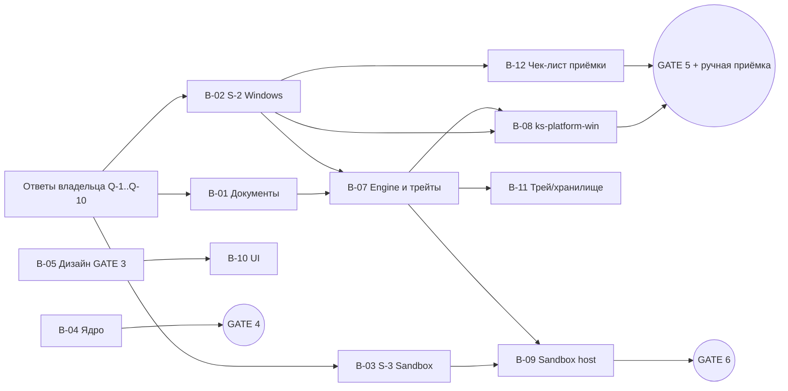

# Фаза 1 — сводный анализ, единый план и backlog

Автор: Project Orchestrator · 2026-11-10 · Входные материалы: `docs/research/*` (4 исследования + 2 перекрёстных ревью), `docs/spikes/S-1-converter-model.md`.
Статус: **предложение владельцу**. Решения, помеченные «владелец», вступают в силу после подтверждения.

## 1. Что сходится у всех специалистов

1. **Универсальной замены «всего поля» не будет.** Гарантировать её во всех программах невозможно; правильный результат при сомнении — отказ без изменений. Поддержка каждой программы объявляется только после теста (матрица `pa-app-matrix.md`, все строки сейчас UNVERIFIED).
2. **Алгоритм записи:** выделить → перечитать выделение → сравнить → проверить, что окно/поле/текст те же → писать → пост-проверка. Ctrl+A — только резерв с той же проверкой. `ValuePattern.SetValue` не используется.
3. **Методы записи по порядку:** W1 `EM_REPLACESEL(fCanUndo)` (только класс `Edit` до проверки RichEdit) → W3 SendInput Unicode (до порога профиля, по умолчанию 200 символов, без `\n`, пакетами ≤ 64 с проверкой фокуса перед каждым) → W2 вставка через буфер (только по профилю проверенного приложения, со строгим сигналом потребления) → отказ.
4. **Буфер обмена:** белый список форматов, лимит 16 МБ, метки исключения из истории/облака, seq под `OpenClipboard`. **Если нет надёжного сигнала, что цель прочитала буфер, — не восстанавливать** (иначе прежний буфер, например пароль, может уйти в чат). Изменение FR-CLIP-2 → владелец (Q-1).
5. **Отказы:** пароль (несколько признаков, не только `IsPassword`), окна с повышенными правами, secure desktop, исключённые приложения, консоль/терминалы, Excel вне режима правки, поля со встроенными объектами (упоминания, картинки), фокус в окне самого KeySwitch, слишком длинный текст.
6. **Песочница макросов:** Wasmtime LTS 48 (≥ 48.0.8 — у 48.0.7 уже есть advisory), QuickJS-ng и CPython 3.14 под WASI собираются в нашем CI из закреплённых commit SHA и встраиваются `include_bytes!`; **stdlib Python — из памяти, без каталогов хоста**; отдельный процесс в LPAC + Job Object + win32k lockdown; лимиты протокола 64 КиБ / 5 000 символов / ≤ 16 клавиш.
7. **Хранение и сбои:** `%LOCALAPPDATA%`, журнал только с метаданными (без заголовков окон и URL), panic hook без payload, исключение из Windows Error Reporting (дампы памяти содержат текст).
8. **Многострочный текст через SendInput запрещён** — перевод строки = Enter = отправка сообщения.
9. **Дизайн:** IDE-подобный каркас, нет уведомлений об успехе, окно выбора языка управляется 1/2/Esc, не показывает текст и отменяется через 10 с. Контраст WCAG AA — 96/96 пар.

## 2. Противоречия и как они решены

| # | Противоречие | Решение | Кто |
|---|---|---|---|
| X-1 | Восстанавливать ли буфер без сигнала потребления (арх. было «да», Security «нет») | Не восстанавливать; архитектор согласился | Оркестратор; изменение FR-CLIP-2 — владелец (Q-1) |
| X-2 | Stdlib Python: read-only каталог (арх.) против памяти (Security) | Память по умолчанию; каталог — запасной вариант только с повторным одобрением Security; архитектор согласился | Оркестратор |
| X-3 | Порог SendInput: 5 000 (Security) против 200 (арх.) | Параметр профиля, по умолчанию 200, поднимается по замерам S-2 | Оркестратор |
| X-4 | Окно выбора языка: без активации (`WS_EX_NOACTIVATE`) или с активацией и возвратом фокуса. **В ревью стороны поменялись позициями.** | По умолчанию без активации + временные хоткеи 1/2/Esc (фокус поля не меняется, нет побочных эффектов blur в веб-чатах). S-2 проверяет оба варианта; вариант с активацией — запасной, с условиями Security | Оркестратор |
| X-5 | «Всё поле» в браузерах (арх. — для `<input>` да; Security — только выделение) | До S-2 — только выделение/фрагмент. Если S-2 покажет, что UIA надёжно отличает `<input>` от contenteditable, — «всё поле» для `<input>` | Владелец (Q-4) |
| X-6 | Прерывать при физическом вводе (SR-21) — без хуков невыполнимо | Заменить проверкой между пакетами (фокус, модификаторы, время последнего ввода) | Оркестратор |
| X-7 | HMAC флагов разрешений (SR-81) | Перенос на GATE 8; сейчас разрешение привязывается к хэшу исходника скрипта (сброс при изменении) | Оркестратор |
| X-8 | Лимит вывода макроса 100 000 (черновик) против поля 5 000 | 5 000 | Оркестратор (согласовано всеми) |
| X-9 | Правило «версии ≥ 2 недель» против частых патчей безопасности Wasmtime | Исключение для security-патчей поддерживаемой LTS с ревью Security | Владелец (Q-3) |
| X-10 | Enter/Tab в макросах (D-07 разрешает) против угрозы «текст + Enter = выполнение команды» | Отдельное разрешение слота, по умолчанию выключено | Владелец (Q-2), изменение D-07 |
| X-11 | Низкая уверенность: молчаливый отказ (PA) или диалог (S-1 №3) | Рекомендация: отказ в v1 | Владелец (Q-5) |
| X-12 | Ctrl+Z: D-12 требует возврат одним шагом, SendInput и JS-редакторы дают несколько шагов | Рекомендация: принять «Ctrl+Z возвращает исходный текст, возможно за 2 шага», задокументировать | Владелец (Q-6) |
| X-13 | Telegram/Discord/WhatsApp могут не отдавать текст через UIA → полный отказ | Рекомендация: разрешить чтение **только выделения** через Ctrl+C по профилю приложения | Владелец (Q-7) |
| X-14 | ACG (запрет динамического кода) несовместим с JIT Cranelift; Pulley — Tier 2 | Решается замерами S-3; если Pulley укладывается в 2 с — Pulley + ACG, иначе Cranelift без ACG, и владелец принимает остаточный High (ST-22) | После S-3 |

## 3. Вопросы владельцу (нужны до старта S-2/S-3)

| Q | Вопрос | Рекомендация |
|---|---|---|
| Q-1 | Если нет подтверждения, что программа прочитала буфер, — оставить в буфере исправленный текст (и предложить «вернуть буфер»), а не восстанавливать прежний? | **Да** |
| Q-2 | Enter/Tab в макросах — отдельное разрешение, по умолчанию выключено (меняет D-07)? | **Да** |
| Q-3 | Разрешить security-патчи (Wasmtime, Tauri) моложе 2 недель после ревью Security Analyst? | **Да**, срок установки ≤ 7 дней |
| Q-4 | В браузерах до проверки S-2 — только выделение/фрагмент, без «всего поля»? | **Да** |
| Q-5 | Низкая уверенность — молча отказаться (без диалога) в v1? | **Да** |
| Q-6 | Ctrl+Z может возвращать текст за 2 шага в части программ — допустимо? | **Да**, с указанием в документации |
| Q-7 | В программах без UIA разрешить чтение только выделения через Ctrl+C (по профилю)? | **Да** |
| Q-8 | Остаточный риск: сторонние менеджеры буфера, игнорирующие метки приватности, могут запомнить временный текст. Принять как Medium? | **Да** (основной путь — SendInput, буфер только по профилю) |
| Q-9 | Процесс песочницы: новый на каждый запуск, если у макроса есть доступ к буферу; иначе «тёплый» до 60 с? | **Да** |
| Q-10 | В CI использовать LGPL-библиотеку PySide6 только для тестовой фикстуры Qt (в продукт не попадает)? | **Да** |

Не срочно (до GATE 3 / GATE 9): акцентный цвет (предложен синий), сочетания по умолчанию (после проверки конфликтов в S-2), автозапуск по умолчанию, звук при отказе (предложено — выкл.), лицензия данных модели R-7, подпись кода.

## 4. Backlog с приоритетами

P0 — блокирует следующий gate; P1 — нужно в v1; P2 — желательно.

| ID | Задача | Роль | Приоритет | Зависит от | Критерий готовности |
|---|---|---|---|---|---|
| B-01 | Консолидировать документы: `00-decisions` (новые D-16…), `01-prd` ← `pa-prd`, `02-architecture` ← arch-v2 + 13 правок + решения §2, `03-threat-model` ← sec-*, `04-plan` ← этот план (условия C-9, C-10) | Orchestrator + Analyst + Architect | P0 | Ответы Q-1…Q-10 | Документы согласованы, ревью Security без замечаний |
| B-02 | **S-2 Windows integration probe**: фикстуры (Win32 Edit/RichEdit, WPF, Edge/WebView2, Electron, Qt/PySide6, Firefox), UIA read/select/verify, W1/W3/W2, контракт буфера, шлюз побочных эффектов с поколением операций, раскладка, RegisterHotKey, окно выбора, crash/WER-тест; 18 сценариев архитектора + 9 из ревью | Rust/Windows Dev + QA | P0 | B-01 (частично), Q-1, Q-4, Q-7, Q-10 | Windows CI зелёный; отчёт спайка: проверено / не проверено |
| B-03 | **S-3 Sandbox**: wasmtime ≥ 48.0.8, сборка QuickJS-ng и CPython WASI в CI из SHA, stdlib из памяти (+ Wizer), LPAC + Job + mitigations, протокол с лимитами, H-01…H-40 на windows-latest, матрица Cranelift/Pulley × ACG | Rust Dev + Security | P0 | Q-2, Q-3, Q-9 | Все враждебные скрипты отклонены на Windows CI; замеры |
| B-04 | Ядро: корпус QA ≥ 500 фраз, защита URL/e-mail/путей (FR-CONV-9), тип `UserText` с zeroize, калибровка порогов, fuzz | Rust Dev + QA | P1 | — | Метрики качества по PRD на корпусе; CI зелёный |
| B-05 | Ревью дизайна владельцем → правки → GATE 3 | Designer | P1 | Прототип опубликован | Владелец утвердил экраны и дизайн-систему |
| B-06 | Быстрые правки конфигурации (из аудита): минимальные capabilities вместо `core:default`, `--locked`, бан-лист в `deny.toml`, `--ignore-scripts` в Windows-сборке, отключение автозаполнения WebView2 | Release Engineer | P1 | — | `check.sh` и CI зелёные, ревью Security |
| B-07 | `ks-types`, `ks-platform` (трейты-«сессии»), `ks-platform-fake`, `ks-engine` (state machine операции) | Architect + Rust Dev | P1 | B-01, итоги B-02 | Unit-тесты конвейера на fake-платформе |
| B-08 | `ks-platform-win` (продуктовая реализация по итогам S-2), профили приложений | Rust/Windows Dev | P1 | B-02, B-07 | Windows CI + ручная приёмка (GATE 5) |
| B-09 | `ks-sandbox-host` + `ks-sandbox-proto` (продуктовая реализация по итогам S-3) | Rust Dev | P1 | B-03, B-07 | H-01…H-40 зелёные (GATE 6) |
| B-10 | UI: каркас, 6 разделов, i18n RU/EN, темы, Macro Studio (CodeMirror 6) | Frontend Dev | P1 | B-05 | Соответствие дизайн-системе; a11y-проверка |
| B-11 | Трей, автозапуск, single-instance, `ks-storage` (SQLite, LocalAppData) | Rust Dev | P1 | B-07 | Тесты; ручная проверка |
| B-12 | Чек-лист ручной приёмки `05-manual-acceptance.md` по матрице приложений | QA + Analyst | P1 | B-02 | Утверждён владельцем |
| B-13 | Подпись кода, лицензия данных модели (R-7), установщик, релизная документация | Release + владелец | P2 (к GATE 9) | — | Решения владельца |

## 5. Зависимости

Параллельно можно вести: B-02, B-03, B-04 (разные crates и файлы) и B-05/B-06. Это 3 кодовых потока + дизайн — в лимите 4.

## 6. Этапы и контрольные точки

| Этап | Содержание | Выход (gate) |
|---|---|---|
| **1. Анализ** (текущий) | Исследования, перекрёстные ревью, этот план | Отчёт владельцу; ответы Q-1…Q-10 |
| **2. Консолидация** | B-01; утверждение дизайна B-05 | **GATE 1** (PRD), **GATE 3** (дизайн) |
| **3. Технические прототипы** | B-02 (S-2), B-03 (S-3), B-04, B-06 | **GATE 2** (архитектура + Security PASS WITH CONDITIONS), **GATE 4** (ядро) |
| **4. Разработка** | B-07…B-11 | **GATE 5** (Windows CI + ручная приёмка владельцем), **GATE 6** (песочница) |
| **5. Стабилизация** | QA по матрице и граничным случаям, полный security-аудит | **GATE 7**, **GATE 8** |
| **6. Релиз** | B-13 | **GATE 9** |

Перед каждым следующим этапом — отчёт владельцу (§20 ТЗ). Ни один gate не закрывается только потому, что код написан.

## 7. Открытые риски (топ)

| Риск | Влияние | Митигация |
|---|---|---|
| Telegram (Qt), Discord/WhatsApp (contenteditable/WebView2) отдают текст через UIA не полностью | Высокое: ключевые сценарии чатов | S-2 на фикстурах + ручная приёмка; Q-7 (выделение через Ctrl+C) |
| Гонка буфера / сторонние слушатели буфера | Критическое (утечка) | SendInput первым; W2 только по профилю со строгим сигналом; не восстанавливать без сигнала |
| Пароли в кастомных полях без `IsPassword` | Критическое | Несколько признаков; профили; исключения по умолчанию |
| Выход из Wasm / ошибки WASI | Критическое | Второй слой LPAC + Job; stdlib из памяти; патчи LTS ≤ 7 дней |
| JIT несовместим с ACG | Высокое | Матрица S-3; решение по замерам |
| Ложные срабатывания антивирусов, неподписанные сборки | Высокое (к релизу) | Без хуков и инъекций; подпись — до GATE 9 |
| Лицензия данных модели (CC-BY-SA, R-7) | Блокирует релиз | Решение до GATE 9 |
| В CI нет реальных программ (Office, Telegram) | Определённо | Фикстуры + ручная приёмка владельцем |
